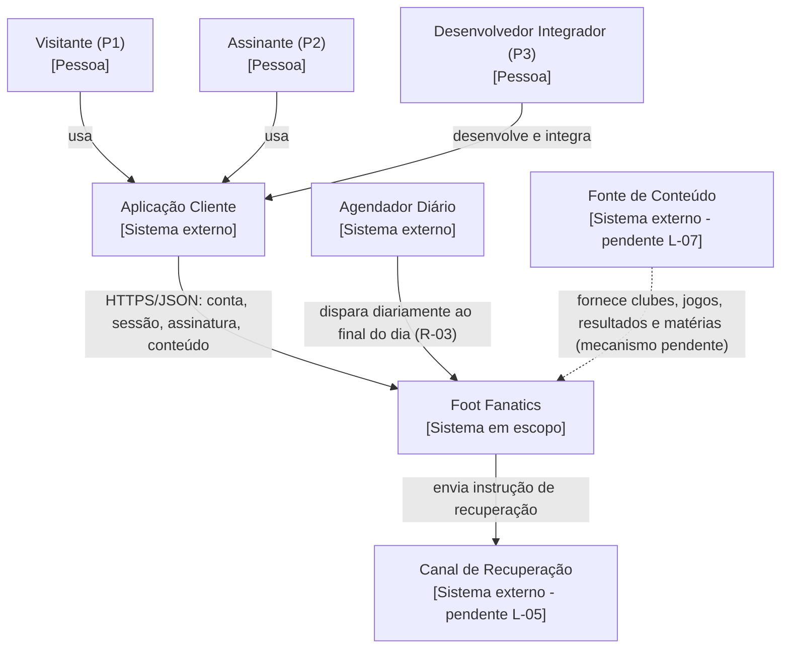
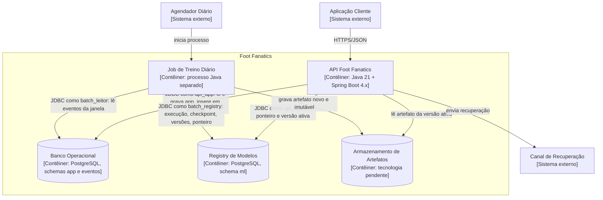
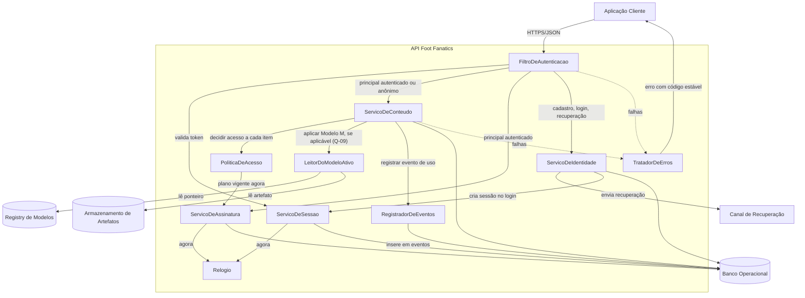
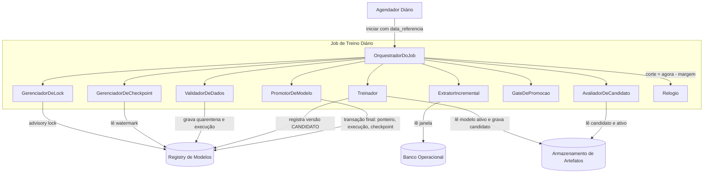
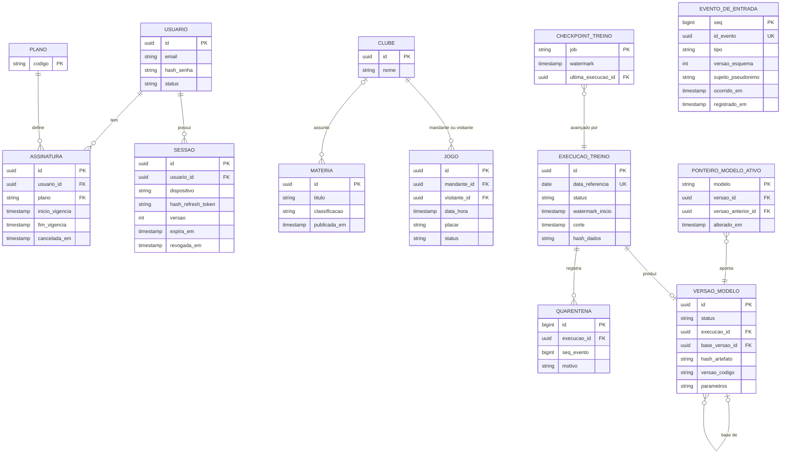
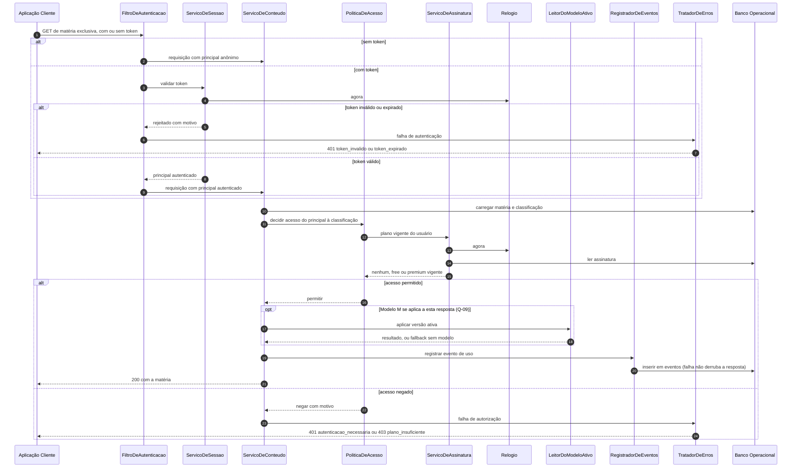
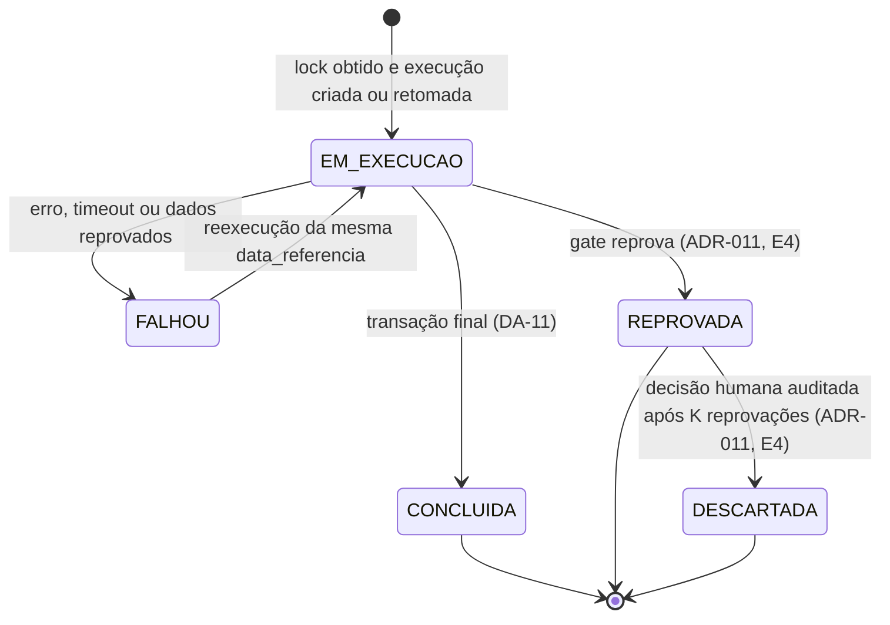
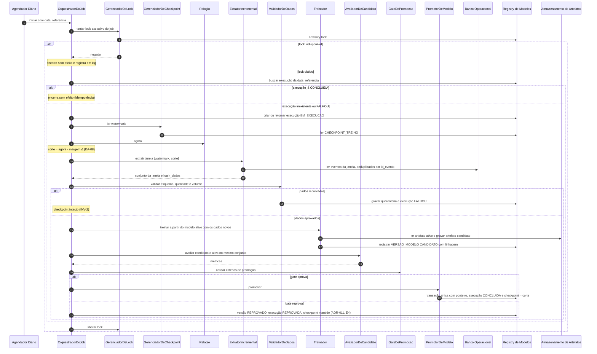
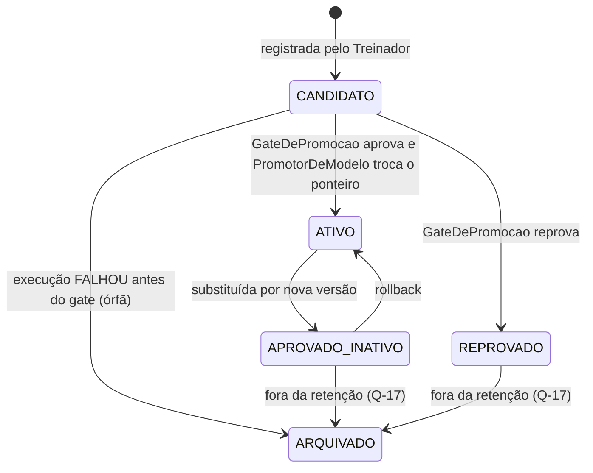
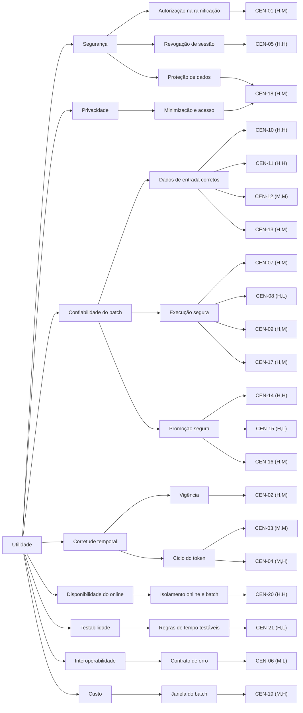

# Foot Fanatics — Arquitetura

> **Status:** em construção (Prática guiada de arquitetura).
>
> | Etapa | Conteúdo | Situação |
> |-------|----------|----------|
> | 1 | Descoberta e drivers (Parte A) | concluída e revisada em 2026-11-13 |
> | 2 | C4 e pipeline diário (Parte B §1–4, §6–12) | concluída e revisada em 2026-11-13 |
> | 3 | Análise ATAM (Parte C) | concluída e revisada em 2026-11-13 |
> | 4 | Revisão cruzada, ADRs e rastreabilidade (Parte D; correções marcadas "(E4)" nas Partes B e C) | **concluída em 2026-11-13; aguardando revisão** |
>
> **Para auditar este documento:** comece pela matriz D5. Cada linha leva ao requisito (Parte A), à ADR (D3), ao componente (§2.1) e ao cenário que o verifica (Parte C).
>
> **Convenções deste documento**
> - Origem citada como `arquivo:linha`. "PROF" = restrição fornecida pelo professor no enunciado da prática (não versionada no repositório).
> - **[FATO]** = está escrito em artefato do repositório. **[SUPOSIÇÃO]** = hipótese de trabalho, nunca usada como fato. **[VALIDAÇÃO PENDENTE]** = precisa de confirmação de quem decide (professor / PO).
> - Identificadores existentes foram preservados: escopos **E1–E4** (`docs/prd.md:28-31`) e personas **P1–P3** (`docs/prd.md:10,16,22`). **Não existem RF-xx/RNF-xx** em nenhum artefato (ver L-02); os IDs novos desta etapa (FC, RAS, R, C, L, S, Q, RK, D) são derivados e sempre apontam para a origem.

---

# Parte A — Descoberta e drivers (Etapa 1)

## A1. Contexto e objetivo

**Contexto [FATO]:** "API REST de conteúdo esportivo (clubes, jogos, resultados e matérias) com assinatura: conta de usuário, controle de acesso e gestão de sessão. É o projeto do semestre da disciplina de qualidade." (`README.md:3`). Os temas de qualidade que a assinatura introduz são **tempo, risco, ramificação e estado compartilhado** (`docs/prd.md:8`).

**Objetivo deste documento:** registrar a base factual (Parte A) e, nas etapas seguintes, o desenho, a avaliação ATAM e as decisões (Parte B), de forma que outra equipe consiga rastrear e contestar cada decisão sem explicação oral.

**Objetivo de produto:** **não definido**. Visão, problema e métricas de sucesso estão em `TODO` (`docs/prd.md:2-5`, `docs/prd.md:34-35`). Ver L-01.

## A2. Fonte de verdade — artefatos consultados

Todos foram lidos integralmente nesta etapa.

| ID | Artefato | O que contém | Peso como fonte |
|----|----------|--------------|-----------------|
| F1 | `docs/prd.md` | §3 personas P1–P3 (`:6-26`); §4 nomes dos escopos E1–E4 (`:27-31`); §5 fora de escopo (`:32-33`). §1 Visão, §2 Problema e §6 Métricas em `TODO`. | Principal. **Personas geradas por IA, validação pendente** (`:8`). |
| F2 | `README.md` | Descrição do produto (`:3`); detalhamento de E1–E4 (`:9-12`); fora de escopo (`:14`); stack com versão (`:18`); pré-requisitos (`:22-30`). | Complementar: é o único lugar com o conteúdo de cada escopo. |
| F3 | `docs/arquitetura.md` (esqueleto original) | Stack: "Java 21 · Spring Boot 4.x · PostgreSQL · Maven"; demais seções em `TODO`. Preservado na Parte B. | Restrição de stack. |
| F4 | `docs/plano-de-teste.md` | Todas as seções em `TODO` (`:2-11`). | Evidência de ausência (L-13). |
| F5 | `pom.xml` | Spring Boot `4.1.2` (`:8`); Java `21` (`:30`); starters webmvc, security, data-jpa, validation (`:33-48`); driver PostgreSQL em runtime (`:50-54`); Testcontainers (`:75-89`). | Fato técnico. |
| F6 | `src/main/resources/application.properties` | Só `spring.application.name=foot-fanatics` (`:1`). Nenhum datasource ou configuração de segurança. | Evidência de ausência. |
| F7 | `src/test/java/br/senac/footfanatics/TestcontainersConfiguration.java` | PostgreSQL de teste com imagem `postgres:latest` (`:15`). | Fato técnico (RK-10). |
| F8 | `.aiox-core/data/tech-presets/java.md` | Preset genérico do framework AIOX: Spring Boot 3.3+, Flyway, exemplos em Gradle, metas de cobertura 90/70/75% (`:14-22`, `:257-269`, `:352-358`). | **Não é fonte de requisito do projeto.** É orientação genérica do instalador; registrado só para explicar a divergência C-04. |
| PROF | Enunciado da prática (professor) | Cron job diário ao final do dia que treina/retreina usando somente dados novos. | Restrição obrigatória da atividade (R-03). **Não consta em nenhum artefato.** |

**Não consultados como fonte de produto:** `.claude/` e o restante de `.aiox-core/`. São ferramental de desenvolvimento, sem requisitos do Foot Fanatics.

## A3. Stakeholders e personas

| ID | Stakeholder | Origem | Interesse principal |
|----|-------------|--------|---------------------|
| P1 | Rafa: torcedor visitante, sem conta ou no plano free | `docs/prd.md:10-14` | Ver jogos/resultados/notícias; saber antes o que é pago; upgrade sem perder contexto. |
| P2 | Bia: assinante premium em vários dispositivos | `docs/prd.md:16-20` | Acesso exclusivo sem interrupção durante a vigência; comportamento previsível de sessões simultâneas; cancelar e recuperar acesso sozinha. |
| P3 | Caio: desenvolvedor que integra a API | `docs/prd.md:22-26` | Contrato previsível; distinguir não autenticado × sem permissão × token expirado × token inválido; nenhum vazamento de dado. |
| SH-1 | Professor / disciplina de qualidade | `README.md:3`; PROF | Projeto como alvo concreto dos temas de qualidade; impõe a restrição R-03. |
| SH-2 | Equipe de desenvolvimento (aluno) | `README.md:3` | Testabilidade; marco zero de cobertura. |

> As três personas foram **geradas com apoio de IA** a partir do enunciado e **não** são as da aula de ATAM (`docs/prd.md:8`). Todo driver que dependa só de uma persona herda esse status de validação pendente.

## A4. Fatos confirmados

| ID | Fato | Origem |
|----|------|--------|
| FC-01 | O produto é uma API REST (não site, não app). | `README.md:3` |
| FC-02 | Domínio de conteúdo: clubes, jogos, resultados e matérias. | `README.md:3`, `README.md:12` |
| FC-03 | E1 Identidade & Conta = cadastro, credencial, perfil, recuperação de acesso. | `docs/prd.md:28`; `README.md:9` |
| FC-04 | E2 Sessão & Acesso = login, emissão de token, expiração, renovação, logout. | `docs/prd.md:29`; `README.md:10` |
| FC-05 | E3 Assinatura = planos free e premium, vigência, upgrade, cancelamento. | `docs/prd.md:30`; `README.md:11` |
| FC-06 | E4 Conteúdo = parte pública e parte exclusiva de assinante. | `docs/prd.md:31`; `README.md:12` |
| FC-07 | Fora de escopo: pagamento real, mobile, push, painel administrativo. | `docs/prd.md:33`; `README.md:14` |
| FC-08 | Stack: Java 21, Spring Boot 4.1.2, Maven (wrapper), PostgreSQL. | `pom.xml:8`, `pom.xml:30`, `pom.xml:50-54`; F3 |
| FC-09 | Dependências presentes: Spring Web MVC, Security, Data JPA, Validation; testes com Testcontainers. | `pom.xml:33-89` |
| FC-10 | Não há datasource configurado; o PostgreSQL de desenvolvimento e teste vem do Testcontainers. | `application.properties:1`; `TestcontainersConfiguration.java:15`; `README.md:25` |
| FC-11 | PostgreSQL é o **único** armazenamento de dados citado em qualquer artefato. | F3; `pom.xml:50-54`; `README.md:18` |
| FC-12 | Não existe teste escrito pela equipe nem plano de teste preenchido. | `docs/plano-de-teste.md:2-11` |
| FC-13 | Temas de qualidade do projeto: tempo, risco, ramificação, estado compartilhado. | `docs/prd.md:8` |

## A5. Restrições

| ID | Restrição | Origem |
|----|-----------|--------|
| R-01 | Stack obrigatória: Java 21 · Spring Boot 4.x · PostgreSQL · Maven. | F3 (`docs/arquitetura.md`, Parte B §1); `pom.xml:8,30` |
| R-02 | Não implementar pagamento real, app mobile, notificação push nem painel administrativo. | `docs/prd.md:33` |
| R-03 | **Um cron job roda diariamente ao final do dia para treinar ou retreinar usando somente dados novos.** | **PROF: restrição fornecida pelo professor.** Ausente de todos os artefatos; ver conflito C-01. |
| R-04 | O PostgreSQL de teste sobe via Testcontainers, o que exige Docker. | `README.md:25`; `TestcontainersConfiguration.java:15` |

## A6. Requisitos arquiteturalmente significativos (RAS)

Não há RF/RNF no repositório (L-02). Os RAS abaixo **derivam** dos escopos e personas e não acrescentam regra nova. Onde a origem é só uma persona, o RAS herda a validação pendente das personas.

| ID | Requisito arquiteturalmente significativo | Por que é significativo | Origem |
|----|-------------------------------------------|-------------------------|--------|
| RAS-01 | Decidir o acesso a cada conteúdo conforme o perfil de quem pede: **anônimo × free × premium**. | Atravessa todos os endpoints de E4. Um erro é vazamento de conteúdo pago. | `README.md:12`; `docs/prd.md:8` ("ramificação"); P1 (`:13-14`); P3 (`:25`) |
| RAS-02 | Ciclo de vida do token: **emissão, expiração, renovação e logout**. | Define o mecanismo de sessão, o modelo de revogação e o contrato com o cliente. | `README.md:10`; P2 (`:19`); P3 (`:24-26`) |
| RAS-03 | A **vigência do plano** muda o acesso com o passar do tempo: upgrade, cancelamento e vencimento. | Introduz tempo no controle de acesso; exige uma fonte de tempo e uma regra únicas. | `README.md:11`; `docs/prd.md:8` ("tempo"); P2 (`:18-19`) |
| RAS-04 | **Sessões simultâneas** do mesmo usuário em vários dispositivos, sob concorrência. | Estado compartilhado: renovação e logout concorrentes podem gerar inconsistência. | `docs/prd.md:8` ("estado compartilhado"); P2 (`:17`, `:19`) |
| RAS-05 | Identidade: cadastro, credencial, perfil e **recuperação de acesso**. | Recuperação é o caminho alternativo de autenticação, e por isso um alvo de ataque. | `README.md:9`; P2 (`:18-19`) |
| RAS-06 | **Contrato de erro previsível**: distinguir não autenticado, sem permissão, token expirado e token inválido. | Afeta todos os endpoints e a integração do cliente. | P3 (`:24-25`) (somente persona) |
| RAS-07 | **Job diário de treino/retreino incremental** (só dados novos), coexistindo com a API online. | Introduz um segundo modo de execução (batch) que compete por recursos e dados. | R-03 (PROF) |
| RAS-08 | **Testabilidade**: o sistema é o alvo de uma disciplina de qualidade e parte do marco zero de cobertura. | Afeta a separação de camadas, a injeção do relógio (tempo) e o isolamento de dependências. | `README.md:3`; FC-12 |

## A7. Atributos de qualidade

Nenhum atributo tem meta numérica nos artefatos. Toda métrica fica como pergunta (A11).

| Atributo | Refinamento observado | RAS | Origem | Métrica |
|----------|----------------------|-----|--------|---------|
| Segurança: confidencialidade e autorização | Conteúdo premium e dados de outro usuário nunca chegam a quem não tem direito. | RAS-01, RAS-05 | `docs/prd.md:8`, `:25` | **ausente** (Q-06) |
| Corretude temporal | Expiração de token e fim de vigência aplicados no momento certo. | RAS-02, RAS-03 | `docs/prd.md:8`, `:19` | **ausente** (Q-03, Q-04) |
| Consistência sob concorrência | Sessões simultâneas e logout com comportamento previsível. | RAS-04 | `docs/prd.md:8`, `:19` | **ausente** (Q-05) |
| Interoperabilidade / usabilidade da API | Códigos e corpos de erro consistentes. | RAS-06 | `docs/prd.md:24-25` | **ausente** (Q-07) |
| Testabilidade | Regras de tempo e acesso testáveis de forma isolada. | RAS-08 | `README.md:3` | **ausente**: metas de cobertura em `TODO` (`docs/plano-de-teste.md:8-9`) |
| Disponibilidade da API online | Assinante acessa "sem interrupção durante toda a vigência". | RAS-02, RAS-07 | P2 (`docs/prd.md:18`) | **ausente** (Q-08) |
| Confiabilidade do batch | O job diário processa só dados novos, inclusive após falha. | RAS-07 | R-03 (PROF) | **ausente** (Q-10) |
| Privacidade (LGPD) | Dados pessoais de cadastro e, possivelmente, de uso no treino. | RAS-05, RAS-07 | **sem artefato**: inferido do domínio (S-06) | **ausente** (Q-12) |
| Desempenho | P1 quer ver "rapidamente" jogos e resultados (qualitativo). | RAS-01 | P1 (`docs/prd.md:12`) | **ausente** (Q-08) |
| Custo | — | RAS-07 | **sem artefato** | **ausente** (Q-11) |

## A8. Drivers priorizados

**A prioridade é uma proposta desta análise** [VALIDAÇÃO PENDENTE]. O critério é impacto de uma falha (vazamento > corrupção de estado > incômodo) × quantos escopos o driver atravessa. Os drivers de negócio não são verificáveis porque visão, problema e métricas estão em `TODO` (L-01).

| Prioridade | Driver | Tipo | RAS / Restrição | Origem | Justificativa da prioridade |
|-----------|--------|------|-----------------|--------|-----------------------------|
| D1 | Autorização correta na ramificação anônimo × free × premium | Qualidade (segurança) | RAS-01 | `README.md:12`; `docs/prd.md:8,25` | Falha = vazamento de conteúdo pago ou de dado de outro usuário. Atravessa E2, E3 e E4. |
| D2 | Ciclo de vida de sessão e token sob concorrência | Qualidade (segurança, consistência) | RAS-02, RAS-04 | `README.md:10`; `docs/prd.md:8,19` | Define o mecanismo de sessão. Erro gera acesso indevido ou quebra a experiência de P2. |
| D3 | Vigência do plano com efeito correto no acesso | Negócio + qualidade (corretude temporal) | RAS-03 | `README.md:11`; `docs/prd.md:8,18-19` | A assinatura é o diferencial do produto (`README.md:3`). Erro gera acesso indevido ou perda de acesso pago. |
| D4 | Testabilidade de regras de tempo e acesso | Qualidade | RAS-08 | `README.md:3`; FC-12 | Finalidade da disciplina. Condiciona a verificação de D1–D3. |
| D5 | Job diário isolado e confiável (só dados novos) | Restrição | RAS-07, R-03 | PROF | Obrigatório na atividade, mas com propósito indefinido (C-01). Por isso fica atrás dos drivers do produto. |
| D6 | Identidade e recuperação de acesso seguras | Qualidade (segurança) | RAS-05 | `README.md:9`; `docs/prd.md:19` | Caminho alternativo de autenticação. |
| D7 | Contrato de erro previsível | Qualidade (interoperabilidade) | RAS-06 | `docs/prd.md:24-25` | Origem só em persona validação-pendente. |
| D8 | Restrições de tecnologia e de escopo | Restrição | R-01, R-02 | F3; `docs/prd.md:33` | Não competem com os demais: delimitam o espaço de solução. |

## A9. Conflitos

| ID | Conflito | Lado A | Lado B | Situação |
|----|----------|--------|--------|----------|
| **C-01** | **O job diário de treino não tem o que treinar nos artefatos.** | R-03 (PROF): cron job diário treina/retreina com dados novos. | Nenhum artefato menciona modelo, ML, recomendação, personalização, dado de treino ou consumidor de modelo. Os escopos E1–E4 (`README.md:9-12`) e o fora de escopo (`docs/prd.md:33`) não citam isso. | **Aberto.** R-03 é mantida como obrigatória, mas o *propósito* do modelo, os *dados* de entrada e o *ponto de uso* no online são desconhecidos (Q-09). Qualquer escolha é suposição (S-01). |
| C-02 | Versão do Spring Boot. | O enunciado da prática diz "Spring Boot 3.x". | `pom.xml:8` = 4.1.2; F3 = "4.x". O start.spring.io aceita só ≥ 4.0.0 (decisão registrada no setup). | **Resolvido a favor do repositório (4.x)**, que é a fonte de verdade. Avisar o professor. |
| C-03 | Origem das personas. | O enunciado esperava as personas da aula de ATAM. | `docs/prd.md:8`: personas geradas por IA, não são as da aula. | **Aberto** [VALIDAÇÃO PENDENTE]. Tudo que deriva só de P1–P3 herda esse status. |
| C-04 | Preset AIOX × projeto. | F8 sugere Boot 3.3+, Flyway, Gradle e metas de cobertura 90/70/75%. | O projeto usa Boot 4.1.2 e Maven, não tem Flyway (`pom.xml`) e não tem metas de cobertura (`docs/plano-de-teste.md:8-9`). | **Não adotado.** F8 não é fonte de requisito, e as metas de cobertura dele **não** valem como metas do projeto. |
| C-05 | Upgrade × pagamento. | E3 prevê upgrade free → premium (`README.md:11`). | Pagamento real está fora de escopo (`docs/prd.md:33`). | **Aberto.** Não se sabe o que efetiva um upgrade (Q-02). |
| C-06 | Conteúdo × painel administrativo. | E4 expõe clubes, jogos, resultados e matérias (`README.md:12`). | Painel administrativo fora de escopo (`docs/prd.md:33`). Nenhum artefato diz como o conteúdo entra no sistema. | **Aberto** (Q-01). |

## A10. Lacunas

Lista não exaustiva. São as lacunas que afetam a arquitetura.

| ID | Lacuna | Onde deveria estar | Afeta |
|----|--------|--------------------|-------|
| L-01 | Visão, problema e métricas de sucesso. | `docs/prd.md:2-5,34-35` (`TODO`) | Todos os drivers de negócio |
| L-02 | Nenhum requisito funcional ou não funcional identificado (RF/RNF). | PRD | Rastreabilidade (Etapa 4) |
| L-03 | Regras de assinatura: duração da vigência; cancelamento imediato ou só no fim da vigência; downgrade; renovação automática. | PRD / regras de negócio | RAS-03, D3 |
| L-04 | Sessão: tipo de token; tempos de expiração; política de renovação; revogação; limite de sessões ou dispositivos; efeito do logout nos outros dispositivos. | PRD / arquitetura | RAS-02, RAS-04, D2 |
| L-05 | Recuperação de acesso: canal (e-mail? SMS? push está fora de escopo); validade do link ou código. | PRD | RAS-05, D6 |
| L-06 | Política de credencial: força da senha, tentativas, bloqueio. | PRD / NFR | RAS-05 |
| L-07 | Origem dos dados de conteúdo: carga manual, integração externa de jogos e resultados ou outra (sem painel admin). | PRD | C-06, E4 |
| L-08 | Volumes (usuários, requisições, conteúdo), latência, disponibilidade e SLA. | NFR | Desempenho, disponibilidade, custo |
| L-09 | Job diário: o que é treinado; quais dados; definição de "dado novo"; horário e fuso do "final do dia"; janela máxima; onde o modelo é consumido; critério de promoção. | PROF / PRD | RAS-07, D5 (C-01) |
| L-10 | Dados pessoais coletados, retenção, consentimento e base legal (LGPD). | PRD / NFR | Privacidade, RAS-07 |
| L-11 | Ambiente de implantação e infraestrutura de produção. | Arquitetura | Disponibilidade, custo, isolamento do batch |
| L-12 | Requisitos de observabilidade e auditoria. | NFR | Operação, segurança |
| L-13 | Estratégia, níveis, critérios e metas de teste. | `docs/plano-de-teste.md:2-11` (`TODO`) | RAS-08, D4 |
| L-14 | Formato padrão do corpo de erro da API. | Arquitetura / contrato | RAS-06, D7 |

## A11. Suposições

Nenhuma suposição é usada como fato. Cada uma é o ponto de partida provisório de uma pergunta.

| ID | Suposição de trabalho | Por que foi necessária | Pergunta que a valida |
|----|-----------------------|------------------------|-----------------------|
| S-01 | ~~O modelo treinado pelo job diário serve a algum recurso de **conteúdo** (por exemplo, recomendação ou ordenação de matérias para o usuário).~~ **Rebaixada na Etapa 2 a exemplo ilustrativo.** O desenho passa a tratar um **Modelo M** genérico, de finalidade pendente, e não depende de S-01. A ideia do Modelo M veio de um texto de revisão de outra execução, colado pelo usuário em 2026-11-13 (não é artefato do repositório). | R-03 exige o job, mas os artefatos não dizem o que ele treina (C-01). | Q-09 |
| S-02 | Os "dados novos" são eventos ou registros gerados pela própria API (por exemplo, consumo de conteúdo) **após o último treino bem-sucedido**. | "Somente dados novos" (R-03) pressupõe um marco de corte, que não está definido. | Q-09, Q-10 |
| S-03 | "Final do dia" = fim do dia no fuso `America/Sao_Paulo`. | O projeto é de uma instituição brasileira (`br.senac`, `pom.xml:11`), mas o fuso não está escrito em nenhum lugar. | Q-10 |
| S-04 | O upgrade é **simulado** (mudança de plano sem cobrança), porque pagamento real está fora de escopo. | C-05. | Q-02 |
| S-05 | Existe uma aplicação cliente separada que consome a API. | Contexto de P1 e P3 (`docs/prd.md:11,23`), mas as personas estão com validação pendente. | Q-13 |
| S-06 | A LGPD se aplica, porque o cadastro (E1) envolve dados pessoais. | O domínio indica dados pessoais; nenhum artefato fala em privacidade. | Q-12 |
| S-07 (E2) | O tráfego da API online é menor no final do dia, o que reduz o impacto do batch. | Contraria o senso comum de um site esportivo (jogos à noite). **Não há dado de tráfego** (L-08). Usada só para justificar por que o horário **não** basta como isolamento (DA-13). | Q-14 |
| S-08 (E2) | Banco Operacional e Registry de Modelos ficam na mesma instância PostgreSQL, em schemas separados. | FC-11 (PostgreSQL é o único armazenamento citado) e infraestrutura desconhecida (L-11). | Q-11 |

## A12. Perguntas abertas

| ID | Pergunta | Para quem | Lacuna / conflito |
|----|----------|-----------|-------------------|
| Q-01 | Como clubes, jogos, resultados e matérias entram no sistema sem painel administrativo? | Professor / PO | L-07, C-06 |
| Q-02 | O que efetiva um upgrade sem pagamento real? Existe trial? | Professor / PO | C-05, L-03 |
| Q-03 | Qual a duração da vigência? O cancelamento corta o acesso na hora ou no fim da vigência? | Professor / PO | L-03 |
| Q-04 | Quais os tempos de expiração do token e da renovação? A renovação tem limite? | Professor / arquiteto | L-04 |
| Q-05 | Quantas sessões simultâneas são permitidas? O logout derruba só o dispositivo atual ou todos? | Professor / PO | L-04 |
| Q-06 | Qual o nível de risco aceitável para falha de autorização? Há exigência de auditoria de acesso? | Professor | L-12 |
| Q-07 | Existe padrão obrigatório de corpo de erro? | Professor / P3 | L-14 |
| Q-08 | Há metas de latência e disponibilidade para a API online? | Professor | L-08 |
| Q-09 | **O que o job diário treina, com quais dados, e quem consome o modelo?** | **Professor** | **C-01, L-09** |
| Q-10 | Qual o horário e o fuso do "final do dia", a janela máxima do job e a definição de "dado novo"? | Professor | L-09 |
| Q-11 | Existe limite de custo ou de infraestrutura (máquina única, nuvem, local)? | Professor | L-11 |
| Q-12 | Quais dados pessoais são coletados, por quanto tempo ficam guardados, e podem ser usados no treino? | Professor | L-10 |
| Q-13 | As personas P1–P3 serão validadas ou substituídas pelas da aula de ATAM? | Professor | C-03 |
| Q-14 (E2) | Qual o perfil de tráfego da API ao longo do dia, principalmente no "final do dia"? | Professor | S-07, L-08 |
| Q-15 (E2) | Qual a margem Δ do corte da janela? Ela depende do timeout máximo de transação da API (DA-08). | Arquiteto (após Q-08) | L-09 |
| Q-16 (E2) | A promoção de um candidato aprovado é automática ou exige aprovação humana? | Professor | DA-11 |
| Q-17 (E2) | Quantas versões aprovadas do Modelo M ficam guardadas para rollback? | Professor | DA-15 |
| Q-18 (E2) | Quando um titular exclui a conta, um modelo já treinado com os dados dele precisa ser descartado ou retreinado? | Professor | L-10, §8 |
| Q-19 (E2) | O que o plano free libera além do que o anônimo já vê? | Professor / PO | L-03, §4.1 |
| Q-20 (E4) | R-03 ("treinar somente com dados novos") permite **avaliar** com um conjunto de referência fixo? | Professor | DIV-04, ADR-012 |
| Q-21 (E4) | Existe exigência de limitar tentativas de login? | Professor | DIV-06, RA-14 |

## A13. Riscos arquiteturais iniciais

Riscos identificados **antes** do desenho. A avaliação formal vem na Etapa 3 (ATAM).

| ID | Risco | Situação | Driver | Origem / evidência |
|----|-------|----------|--------|--------------------|
| RK-01 | Desenhar o pipeline de treino sem saber o que ele treina: arquitetura especulativa e retrabalho. | Confirmado (C-01) | D5 | R-03 × ausência nos artefatos |
| RK-02 | Falha na ramificação de acesso (por exemplo, endpoint de conteúdo premium sem checagem de plano) leva a vazamento. | Dúvida a investigar (sem código ainda) | D1 | `docs/prd.md:25`; RAS-01 |
| RK-03 | Fontes de tempo diferentes para expiração de token e fim de vigência levam a acesso indevido ou perda de acesso. | Dúvida a investigar | D2, D3 | RAS-02, RAS-03 |
| RK-04 | Renovação e logout concorrentes do mesmo usuário deixam sessões em estado inconsistente. | Dúvida a investigar | D2 | RAS-04; `docs/prd.md:19` |
| RK-05 | Tensão entre um token autocontido (não depende de consulta) e o corte imediato de acesso no cancelamento ou logout. | Dúvida: possível trade-off para a Etapa 3; **nenhuma tecnologia escolhida** | D2, D3 | RAS-02, RAS-03; L-04 |
| RK-06 | O job batch e a API online compartilham o único armazenamento citado (PostgreSQL), e o batch pode degradar o online. | Dúvida: depende do desenho da Etapa 2 | D5 | FC-11; RAS-07 |
| RK-07 | Requisitos fracos (sem RF/RNF, personas não validadas): drivers podem mudar após validação. | Confirmado | Todos | L-02; C-03 |
| RK-08 | Dados pessoais usados no treino sem base legal ou minimização. | Dúvida a investigar | D5, D6 | S-06; L-10 |
| RK-09 | Entrada de conteúdo indefinida: a API pode não ter como receber dados de jogos e resultados. | Confirmado (C-06) | — | `docs/prd.md:33`; L-07 |
| RK-10 | Imagem de teste `postgres:latest` sem versão fixa: resultados de teste podem mudar sem mudança no código. | Confirmado | D4 | `TestcontainersConfiguration.java:15` |

## A14. Glossário

| Termo | Definição | Origem |
|-------|-----------|--------|
| Anônimo / visitante | Quem usa a API sem estar autenticado. | P1 (`docs/prd.md:10-11`) |
| Plano free | Plano de assinatura sem custo. Conteúdo liberado: **definição pendente**. | `README.md:11` |
| Plano premium | Plano que dá acesso à parte exclusiva de assinante. | `README.md:11-12` |
| Assinante | Usuário com plano premium vigente. **Definição pendente**: um usuário free também conta como "assinante"? | `README.md:12` |
| Vigência | Período em que um plano dá direito de acesso. Duração: **pendente** (Q-03). | `README.md:11` |
| Upgrade | Mudança free → premium. Mecanismo: **pendente** (Q-02). | `README.md:11` |
| Cancelamento | Encerramento do plano premium. Efeito no tempo: **pendente** (Q-03). | `README.md:11` |
| Token | Credencial emitida no login e apresentada nas requisições. Tipo: **pendente** (Q-04). | `README.md:10` |
| Expiração / renovação | Fim da validade do token / obtenção de nova validade sem novo login. | `README.md:10` |
| Sessão | Período autenticado de um usuário em um dispositivo. | `README.md:10`; `docs/prd.md:17` |
| Ramificação | Comportamentos distintos da API para anônimo × free × premium. | `docs/prd.md:8,14` |
| Estado compartilhado | Dados de sessão ou assinatura acessados de forma concorrente. | `docs/prd.md:8,20` |
| Conteúdo público / exclusivo | Parte de E4 aberta a todos / restrita a assinante. | `README.md:12` |
| Cron job diário | Execução agendada, uma vez por dia ao final do dia, que treina/retreina um modelo. | R-03 (PROF) |
| Dados novos | Dados ainda não usados em treino. Definição operacional: **pendente** (Q-10). | R-03 (PROF) |
| Online / batch | Online = atendimento síncrono da API. Batch = o job diário. | Termos desta análise |
| RAS | Requisito arquiteturalmente significativo. | Termo desta análise |
| Driver | Requisito, restrição ou atributo que direciona decisões de arquitetura. | Termo desta análise |
| Modelo M (E2) | O modelo treinado pelo Job de Treino Diário. Finalidade **pendente** (Q-09). | R-03; Parte B §6 |
| Watermark / checkpoint (E2) | Marca persistida do último ponto de dados já consumido com sucesso pelo job. | Parte B §6 |
| Janela / corte / margem Δ (E2) | Intervalo (watermark, corte] lido em uma execução. Corte = início da execução − Δ. | DA-08 |
| Candidato (E2) | Nova versão do Modelo M produzida por uma execução, ainda não promovida. | Parte B §6 |
| Gate (E2) | Conjunto de critérios que o candidato precisa cumprir para ser promovido. | DA-11, INV-3 |
| Ponteiro do modelo ativo (E2) | Registro que diz qual versão do Modelo M a API usa. | DA-10, DA-16 |
| Quarentena (E2) | Registros reprovados na validação de dados, guardados com o motivo e fora do treino. | §6.3 item 8 |
| Linhagem (E2) | Vínculo de uma versão do modelo com a janela de dados, o código e os parâmetros que a geraram. | §6.3 item 8 |

---

# Parte B — Desenho e decisões (Etapas 2–4)

> **Etapa 2 (2026-11-13):** §1–4 e §6–12 preenchidas. §5 (ADR) fica para a Etapa 4. Toda decisão daqui é uma **proposta (DA-xx)** e só vira ADR na Etapa 4. Os prefixos **DA** (decisão de arquitetura) e **D** (driver, Parte A §A8) são diferentes: DA-06 não é D6.
>
> **Regra de nomes:** todo elemento tem um nome canônico no catálogo §2.1, e texto e diagramas usam exatamente esse nome.

## 1. Stack
Java 21 · Spring Boot 4.x · PostgreSQL · Maven

### 1.1 Tecnologia × justificativa

Nenhuma tecnologia entra por preferência. Quando não há requisito que a sustente, ela aparece como **sem requisito correspondente**.

| Tecnologia / mecanismo | Onde | Justificativa | Situação |
|------------------------|------|---------------|----------|
| Java 21 · Spring Boot 4.x · Maven | API Foot Fanatics, Job de Treino Diário | R-01 | Adotada (restrição) |
| PostgreSQL | Banco Operacional, Registry de Modelos | R-01, FC-11 | Adotada (restrição) |
| Spring Security | FiltroDeAutenticacao, PoliticaDeAcesso | RAS-01, RAS-02; já em `pom.xml:38-39` | Adotada |
| Spring Data JPA | Persistência da API | R-01; `pom.xml:34-35` | Adotada |
| Bean Validation | Validação de entrada HTTP | RAS-06; `pom.xml:42-43` | Adotada |
| Testcontainers | Testes de integração | R-04, RAS-08 | Adotada |
| Hash de senha adaptativo (ex.: BCrypt do Spring Security) | ServicoDeIdentidade | RAS-05 | Adotado o mecanismo; algoritmo e custo **sem requisito específico** |
| Problem Details (RFC 9457) | TratadorDeErros | RAS-06 | Hipótese (DA-17); formato oficial pendente (Q-07) |
| Advisory lock do PostgreSQL | GerenciadorDeLock | RAS-07; R-01 (não acrescenta tecnologia) | Proposta (DA-09) |
| Biblioteca de lock distribuído (ex.: ShedLock) | — | **sem requisito correspondente** | Alternativa não adotada (DA-09) |
| Spring Batch | — | **sem requisito correspondente** | Alternativa não adotada (DA-06) |
| Biblioteca de ML | Treinador | **sem requisito correspondente**: depende do que é o Modelo M (Q-09). Se exigir ecossistema fora do Java, conflita com R-01. | Adiada |
| MLflow | — | **sem requisito correspondente** | Alternativa não adotada (DA-10) |
| Sistema de arquivos ou armazenamento de objetos | Armazenamento de Artefatos | **sem requisito correspondente**; infraestrutura desconhecida (L-11) | Adiada (DA-15) |
| Agendador (cron do SO ou agendador da plataforma) | Agendador Diário | R-03 exige agendamento; a tecnologia **não tem requisito** | Adiada (L-11) |
| Spring Boot Actuator + Micrometer | Observabilidade (§7) | **sem requisito explícito** (L-12); sustenta as métricas de §7 | Hipótese |
| Formato do token de acesso (autocontido ou opaco) | ServicoDeSessao | RAS-02 | ~~Adiada para o ATAM (DA-04)~~ **(E4) Token opaco, ADR-004 (Proposta)** |

## 2. Camadas (C4)

### 2.1 Catálogo de elementos (nomes canônicos)

| Nome | Nível C4 | Responsabilidade | Driver / origem |
|------|----------|------------------|-----------------|
| Visitante (P1) | Pessoa | Lê conteúdo público; avalia o upgrade. | P1 |
| Assinante (P2) | Pessoa | Consome conteúdo exclusivo em vários dispositivos. | P2 |
| Desenvolvedor Integrador (P3) | Pessoa | Constrói a Aplicação Cliente sobre o contrato da API. | P3 |
| Aplicação Cliente | Sistema externo | Interface usada por P1 e P2. Fora do escopo deste sistema. | S-05 |
| Foot Fanatics | Sistema em escopo | API de conteúdo com assinatura e job de treino diário. | FC-01, R-03 |
| Agendador Diário | Sistema externo | Dispara o Job de Treino Diário uma vez por dia, ao final do dia. | R-03 |
| Canal de Recuperação | Sistema externo | Entrega a instrução de recuperação de acesso. Tecnologia **pendente** (L-05). | E1; L-05 |
| Fonte de Conteúdo | Sistema externo | Origem de clubes, jogos, resultados e matérias. Mecanismo **pendente** (L-07). | C-06 |
| API Foot Fanatics | Contêiner | Atende E1–E4 de forma síncrona. Único ponto de entrada externo. | DA-01 |
| Job de Treino Diário | Contêiner | Treina/retreina o Modelo M com dados novos, em processo separado. | R-03, DA-06 |
| Banco Operacional | Contêiner | PostgreSQL, schemas `app` (conta, sessão, assinatura, conteúdo) e `eventos` (dados de entrada do treino). | R-01, DA-07 |
| Registry de Modelos | Contêiner | Schema `ml`: execuções, checkpoint, versões do Modelo M, ponteiro do modelo ativo. | DA-10, S-08 |
| Armazenamento de Artefatos | Contêiner | Guarda os artefatos imutáveis do Modelo M, endereçados por hash. | DA-15 |
| FiltroDeAutenticacao | Componente (API) | Extrai e valida o token. Produz um principal autenticado ou anônimo. | RAS-02 |
| PoliticaDeAcesso | Componente (API) | Decisão única de acesso anônimo × free × premium. Nega por padrão. | D1, DA-02 |
| ServicoDeIdentidade | Componente (API) | Cadastro, credencial, perfil e recuperação de acesso (E1). | RAS-05 |
| ServicoDeSessao | Componente (API) | Login, emissão, renovação e logout; sessões por dispositivo (E2). | RAS-02, RAS-04, DA-04 |
| ServicoDeAssinatura | Componente (API) | Planos, vigência, upgrade e cancelamento (E3). Responde qual o plano vigente agora. | RAS-03, DA-03 |
| ServicoDeConteudo | Componente (API) | Clubes, jogos, resultados e matérias (E4). Consulta a PoliticaDeAcesso antes de devolver qualquer item. | RAS-01, DA-02 |
| RegistradorDeEventos | Componente (API) | Grava os eventos de entrada do treino (append-only). | DA-07 |
| LeitorDoModeloAtivo | Componente (API) | Carrega a versão ativa do Modelo M (somente leitura), com fallback sem modelo. | DA-16 |
| Relogio | Componente (API e Job) | Fonte única de "agora" para token, vigência e corte do batch. | DA-05 |
| TratadorDeErros | Componente (API) | Converte falhas em contrato de erro estável. | RAS-06, DA-17 |
| OrquestradorDoJob | Componente (Job) | Sequencia as etapas e controla o estado da execução. | §6 |
| GerenciadorDeLock | Componente (Job) | Garante no máximo uma execução ativa. | DA-09 |
| GerenciadorDeCheckpoint | Componente (Job) | Lê o watermark. A escrita acontece só na transação final (DA-11). | INV-2 |
| ExtratorIncremental | Componente (Job) | Lê os eventos da janela, deduplicados. | DA-07, DA-08 |
| ValidadorDeDados | Componente (Job) | Esquema, qualidade e volume; quarentena. | §6.3 item 8 |
| Treinador | Componente (Job) | Produz o candidato a partir do modelo ativo e dos dados novos. | DA-14 |
| AvaliadorDeCandidato | Componente (Job) | Mede candidato e modelo ativo no mesmo conjunto de avaliação. | §6.3 item 10 |
| GateDePromocao | Componente (Job) | Aplica os critérios de promoção. | INV-3 |
| PromotorDeModelo | Componente (Job) | Único componente que altera o ponteiro do modelo ativo. | INV-3, DA-11 |

### 2.2 Diagrama de contexto (C4 nível 1)

### 2.3 Diagrama de contêineres (C4 nível 2)

**Interfaces e dependências entre contêineres**

| De → Para | Interface | Dados | Regra |
|-----------|-----------|-------|-------|
| Aplicação Cliente → API Foot Fanatics | HTTPS/JSON (REST) | Requisições E1–E4; token | Único ponto de entrada externo (DA-01). |
| API Foot Fanatics → Banco Operacional | JDBC, papel `api_app` | Schema `app` (leitura e escrita); `eventos` (só inserção) | A API não lê `eventos`. |
| API Foot Fanatics → Registry de Modelos | JDBC, papel `api_app` | Ponteiro e metadados da versão ativa (só leitura) | A API nunca escreve em `ml` (DA-16). |
| API Foot Fanatics → Armazenamento de Artefatos | Leitura de arquivo/objeto | Artefato da versão ativa | Somente leitura. |
| Agendador Diário → Job de Treino Diário | Início de processo | `data_referencia` | Uma disparada por dia (R-03). Disparos extras são tratados pelo lock (DA-09). |
| Job de Treino Diário → Banco Operacional | JDBC, papel `batch_leitor` | Schema `eventos` (só leitura, só a janela) | Sem acesso a `app` (§8). Conexões limitadas e `statement_timeout` (DA-13). |
| Job de Treino Diário → Registry de Modelos | JDBC, papel `batch_registry` | Execução, checkpoint, versões, ponteiro | Avanço do checkpoint e troca do ponteiro só na transação final (DA-11). |
| Job de Treino Diário → Armazenamento de Artefatos | Escrita de arquivo/objeto | Artefato candidato | Escrita nova, nunca sobrescrita (DA-15). |

**A API Foot Fanatics não depende do Job de Treino Diário para responder.** Se o Job não roda ou falha, a API continua com a última versão ativa ou sem modelo (DA-16).

### 2.4 Componentes da API Foot Fanatics (C4 nível 3)

Camadas, de fora para dentro: **HTTP** (FiltroDeAutenticacao, TratadorDeErros, controladores) → **aplicação** (Servico*) → **domínio** (PoliticaDeAcesso, regras de vigência e sessão) → **persistência** (repositórios JPA). O domínio não depende de HTTP nem de JPA, para que as regras de tempo e acesso possam ser testadas isoladamente (RAS-08, D4). A camada de domínio recebe o tempo do Relogio, nunca da hora do sistema (DA-05).

### 2.5 Componentes do Job de Treino Diário (C4 nível 3)

## 3. Modelo de dados

Modelo **lógico mínimo**, sem DDL. Os atributos servem só para sustentar as decisões; tipos e índices ficam para o detalhamento.

| Schema | Entidades | Escrita | Leitura |
|--------|-----------|---------|---------|
| `app` | USUARIO, SESSAO, PLANO, ASSINATURA, CLUBE, JOGO, MATERIA | `api_app` | `api_app` |
| `eventos` | EVENTO_DE_ENTRADA (append-only) | `api_app` (só inserção) | `batch_leitor` |
| `ml` | EXECUCAO_TREINO, CHECKPOINT_TREINO, VERSAO_MODELO, PONTEIRO_MODELO_ATIVO, QUARENTENA | `batch_registry` (PONTEIRO_MODELO_ATIVO: só pelo PromotorDeModelo) | `batch_registry`; `api_app` (só ponteiro e versão) |

- **Resultado de jogo** fica em JOGO (`placar`, `status`), porque nenhum artefato o trata como entidade separada (FC-02).
- **O conteúdo de EVENTO_DE_ENTRADA** (`tipo` e demais campos) depende do Modelo M (Q-09). A tabela fixa só o envelope: identificador, esquema, sujeito pseudônimo e tempos.
- **AUDITORIA** é tratada em §7 e ainda não foi modelada. Onde ela mora é decisão da Etapa 4.

## 4. Autenticação e sessão

**Decisões que valem aqui:** DA-02 (política central), DA-03 (plano fora do token), DA-04 (sessão por dispositivo; formato do token adiado), DA-05 (Relogio) e DA-17 (contrato de erro).

### 4.1 Matriz de ramificação de acesso

Sem RF, a matriz é derivada de `README.md:12` e de P1–P3.

| Recurso \ Perfil | Anônimo | Free | Premium vigente | Premium cancelado ou vencido |
|------------------|---------|------|-----------------|------------------------------|
| Conteúdo público | permitido | permitido | permitido | permitido |
| Conteúdo exclusivo | **401** `autenticacao_necessaria` | **403** `plano_insuficiente` | permitido | **403** `plano_insuficiente`, a partir do instante definido em Q-03 |
| Conta, sessão e assinatura do próprio usuário | **401** | permitido | permitido | permitido |
| Dados de outro usuário | **401** | **403** `acesso_negado` | **403** `acesso_negado` | **403** `acesso_negado` |

- **O que o free libera além do anônimo:** pendente (Q-19).
- **Códigos de erro:** os nomes são hipóteses de contrato (DA-17, Q-07).

### 4.2 Ciclo de vida da sessão

| Evento | Comportamento proposto | Decisão | Pendência |
|--------|------------------------|---------|-----------|
| Login | Cria uma SESSAO por dispositivo e emite um token de acesso de vida curta mais um refresh token, guardado só como hash. | DA-04 | TTLs (Q-04) |
| Requisição | O FiltroDeAutenticacao valida o token de acesso. Expirado → 401 `token_expirado`; malformado ou revogado → 401 `token_invalido`. **(E4)** O token de acesso é **opaco** e validado contra SESSAO a cada requisição autenticada (ADR-004). | DA-04, DA-17, ADR-004 | ~~Formato do token (ATAM)~~ TTL (Q-04) |
| Renovação | Troca o refresh token por um novo (rotação) com controle otimista em SESSAO.`versao`. ~~Reapresentar um refresh já usado revoga a sessão.~~ **(E4)** Reapresentar o refresh **imediatamente anterior**, do mesmo dispositivo e dentro de uma tolerância curta, devolve o mesmo par já emitido. Fora disso, revoga a sessão (ADR-004; motivo: RA-12). | DA-04, ADR-004 | Limite de renovações (Q-04); tolerância (EXP-10) |
| Renovação concorrente (dois dispositivos ou duas abas) | Cada dispositivo tem a própria SESSAO, sem disputa entre dispositivos. Na mesma sessão, só uma renovação vence (`versao`). ~~A outra recebe 401 `token_invalido`.~~ **(E4)** A outra, se estiver dentro da tolerância, recebe o mesmo par vencedor. | DA-04, ADR-004 | ~~Tolerância a corrida na mesma sessão → ATAM~~ Valor da tolerância (EXP-10) |
| Logout | Revoga a SESSAO do dispositivo atual (`revogada_em`). | DA-04 | Logout global (Q-05) |
| Cancelamento ou vencimento do plano | Não mexe na sessão. O acesso exclusivo cai porque a PoliticaDeAcesso consulta o plano vigente a cada decisão. | DA-03 | Instante do corte (Q-03) |
| Recuperação de acesso | Código ou link de uso único e curto, guardado como hash; mesma resposta para e-mail existente ou inexistente; sucesso revoga as sessões existentes. | §8 | Canal (L-05), validade (L-05) |

### 4.3 Sequência do fluxo online: leitura de conteúdo exclusivo

**Por que a falha do RegistradorDeEventos não derruba a resposta:** a disponibilidade do online vem antes da completude dos dados de treino (INV-1). O custo é que eventos podem se perder. Isso é um **ponto de trade-off para o ATAM** (DA-07).

## 5. Decisões (ADR)
~~TODO (Etapa 4).~~ **(E4)** As ADRs completas estão na Parte D, §D3. Índice:

| ADR | Título | Status | Origem (DA) |
|-----|--------|--------|-------------|
| ADR-001 | API como monólito modular | Aceita | DA-01 |
| ADR-002 | PoliticaDeAcesso central que nega por padrão | Aceita | DA-02 |
| ADR-003 | Plano e vigência fora do token | Aceita | DA-03 |
| ADR-004 | Sessão persistida, token de acesso opaco, refresh rotativo com tolerância | Proposta | DA-04 |
| ADR-005 | Relogio único injetável | Aceita | DA-05 |
| ADR-006 | Job em processo separado com isolamento de recursos no banco | Proposta | DA-06, DA-13 |
| ADR-007 | Ingestão append-only de eventos, com contagem de perdas e compatibilidade de esquema | Proposta | DA-07 |
| ADR-008 | Watermark por tempo de ingestão com margem Δ | Proposta | DA-08 |
| ADR-009 | Lock por advisory lock + idempotência por data | Aceita | DA-09 |
| ADR-010 | Registry em tabelas + transação final única | Aceita | DA-10, DA-11 |
| ADR-011 | Checkpoint não avança quando o gate reprova, com limite e escalação | Proposta | DA-12 |
| ADR-012 | Treino incremental sobre o modelo ativo | Aceita | DA-14 |
| ADR-013 | Artefatos imutáveis + LeitorDoModeloAtivo com fallback | Proposta | DA-15, DA-16 |
| ADR-014 | Contrato de erro estável (Problem Details) | Proposta | DA-17 |
| ADR-015 | Minimização, papéis de acesso e retenção de dados | Proposta | §8 |
| ADR-016 | Observabilidade mínima obrigatória | Proposta | §7 |

## 6. Pipeline batch diário: Job de Treino Diário

Restrição: R-03, executar diariamente ao final do dia e treinar ou retreinar **somente com dados novos**. O modelo é o **Modelo M**, de finalidade pendente (Q-09). O pipeline abaixo não depende dessa finalidade, exceto nos itens marcados como **pendente**.

### 6.1 Estados da execução

> **(E4)** O estado **REPROVADA** foi incluído porque a Etapa 2 não dizia em que estado a execução termina quando o gate reprova (inconsistência IC-01). **DESCARTADA** é o único caminho, fora da promoção, que avança o checkpoint, e só por decisão humana auditada (ADR-011).

### 6.2 Sequência do fluxo batch

### 6.3 Checklist do pipeline incremental

"Mecanismo" é o que o desenho garante. "Parâmetro pendente" é o valor que depende de resposta.

| # | Item | Mecanismo proposto | Decisão | Parâmetro pendente | Situação |
|---|------|--------------------|---------|--------------------|----------|
| 1 | Watermark / checkpoint | CHECKPOINT_TREINO guarda o `watermark` (tempo de ingestão `registrado_em`). A janela é (watermark, corte], com corte = início − Δ. Execução atrasada ou perdida: a próxima janela começa no mesmo watermark e cobre todos os dias acumulados. | DA-08 | Δ (Q-15) | **Tratado** |
| 2 | Atualização atômica do checkpoint | O checkpoint só é escrito na **mesma transação** que marca a execução CONCLUIDA (e troca o ponteiro, se houver promoção). Uma falha antes disso desfaz tudo. | DA-11 | — | **Tratado** |
| 3 | Idempotência | `data_referencia` é única em EXECUCAO_TREINO. Reexecutar uma data CONCLUIDA não tem efeito; uma data FALHOU é retomada desde o início com a mesma janela. Os eventos são append-only, então a mesma janela produz o mesmo conjunto (item 9). | DA-09, DA-11 | — | **Tratado** |
| 4 | Deduplicação | `id_evento` único, gerado na origem pelo RegistradorDeEventos: o mesmo evento não é gravado duas vezes. O ExtratorIncremental deduplica por `id_evento` dentro da janela. | DA-07 | **Chave de negócio**: o que torna dois eventos diferentes "o mesmo fato" depende do Modelo M (Q-09). | **Pendente** (mecanismo pronto, chave indefinida) |
| 5 | Lock e concorrência | Advisory lock do PostgreSQL por job. Disparo duplicado ou manual sobreposto encerra sem efeito. A queda do processo libera o lock junto com a conexão. A unicidade de `data_referencia` é a segunda barreira. | DA-09 | — | **Tratado** |
| 6 | Retry, timeout, recuperação e falha parcial | Erros transitórios (conexão, I/O): poucas novas tentativas com espera crescente, por etapa. Erros de dados não são repetidos. O timeout global da execução é o fim da janela permitida. Qualquer falha deixa a execução FALHOU com o checkpoint intacto. Falhas parciais: artefato gravado sem versão registrada fica órfão, e versão CANDIDATO de execução FALHOU é arquivada (§6.4). **(E4)** Quem arquiva é o OrquestradorDoJob, **no início da execução seguinte e com o lock obtido** (ADR-010; antes não estava definido, IC-06). Promoção incompleta não existe, porque a troca do ponteiro está na transação final. | DA-11 | Número de tentativas; janela (Q-10) | **Tratado** (valores pendentes) |
| 7 | Dados tardios | A janela é por **tempo de ingestão**, então um evento que chega tarde entra na próxima janela e não é perdido. A margem Δ cobre transações da API que gravaram `registrado_em` antes do corte, mas fizeram commit depois: Δ precisa ser maior que o timeout máximo de transação da API. | DA-08 | Δ (Q-15); se o Modelo M exigir tempo do evento (`ocorrido_em`), rever (Q-09) | **Tratado** |
| 8 | Qualidade, esquema e linhagem | O ValidadorDeDados checa `versao_esquema` conhecida, campos obrigatórios, tipos e faixas, e volume mínimo da janela. Registros inválidos vão para QUARENTENA com motivo. Execução reprovada se a taxa de quarentena ou o volume ultrapassar o limite. A linhagem fica em VERSAO_MODELO (execução → janela e `hash_dados`; `versao_codigo`; `parametros`; `base_versao_id`). | — | Limites de taxa e volume; regras de faixa (Q-09) | **Tratado** (limites pendentes) |
| 9 | Reprodutibilidade | Mesma janela + eventos imutáveis + `versao_codigo` + `parametros` (incluindo semente fixa) + artefato base (`base_versao_id`) reproduzem o candidato. `hash_dados` prova que o conjunto é o mesmo. | DA-14 | Limite: a retenção (Q-12) pode apagar eventos e impedir a reprodução. **Trade-off para o ATAM.** | **Tratado** (conflito com retenção registrado) |
| 10 | Validação do candidato | O AvaliadorDeCandidato mede o candidato **e** o modelo ativo no mesmo conjunto de avaliação, separado da janela, mais checagens de sanidade (artefato carrega e produz saída válida). | — | **Métricas e conjunto de avaliação** dependem do Modelo M (Q-09). | **Pendente** (mecanismo pronto, critério indefinido) |
| 11 | Versionamento e model registry | VERSAO_MODELO é imutável depois de registrada, e o artefato é endereçado por `hash_artefato` no Armazenamento de Artefatos. O registry é feito de tabelas no schema `ml`. | DA-10, DA-15 | — | **Tratado** |
| 12 | Critérios de promoção | O GateDePromocao aprova se: validação de dados aprovada, sanidade aprovada e métrica do candidato ≥ métrica do ativo − tolerância. Sem modelo ativo (primeira execução), vale só a sanidade mais um piso mínimo. | INV-3 | Métrica, tolerância e piso (Q-09); promoção automática ou humana (Q-16) | **Tratado** (valores pendentes) |
| 13 | Rollback | O ponteiro volta para `versao_anterior_id` (ou outra versão APROVADO_INATIVO), alterado só pelo PromotorDeModelo e auditado. Não exige retreino. A API troca de versão pelo LeitorDoModeloAtivo (DA-16). O próximo treino parte da versão ativa após o rollback. | DA-16 | Versões retidas (Q-17); gatilho do rollback (manual ou alerta) | **Tratado** |
| 14 | Isolamento do modelo ativo | A API só lê o ponteiro e o artefato, que é imutável. O Job grava sempre um artefato novo e nunca sobrescreve o ativo. O LeitorDoModeloAtivo só troca de versão em memória depois de carregar a nova com sucesso. Em caso de falha, mantém a atual ou faz fallback sem modelo. | DA-15, DA-16 | Intervalo de recarga | **Tratado** |

**Treinar "somente com dados novos" (DA-14).** O candidato é o modelo ativo atualizado com os dados da janela (warm start), e não um retreino com o histórico, que R-03 proíbe. Consequência: o algoritmo do Modelo M **precisa** suportar atualização incremental (Q-09).

### 6.4 Estados de uma versão do Modelo M

## 7. Observabilidade

Nenhum limiar tem origem nos artefatos (L-12). Todos os valores ficam **pendentes**.

| Sinal | API Foot Fanatics (online) | Job de Treino Diário (batch) |
|-------|----------------------------|------------------------------|
| **Logs correlacionados** | Estruturados, com `id_correlacao` por requisição (recebido da Aplicação Cliente ou gerado). **Nunca** registrar token, senha ou e-mail. | Estruturados, com `id_execucao` em toda linha. As versões geradas carregam `id_execucao` (linhagem). |
| **Métricas** | Latência por rota; taxa de 401/403 **por código de erro**; renovações e falhas de renovação; sessões ativas; 5xx; versão do Modelo M carregada; contagem de fallback sem modelo. **(E4)** Eventos **não gravados** pelo RegistradorDeEventos (RA-05, ADR-007). | Duração por etapa; registros lidos, deduplicados e em quarentena; atraso do watermark (agora − watermark); resultado do gate; métricas do candidato × ativo; conexões em uso por `batch_leitor`. |
| **Alertas** (limiares pendentes) | Pico de 403 `acesso_negado` (possível sondagem); fallback de modelo ativo; latência acima da meta (Q-08). | Execução não CONCLUIDA no fim da janela; atraso do watermark maior que um ciclo diário; reprovações consecutivas do gate; taxa de quarentena acima do limite; `batch_leitor` no limite de conexões. |
| **Auditoria** (append-only) | Cadastro, login (sucesso e falha), renovação, logout, recuperação de acesso, mudança de plano, cancelamento: com ator, instante (Relogio) e `id_correlacao`. | Promoção, reprovação, rollback e qualquer alteração do ponteiro: com ator (Job ou humano), versões de e para, e `id_execucao`. |

## 8. Segurança e LGPD

A aplicação da LGPD é **suposição** (S-06), e os parâmetros dependem de Q-12.

| Tema | Proposta | Origem / pendência |
|------|----------|--------------------|
| **Minimização** | EVENTO_DE_ENTRADA usa `sujeito_pseudonimo`, nunca e-mail ou id direto, e guarda só os campos que o Modelo M precisar. O Job não tem acesso ao schema `app`. | RK-08; campos dependem de Q-09 |
| **Retenção** | Eventos, quarentena, versões e auditoria com prazos próprios. | **Pendente** (Q-12, Q-17). **Conflito:** retenção curta impede a reprodutibilidade (§6.3 item 9) → ATAM |
| **Acesso** | Papéis separados: `api_app`, `batch_leitor` e `batch_registry` (§3). Só o PromotorDeModelo altera o ponteiro. Acesso humano direto ao banco fica fora do fluxo e é auditado. | DA-13, INV-3 |
| **Criptografia** | TLS entre a Aplicação Cliente e a API. Senha com hash adaptativo. Refresh token e código de recuperação guardados só como hash. | RAS-01, RAS-05. Criptografia em repouso: **pendente** (L-11) |
| **Descarte** | Exclusão de conta remove ou anonimiza os dados de `app` e encerra as sessões. Eventos já pseudonimizados perdem o vínculo com o titular. | **Pendente:** o que fazer com versões do Modelo M treinadas com dados do titular (Q-18) |
| **Recuperação de acesso** | Uso único, validade curta, mesma resposta para conta existente ou inexistente (evita enumeração). Sucesso revoga as sessões. | RAS-05; canal e validade pendentes (L-05) |
| **Força bruta no login** | — | **Sem requisito** (L-06). Registrada para o ATAM |

## 9. Custos

Não há volumes (L-08) nem janela (Q-10). Por isso esta seção dá **fórmulas e tendências**, não valores.

| Dimensão | Análise |
|----------|---------|
| **Janela** | O "final do dia" tem início e fim pendentes (Q-10, S-03). O timeout global do Job é o fim dessa janela. |
| **Computação do batch** | Proporcional ao **volume de dados novos** da janela, não ao histórico, porque o treino é incremental (DA-14). Cresce com o uso. Com DA-12 na opção (B), cresce também com os dias acumulados após reprovações. |
| **Computação do online** | DA-03 (plano consultado a cada decisão de conteúdo exclusivo) e DA-04 (se o token for opaco) acrescentam uma consulta por requisição. O custo não pode ser avaliado sem volume (L-08). |
| **Armazenamento** | Eventos ≈ eventos/dia × tamanho médio × dias retidos (Q-12). Artefatos ≈ versões retidas (Q-17) × tamanho do artefato (Q-09). Quarentena ≈ taxa de rejeição × eventos/dia × retenção. |
| **Crescimento** | Linear no uso para eventos; limitado pela retenção para artefatos. Sem números, nenhuma capacidade é dimensionada aqui. |

## 10. Decisões de arquitetura propostas (DA) e alternativas

Status: **proposta** (há base suficiente), **hipótese** (validável, depende de suposição), **adiada** (sem dados; vai para o ATAM ou para resposta). Só viram ADR na Etapa 4.

| ID | Decisão | Drivers | Alternativas | Motivo / o que falta | Status |
|----|---------|---------|--------------|----------------------|--------|
| DA-01 | API Foot Fanatics como **monólito modular** (um único deployable, módulos por escopo E1–E4). | R-01, RAS-08, L-08 | (a) monólito modular; (b) um serviço por escopo | Não há volume nem necessidade de escala independente (L-08). (b) espalha a checagem de autorização entre serviços (D1). | Proposta |
| DA-02 | **PoliticaDeAcesso única, nega por padrão**, consultada pelo ServicoDeConteudo antes de devolver qualquer item. | D1, RAS-01 | (a) política central; (b) checagens espalhadas por endpoint | (b) torna RK-02 provável (uma checagem esquecida) e impede testar a matriz §4.1 num ponto só. | Proposta |
| DA-03 | **Plano e vigência nunca vão no token.** São consultados a cada decisão de conteúdo exclusivo. | D3, RK-05 | (a) consulta a cada decisão; (b) plano como dado dentro do token | Com (b), o cancelamento só valeria quando o token expirasse. (a) custa uma consulta por requisição exclusiva (§9). | Proposta (**trade-off → ATAM**) |
| DA-04 | **Sessão por dispositivo persistida** com refresh token rotativo guardado como hash. Formato do token de acesso **adiado**. | D2, RAS-02, RAS-04 | (a) token de acesso autocontido de vida curta + refresh persistido; (b) token opaco consultado a cada requisição | (a) carga menor, mas logout e revogação só valem quando o token expira. (b) revogação imediata, com uma consulta por requisição. Sem TTL (Q-04) nem volume (L-08). | Adiada → ATAM |
| DA-05 | **Relogio único injetável** para token, vigência e corte do batch. | D3, D4, RK-03 | (a) relógio único; (b) hora do sistema ou do banco em cada lugar | (b) gera divergência de tempo (RK-03) e impede testar bordas de expiração e vigência. | Proposta |
| DA-06 | **Job de Treino Diário em processo separado** da API, no mesmo repositório Maven e com ponto de entrada próprio. | INV-1, RAS-07 | (a) processo separado; (b) agendamento dentro da JVM da API; (c) Spring Batch em processo separado | (b) põe CPU e memória do treino na JVM da API e viola INV-1. (c) é **sem requisito correspondente** e pode ser reavaliado se o pipeline crescer. | Proposta |
| DA-07 | **Fonte de dados novos = EVENTO_DE_ENTRADA append-only**, gravada pelo RegistradorDeEventos sem bloquear a resposta. | RAS-07, S-02, INV-1 | (a) tabela de eventos; (b) ler tabelas operacionais por data de atualização; (c) captura de mudanças (CDC) | (b) não capta exclusões e põe o batch nas tabelas quentes (RK-06). (c) é **sem requisito correspondente** e exige nova infraestrutura. (a) depende do que o Modelo M consome (Q-09) e aceita perder eventos (§4.3). | Hipótese (**trade-off → ATAM**) |
| DA-08 | **Watermark por tempo de ingestão**; janela (watermark, corte]; corte = início − Δ; Δ maior que o timeout máximo de transação da API. | RAS-07 | (a) tempo de ingestão + Δ; (b) sequência numérica `seq`; (c) tempo do evento | (b) tem o mesmo problema de commit fora de ordem e também precisaria de margem. (c) perde eventos tardios. | Proposta (Δ pendente, Q-15) |
| DA-09 | **Advisory lock do PostgreSQL** + `data_referencia` única. | RAS-07, R-01 | (a) advisory lock; (b) biblioteca de lock (**sem requisito correspondente**); (c) arquivo de lock local | (c) não funciona com mais de uma máquina. (b) acrescenta dependência sem requisito. (a) é liberado automaticamente se a conexão cair. | Proposta |
| DA-10 | **Registry de Modelos = tabelas no schema `ml`.** | RAS-07, R-01, FC-11 | (a) tabelas próprias; (b) MLflow (**sem requisito correspondente**) | (b) é um novo serviço para operar e proteger. (a) permite a transação única com o checkpoint (DA-11). Revisar se surgir requisito de experimentação (Q-09). | Proposta |
| DA-11 | **Execução CONCLUIDA + avanço do checkpoint + troca do ponteiro na mesma transação.** | INV-2, INV-3 | (a) transação única; (b) passos separados com compensação | (b) abre janela para promoção incompleta e para checkpoint avançado sem modelo correspondente. | Proposta |
| DA-12 | **Checkpoint quando o gate reprova o candidato.** | INV-2, R-03 | (A) **avança**: a janela fica consumida, e esses dados nunca chegam ao modelo ativo, porque R-03 impede retreinar com dados antigos; (B) **não avança**: a próxima janela acumula, o custo cresce, e se o problema forem os próprios dados o job reprova indefinidamente | Sem critério de gate (Q-09) nem janela (Q-10). Nas duas opções o avanço continua só na transação final (DA-11). A questão veio do texto de referência colado pelo usuário. | **Adiada → ATAM** |
| DA-13 | **Isolamento de recursos do batch na mesma instância PostgreSQL:** papel `batch_leitor`, limite de conexões, `statement_timeout`, leitura só de `eventos`. | INV-1, RK-06, S-08 | (a) mesma instância com limites; (b) réplica de leitura; (c) instância dedicada | (b) e (c) são **sem requisito correspondente** e dependem da infraestrutura (L-11, Q-11). O horário não basta como isolamento (S-07 sem dado). Risco residual de I/O compartilhado. | Hipótese → ATAM |
| DA-14 | **Treino incremental:** candidato = modelo ativo + dados da janela. | R-03 | (a) incremental sobre o ativo; (b) retreino com o histórico | (b) viola "somente dados novos" (R-03). (a) exige um algoritmo com atualização incremental (Q-09). | Proposta (imposta por R-03) |
| DA-15 | **Artefatos imutáveis endereçados por hash** no Armazenamento de Artefatos. | RAS-07 | (a) sistema de arquivos ou objetos; (b) coluna binária no PostgreSQL | O tamanho do artefato é desconhecido (Q-09), e (b) pesaria sobre o banco compartilhado (RK-06). | Adiada (tecnologia) |
| DA-16 | **LeitorDoModeloAtivo** recarrega o ponteiro periodicamente, troca em memória só após carga válida e faz fallback sem modelo. | INV-1, §6.3 item 14 | (a) recarga periódica; (b) reiniciar a API para trocar de modelo | (b) acopla o deploy da API ao resultado do batch. | Proposta (intervalo pendente) |
| DA-17 | **Contrato de erro com código estável por situação**, no formato Problem Details. | D7, RAS-06 | (a) Problem Details (RFC 9457); (b) formato próprio | O Spring suporta (a) nativamente. O formato oficial está pendente (Q-07). | Hipótese |

### 10.1 Situação das DAs após a Etapa 4

As linhas da tabela acima ficam como registro histórico da Etapa 2. A situação atual é esta:

| DA | Virou | Status atual | O que mudou na Etapa 4 |
|----|-------|--------------|------------------------|
| DA-01 | ADR-001 | Aceita | — |
| DA-02 | ADR-002 | Aceita | — |
| DA-03 | ADR-003 | Aceita | O trade-off TO-02 foi aceito |
| DA-04 | ADR-004 | Proposta | Deixou de estar adiada: token **opaco** + tolerância de reuso do refresh (RA-06, RA-12) |
| DA-05 | ADR-005 | Aceita | — |
| DA-06, DA-13 | ADR-006 | Proposta | DA-13 continua dependente de EXP-01 |
| DA-07 | ADR-007 | Proposta | + métrica de eventos perdidos (RA-05) + compatibilidade de esquema N e N−1 (RA-15) |
| DA-08 | ADR-008 | Proposta | Δ pendente (Q-15) |
| DA-09 | ADR-009 | Aceita | — |
| DA-10, DA-11 | ADR-010 | Aceita | + limpeza de órfãos pelo OrquestradorDoJob (IC-06) + rollback só pelo PromotorDeModelo (RA-11) |
| DA-12 | ADR-011 | Proposta | Deixou de estar adiada: opção **(C)**, sem avanço, com limite K e escalação humana. Há divergência registrada (D2.2). |
| DA-14 | ADR-012 | Aceita | — |
| DA-15, DA-16 | ADR-013 | Proposta | Tecnologia de armazenamento continua adiada |
| DA-17 | ADR-014 | Proposta | — |

## 11. Invariantes

| Invariante | Como o desenho garante | Decisões | Risco residual |
|------------|------------------------|----------|----------------|
| **INV-1: o batch não pode derrubar o online** | Processo separado (sem CPU ou memória compartilhada com a JVM da API). Papel `batch_leitor` com limite de conexões e `statement_timeout`, lendo só `eventos`. A API não depende do Job para responder. O modelo ativo é imutável e tem fallback. A gravação de eventos não bloqueia a resposta. | DA-06, DA-07, DA-13, DA-16 | I/O compartilhado na mesma instância PostgreSQL (DA-13, hipótese) → ATAM |
| **INV-2: o checkpoint não pode avançar antes do sucesso** | O checkpoint só é escrito na transação final que marca a execução CONCLUIDA. Qualquer falha anterior deixa o checkpoint intacto e a execução FALHOU. | DA-11 | ~~**DA-12 define se "gate reprovou" conta como sucesso.**~~ **(E4)** ADR-011: "gate reprovou" **não** conta como sucesso, e a execução termina REPROVADA sem avançar. Fora da promoção, o checkpoint só avança por DESCARTADA (decisão humana auditada), também na transação final. |
| **INV-3: nenhum modelo é promovido sem gate** | Só o PromotorDeModelo altera o ponteiro, e ele só é chamado no ramo "gate aprova". Só o papel `batch_registry` escreve em `ml`. O rollback só aponta para versões que já passaram pelo gate (APROVADO_INATIVO). | DA-10, DA-11, §6.4 | Alteração manual do ponteiro fora do Job: proibida por papel e auditada (§7), mas depende de disciplina operacional |

## 12. Pendências da Etapa 2

- **Pendentes no checklist (§6.3):** item 4, a chave de negócio da deduplicação, e item 10, as métricas e o conjunto de avaliação do candidato. Os dois dependem de Q-09.
- **Trade-offs que já vão para o ATAM:** DA-03, DA-04, DA-07, DA-12 e DA-13; a retenção × reprodutibilidade (§6.3 item 9, §8); e a corrida de renovação na mesma sessão (§4.2).
- **Novas suposições e perguntas:** S-07, S-08 e Q-14–Q-19, registradas na Parte A (§A11, §A12).

---

# Parte C — Avaliação ATAM (Etapa 3)

> **Equipe avaliadora:** independente do desenho da Parte B. Lemos as personas (`docs/prd.md:6-26`), os escopos (`docs/prd.md:27-33`, `README.md:9-14`) e as Partes A e B inteiras antes de avaliar.
>
> **Limites desta avaliação**
> - **Não há código nem medição.** Toda "evidência existente" é uma seção do desenho, e nenhuma é empírica.
> - **Importância e dificuldade foram atribuídas pela equipe avaliadora** [VALIDAÇÃO PENDENTE com o professor e os stakeholders].
> - **Toda métrica com faixa numérica é hipótese, salvo indicação.** Ela vem marcada "validação pendente" e **não** vira requisito.
>
> **Prefixos novos:** CEN (cenário), SP (ponto de sensibilidade), TO (ponto de trade-off), RA (risco ATAM), NR (não-risco), TR (tema de risco), EXP (experimento).

## C1. Resumo para a avaliação

### C1.1 Drivers de negócio e restrições

- **Drivers de negócio** (Parte A §A8): D3 (a assinatura é o diferencial: `README.md:3`) e D1 (vazamento de conteúdo pago anula esse diferencial). **Visão, problema e métricas de negócio estão vazios** (L-01), então nenhum driver de negócio tem meta.
- **Restrições:** R-01 (stack), R-02 (fora de escopo), R-03 (job diário só com dados novos, PROF) e R-04 (Testcontainers).

### C1.2 Atributos prioritários

Na ordem da utility tree (C2): **Segurança** (D1, D2, D6) > **Confiabilidade do batch** (D5) > **Corretude temporal** (D3) > **Disponibilidade do online** (INV-1) > **Testabilidade** (D4) > **Privacidade** (S-06) > **Interoperabilidade** (D7) > **Custo**.

### C1.3 Abordagens arquiteturais avaliadas

| Abordagem | Decisões |
|-----------|----------|
| Monólito modular com política de acesso central que nega por padrão | DA-01, DA-02 |
| Estado de plano consultado na hora, fora do token | DA-03 |
| Sessão por dispositivo com refresh rotativo | DA-04 |
| Fonte única de tempo injetável | DA-05 |
| Batch em processo separado, com papéis e limites no banco | DA-06, DA-13 |
| Ingestão append-only com watermark por tempo de ingestão e margem | DA-07, DA-08 |
| Lock + idempotência por data | DA-09 |
| Registry em tabelas + transação única para conclusão, checkpoint e promoção | DA-10, DA-11 |
| Treino incremental | DA-14 |
| Artefato imutável + leitor com fallback | DA-15, DA-16 |
| Contrato de erro padronizado | DA-17 |

### C1.4 Divergências entre requisitos e arquitetura

| ID | Divergência | Lado requisito | Lado arquitetura | Efeito |
|----|-------------|----------------|------------------|--------|
| DV-01 | A arquitetura introduz uma fonte de dados sem requisito. | Nenhum artefato pede registro de eventos de uso (L-02). | RegistradorDeEventos e EVENTO_DE_ENTRADA (DA-07) existem só para alimentar R-03, sobre a suposição S-02. | Componente sem requisito funcional. Se Q-09 disser que o Modelo M usa outro dado, DA-07 cai. |
| DV-02 | "Somente dados novos" × completude. | R-03 pressupõe que todo dado novo chega ao treino. | DA-07 aceita perder eventos quando o RegistradorDeEventos falha (§4.3). | Perda silenciosa de dados (RA-05). |
| DV-03 | "Sem interrupção durante a vigência" × revogação. | P2 (`docs/prd.md:18-19`) não quer ser deslogada nem perder acesso. | Detectar reuso de refresh revoga a sessão (§4.2). Duas abas renovando juntas podem deslogar a usuária legítima. | Conflito segurança × usabilidade (TO-09). |
| DV-04 | Stack Java × ML. | R-01 fixa Java 21 / Spring Boot. | DA-14 exige um algoritmo incremental, cuja biblioteca é desconhecida e talvez fora do ecossistema Java. | Possível conflito de restrição (RA-09). |
| DV-05 | Reprodutibilidade × retenção. | S-06 (LGPD, suposição) pede retenção limitada. | §6.3 item 9 exige os eventos para reproduzir um candidato. | Trade-off TO-05. |
| DV-06 | Matriz de acesso incompleta. | `README.md:12` só diz "parte pública, parte exclusiva de assinante". | §4.1 não sabe o que o free libera além do anônimo (Q-19). | Matriz de teste de CEN-01 incompleta (RA-13). |

## C2. Utility tree

**Escala:** **(H)** alta, **(M)** média, **(L)** baixa.
- **Importância** = impacto para os stakeholders se o cenário falhar.
- **Dificuldade** = esforço ou incerteza para atingir a resposta com o desenho atual.

| Atributo | Refinamento | Cenário | (I,D) | Justificativa da importância | Justificativa da dificuldade |
|----------|-------------|---------|-------|------------------------------|------------------------------|
| Segurança | Revogação de sessão | CEN-05 Logout com token de acesso ainda válido | **(H,H)** | Sessão ativa após logout é uso indevido (P2, P3 `:25`). | DA-04 está adiada; TTL desconhecido (Q-04); revogação imediata custa uma consulta por requisição (TO-01). |
| Confiabilidade do batch | Dados de entrada corretos | CEN-10 Evento com commit depois do corte | **(H,H)** | Perder dado novo viola R-03 sem ninguém perceber. | Depende de Δ (Q-15) e do timeout de transação da API, nenhum dos dois definido; difícil de testar. |
| Confiabilidade do batch | Dados de entrada corretos | CEN-11 Evento duplicado | **(H,H)** | Duplicata distorce o Modelo M. | A chave de negócio depende de Q-09 (§6.3 item 4 pendente). |
| Confiabilidade do batch | Promoção segura | CEN-14 Candidato pior que o ativo | **(H,H)** | Um modelo pior chega à API de todos os usuários. | Sem métrica nem tolerância (Q-09); DA-12 adiada. |
| Disponibilidade do online | Isolamento online e batch | CEN-20 Batch degrada a API | **(H,H)** | INV-1 é invariante obrigatória. | Mesma instância PostgreSQL (DA-13, hipótese); sem perfil de tráfego (Q-14); sem meta de latência (Q-08). |
| Segurança | Autorização na ramificação | CEN-01 Free pede conteúdo exclusivo | (H,M) | Vazamento de conteúdo pago (D1). | Mecanismo central claro (DA-02), mas a matriz está incompleta (Q-19). |
| Corretude temporal | Vigência | CEN-02 Cancelamento do premium | (H,M) | Acesso após cancelar, ou perda antes do fim (P2 `:19`). | DA-03 resolve o mecanismo; o instante do corte é desconhecido (Q-03). |
| Confiabilidade do batch | Execução segura | CEN-07 Queda após registrar o candidato | (H,M) | Estado parcial pode corromper o registry. | DA-11 cobre o fim; falta a limpeza de órfãos. |
| Confiabilidade do batch | Execução segura | CEN-09 Duas execuções sobrepostas | (H,M) | Dois candidatos e dois avanços de checkpoint. | Advisory lock simples, mas precisa de teste de corrida. |
| Confiabilidade do batch | Dados de entrada corretos | CEN-13 Queda de qualidade dos dados | (H,M) | Treino com lixo gera um modelo pior. | Limites de quarentena desconhecidos. |
| Confiabilidade do batch | Promoção segura | CEN-16 Rollback do modelo ativo | (H,M) | Única saída rápida depois de uma promoção ruim. | Mecanismo pronto; gatilho e intervalo de recarga pendentes. |
| Confiabilidade do batch | Execução segura | CEN-17 Registry indisponível | (H,M) | Falha no meio do pipeline. | Falha de modo comum com o Banco Operacional (S-08). |
| Segurança / Privacidade | Proteção de dados | CEN-18 Uso indevido de dados pessoais pelo batch ou nos logs | (H,M) | LGPD (S-06); vazamento. | Papéis definidos (§3); retenção e descarte pendentes (Q-12, Q-18). |
| Confiabilidade do batch | Execução segura | CEN-08 Reexecução da mesma data | (H,L) | Reexecutar é a operação mais comum de recuperação. | DA-09 + DA-11 tornam direto. |
| Confiabilidade do batch | Promoção segura | CEN-15 Queda durante a promoção | (H,L) | Promoção incompleta deixa ponteiro e checkpoint divergentes. | Transação única (DA-11). |
| Testabilidade | Regras de tempo testáveis | CEN-21 Testar a borda exata do fim da vigência | (H,L) | Finalidade da disciplina (D4). | DA-05 torna direto. |
| Corretude temporal | Ciclo do token | CEN-04 Renovação concorrente na mesma sessão | (M,H) | Frustração de P2, ser deslogada (`:19`). | Corrida difícil de reproduzir; reuso detectado gera falso positivo (TO-09). |
| Custo | Janela do batch | CEN-19 Execução acima da janela | (M,H) | Modelo sem atualização num dia; custo. | Sem volume (L-08) nem janela (Q-10); DA-12(B) acumula dados. |
| Corretude temporal | Ciclo do token | CEN-03 Token expira durante a leitura | (M,M) | Frustração de P2 (`:19`). | Depende de TTL (Q-04) e da Aplicação Cliente renovar. |
| Confiabilidade do batch | Dados de entrada corretos | CEN-12 Nova versão de esquema do evento | (M,M) | Treino com campos errados. | `versao_esquema` existe; falta política de compatibilidade. |
| Interoperabilidade | Contrato de erro | CEN-06 Distinguir token expirado de inválido | (M,L) | Frustração de P3 (`:25`). | Hipótese DA-17 direta; formato oficial pendente (Q-07). |

## C3. Cenários em seis partes

A ordem segue a utility tree: **(H,H) primeiro**, depois (H,M), (H,L), (M,H), (M,M) e (M,L).

Cada cenário traz:
- as seis partes: fonte, estímulo, ambiente, artefato, resposta e métrica;
- as decisões relacionadas;
- a **tática do catálogo de Len Bass** (Bass, Clements e Kazman, *Software Architecture in Practice*, 4ª ed.), com o nome original em inglês;
- a métrica que comprova a tática;
- a evidência existente, as lacunas e as descobertas.

### C3.1 Cenários (H,H)

#### CEN-05 — Logout com token de acesso ainda válido (H,H)
| Parte | Conteúdo |
|-------|----------|
| Fonte | Assinante (P2), ou alguém de posse de um token de acesso copiado. |
| Estímulo | P2 faz logout no computador. Um token de acesso emitido para essa sessão é reapresentado logo depois. |
| Ambiente | Operação normal; sessão ainda dentro do TTL do token de acesso. |
| Artefato | ServicoDeSessao, FiltroDeAutenticacao, SESSAO. |
| Resposta | O token é recusado com 401 `token_invalido`. Nenhum conteúdo é devolvido. |
| Métrica | Tempo máximo entre o logout e a recusa. Hipótese: **≤ TTL do token de acesso com DA-04(a), faixa 5–15 min; 0 s com DA-04(b)**. Validação pendente (Q-04). |
- **Decisões:** DA-04 (adiada), DA-02.
- **Tática (Bass):** Revogar acesso (*Revoke Access*); Limitar exposição (*Limit Exposure*), com TTL curto. **Métrica que comprova:** teste de logout seguido de requisição com o token antigo, medindo o intervalo até o primeiro 401.
- **Evidência existente:** §4.2, linha "Logout". Nenhuma evidência empírica.
- **Lacunas:** Q-04, Q-05.
- **Descobertas:** SP-02, TO-01, RA-06.

#### CEN-10 — Evento com commit depois do corte (H,H)
| Parte | Conteúdo |
|-------|----------|
| Fonte | RegistradorDeEventos (transação lenta da API). |
| Estímulo | Uma transação grava `registrado_em` antes do corte, mas só faz commit depois que o ExtratorIncremental já leu a janela. |
| Ambiente | Execução diária em andamento, com a API sob carga. |
| Artefato | ExtratorIncremental, CHECKPOINT_TREINO, EVENTO_DE_ENTRADA. |
| Resposta | O evento entra na janela atual ou na próxima, e nunca fica antes do watermark sem ter sido lido. |
| Métrica | Eventos perdidos por execução = **0** (meta proposta), em teste com transações lentas até o timeout máximo da API. Δ ≥ timeout máximo de transação + folga, com folga **hipótese 1–5 min, validação pendente** (Q-15). |
- **Decisões:** DA-08, DA-07.
- **Tática (Bass):** Carimbo de tempo (*Timestamp*), que detecta sequência incorreta de eventos; Limitar tempo de execução (*Bound Execution Times*), já que o timeout de transação da API limita o atraso de commit. **Métrica que comprova:** contagem de eventos com `registrado_em` ≤ watermark e não incluídos em nenhuma janela (consulta de reconciliação, EXP-02).
- **Evidência existente:** §6.3 itens 1 e 7. Nenhuma evidência empírica.
- **Lacunas:** Q-15; o timeout de transação da API não está definido (Q-08).
- **Descobertas:** SP-01, TO-06, RA-05.

#### CEN-11 — Evento duplicado (H,H)
| Parte | Conteúdo |
|-------|----------|
| Fonte | Aplicação Cliente (reenvio por timeout) ou RegistradorDeEventos (nova tentativa). |
| Estímulo | O mesmo fato de uso chega duas vezes: com o mesmo `id_evento` (nova tentativa interna) ou com `id_evento` diferente (nova requisição do cliente). |
| Ambiente | Operação normal; rede instável. |
| Artefato | EVENTO_DE_ENTRADA, ExtratorIncremental. |
| Resposta | O fato é contado uma única vez no treino. |
| Métrica | Duplicatas por `id_evento` no conjunto de treino = **0** (garantido pela unicidade). Duplicatas de negócio: **sem métrica definível até Q-09**. Hipótese de aceite: ≤ 0,1–1% do conjunto, validação pendente. |
- **Decisões:** DA-07; §6.3 item 4 (pendente).
- **Tática (Bass):** Validar entrada (*Validate Input*); Checagem de sanidade (*Sanity Checking*). **Métrica que comprova:** taxa de duplicatas de negócio medida por amostragem no conjunto da janela (EXP-03).
- **Evidência existente:** unicidade de `id_evento` (§3). A chave de negócio não existe.
- **Lacunas:** Q-09.
- **Descobertas:** RA-02.

#### CEN-14 — Candidato pior que o modelo ativo (H,H)
| Parte | Conteúdo |
|-------|----------|
| Fonte | Treinador (dados novos com viés, ou erro de parâmetro). |
| Estímulo | O candidato tem métrica pior que o ativo no mesmo conjunto de avaliação. |
| Ambiente | Execução diária normal. |
| Artefato | AvaliadorDeCandidato, GateDePromocao, PONTEIRO_MODELO_ATIVO. |
| Resposta | O candidato fica REPROVADO, o ponteiro não muda, um alerta é emitido e o checkpoint segue DA-12. |
| Métrica | Promoções com métrica < ativo − tolerância = **0** (meta proposta). Tolerância **sem faixa possível até Q-09**. Validação pendente. |
- **Decisões:** DA-11, DA-12 (adiada), DA-14; §6.3 itens 10 e 12.
- **Tática (Bass):** Checagem de sanidade (*Sanity Checking*); Sombra (*Shadow*), em que o candidato roda em paralelo ao ativo antes de assumir (experimento EXP-04, ainda não adotado). **Métrica que comprova:** comparação candidato × ativo registrada em cada VERSAO_MODELO, e contagem de promoções abaixo da tolerância.
- **Evidência existente:** §6.2 (ramo "gate reprova") e §6.4. O critério não existe.
- **Lacunas:** Q-09, Q-16.
- **Descobertas:** SP-04, TO-04, RA-01, RA-07.

#### CEN-20 — Batch degrada a API online (H,H)
| Parte | Conteúdo |
|-------|----------|
| Fonte | Job de Treino Diário. |
| Estímulo | O ExtratorIncremental lê uma janela grande enquanto a API atende usuários. |
| Ambiente | "Final do dia", com tráfego desconhecido (S-07 sem dado, Q-14) e mesma instância PostgreSQL (S-08). |
| Artefato | Banco Operacional (instância compartilhada), API Foot Fanatics. |
| Resposta | A API continua atendendo dentro da meta. O batch é que fica mais lento ou falha. |
| Métrica | p95 de latência da API durante o batch ≤ p95 de referência sem batch × (1 + **15–25%**) e **0** erros por esgotamento de conexões da API. Hipótese, validação pendente (Q-08, Q-14). |
- **Decisões:** DA-06, DA-07, DA-13 (hipótese).
- **Tática (Bass):** Agendar recursos (*Schedule Resources*); Limitar tamanho de filas (*Bound Queue Sizes*), via limite de conexões do `batch_leitor`; Limitar tempo de execução (*Bound Execution Times*), via `statement_timeout`; alternativa: Aumentar recursos (*Increase Resources*), com réplica ou instância dedicada. **Métrica que comprova:** teste de carga com e sem o batch (EXP-01).
- **Evidência existente:** §2.3 (interfaces) e §11 (INV-1). Nenhuma medição.
- **Lacunas:** Q-08, Q-11, Q-14.
- **Descobertas:** SP-03, TO-07, TO-08, RA-03.

### C3.2 Cenários (H,M)

#### CEN-01 — Usuário free pede conteúdo exclusivo (H,M)
| Parte | Conteúdo |
|-------|----------|
| Fonte | Visitante (P1) com conta free, ou um cliente que manipula a requisição. |
| Estímulo | GET de matéria classificada como exclusiva. |
| Ambiente | Operação normal. |
| Artefato | ServicoDeConteudo, PoliticaDeAcesso. |
| Resposta | 403 `plano_insuficiente`, sem nenhum campo do conteúdo exclusivo no corpo. |
| Métrica | Respostas 200 com conteúdo exclusivo para anônimo ou free = **0** em teste exaustivo da matriz §4.1 (perfil × classificação × endpoint). Meta proposta; validação pendente. |
- **Decisões:** DA-02, DA-01.
- **Tática (Bass):** Autorizar atores (*Authorize Actors*); Limitar exposição (*Limit Exposure*), com um único ponto de decisão. **Métrica que comprova:** cobertura de 100% das células da matriz §4.1 em teste automatizado.
- **Evidência existente:** §4.1, §4.3, catálogo §2.1.
- **Lacunas:** Q-19.
- **Descobertas:** RA-13.

#### CEN-02 — Cancelamento do premium (H,M)
| Parte | Conteúdo |
|-------|----------|
| Fonte | Assinante (P2). |
| Estímulo | P2 cancela o plano e, depois do instante de corte (Q-03), pede conteúdo exclusivo com um token ainda válido. |
| Ambiente | Operação normal; sessão ativa. |
| Artefato | ServicoDeAssinatura, PoliticaDeAcesso, Relogio. |
| Resposta | 403 `plano_insuficiente` a partir do instante de corte, e permitido antes dele. |
| Métrica | Atraso entre o instante de corte e a primeira negação = **0 requisições** (a primeira requisição após o corte já é negada). Meta proposta; validação pendente (Q-03). |
- **Decisões:** DA-03, DA-05.
- **Tática (Bass):** Autorizar atores (*Authorize Actors*), com decisão feita na hora; Revogar acesso (*Revoke Access*). **Métrica que comprova:** teste com Relogio fixo no instante de corte −1 ms / +1 ms (CEN-21).
- **Evidência existente:** §4.2, linha "Cancelamento ou vencimento".
- **Lacunas:** Q-03.
- **Descobertas:** NR-04, TO-02.

#### CEN-07 — Queda do Job depois de registrar o candidato (H,M)
| Parte | Conteúdo |
|-------|----------|
| Fonte | Infraestrutura (o processo do Job é encerrado). |
| Estímulo | Queda entre o registro da VERSAO_MODELO CANDIDATO e o gate. |
| Ambiente | Execução diária em andamento. |
| Artefato | OrquestradorDoJob, Registry de Modelos, Armazenamento de Artefatos. |
| Resposta | Execução FALHOU; checkpoint e ponteiro intactos; candidato órfão ARQUIVADO; a próxima execução reprocessa a mesma janela. |
| Métrica | Checkpoint alterado após a queda = **0 casos**; candidatos órfãos não arquivados após a execução seguinte = **0**. Meta proposta, em teste de injeção de falha (EXP-05). |
- **Decisões:** DA-11, DA-09.
- **Tática (Bass):** Transações (*Transactions*); Detecção de exceção (*Exception Detection*); Reversão (*Rollback*), pela transação desfeita. **Métrica que comprova:** injeção de falha em cada passo de §6.2, verificando o estado de `ml` depois.
- **Evidência existente:** §6.3 item 6; §6.4.
- **Lacunas:** quem arquiva os órfãos e quando (não definido).
- **Descobertas:** RA-11 (parcial).

#### CEN-09 — Duas execuções sobrepostas (H,M)
| Parte | Conteúdo |
|-------|----------|
| Fonte | Agendador Diário (disparo duplicado) ou operador (disparo manual). |
| Estímulo | Duas instâncias do Job começam com segundos de diferença. |
| Ambiente | Execução diária em andamento. |
| Artefato | GerenciadorDeLock, EXECUCAO_TREINO. |
| Resposta | Só uma prossegue. A outra encerra sem efeito e registra log. |
| Métrica | Execuções EM_EXECUCAO simultâneas ≤ **1**. Tempo até a segunda encerrar: **hipótese ≤ 1 min**, validação pendente. |
- **Decisões:** DA-09.
- **Tática (Bass):** Prevenção de exceção (*Exception Prevention*), por exclusão mútua; Transações (*Transactions*), pela unicidade de `data_referencia`. **Métrica que comprova:** teste de disparo concorrente repetido N vezes (EXP-05).
- **Evidência existente:** §6.2 (ramo "lock indisponível"); §6.3 item 5.
- **Lacunas:** nenhuma de requisito.
- **Descobertas:** NR-03.

#### CEN-13 — Queda de qualidade dos dados (H,M)
| Parte | Conteúdo |
|-------|----------|
| Fonte | RegistradorDeEventos (bug após um deploy da API). |
| Estímulo | Parte dos eventos da janela chega com campos nulos ou fora de faixa. |
| Ambiente | Execução diária. |
| Artefato | ValidadorDeDados, QUARENTENA. |
| Resposta | Registros inválidos vão para a quarentena. Acima do limite, a execução fica FALHOU, um alerta é emitido e o checkpoint fica intacto. |
| Métrica | Execução reprovada quando a taxa de quarentena passa do limite: **hipótese 1–5%**, validação pendente. Alerta emitido antes do fim da execução. |
- **Decisões:** §6.3 item 8; INV-2.
- **Tática (Bass):** Checagem de sanidade (*Sanity Checking*); Monitoramento de condição (*Condition Monitoring*). **Métrica que comprova:** teste com janelas sintéticas de 0%, limite −1 ponto e limite +1 ponto de inválidos.
- **Evidência existente:** §6.3 item 8; §7 (alerta de quarentena).
- **Lacunas:** limites (Q-09).
- **Descobertas:** SP-05, RA-07 (sob DA-12 B, a falha se repete todo dia).

#### CEN-16 — Rollback do modelo ativo (H,M)
| Parte | Conteúdo |
|-------|----------|
| Fonte | Operador, ou alerta da API (fallback ou métrica de negócio, se existir). |
| Estímulo | A versão recém-promovida mostra problema em produção. |
| Ambiente | Operação normal, depois de uma promoção. |
| Artefato | PromotorDeModelo, PONTEIRO_MODELO_ATIVO, LeitorDoModeloAtivo. |
| Resposta | O ponteiro volta para `versao_anterior_id`, a API passa a servir essa versão e a ação é auditada. |
| Métrica | Tempo do comando de rollback até a API servir a versão anterior ≤ intervalo de recarga do LeitorDoModeloAtivo + tempo da operação. **Hipótese 5–15 min**, validação pendente. |
- **Decisões:** DA-16, DA-11; §6.3 item 13.
- **Tática (Bass):** Reversão (*Rollback*); Degradação graciosa (*Graceful Degradation*), pelo fallback sem modelo. **Métrica que comprova:** ensaio de rollback cronometrado (EXP-06).
- **Evidência existente:** §6.3 item 13; §6.4.
- **Lacunas:** gatilho do rollback; Q-17.
- **Descobertas:** SP-06, RA-11.

#### CEN-17 — Registry de Modelos indisponível (H,M)
| Parte | Conteúdo |
|-------|----------|
| Fonte | Infraestrutura (PostgreSQL). |
| Estímulo | O schema `ml` fica inacessível durante uma execução e durante o atendimento da API. |
| Ambiente | Falha de infraestrutura. |
| Artefato | Registry de Modelos, Job de Treino Diário, LeitorDoModeloAtivo. |
| Resposta | **Job:** novas tentativas limitadas, depois FALHOU, sem avanço do checkpoint. **API:** segue com a versão em memória. |
| Métrica | Erros 5xx da API atribuíveis só ao registry = **0** enquanto o Banco Operacional responde (meta proposta). Observação: com S-08, registry e Banco Operacional caem **juntos**. |
- **Decisões:** DA-10, DA-16, S-08.
- **Tática (Bass):** Degradação graciosa (*Graceful Degradation*); Nova tentativa (*Retry*); Monitorar (*Monitor*). **Métrica que comprova:** teste com o papel `api_app` sem acesso a `ml` (simula queda do registry), contando 5xx.
- **Evidência existente:** §2.3 (a API não depende do Job); DA-16.
- **Lacunas:** Q-11.
- **Descobertas:** SP-08, NR-05, TR-2.

#### CEN-18 — Uso indevido de dados pessoais pelo batch ou nos logs (H,M)
| Parte | Conteúdo |
|-------|----------|
| Fonte | Job de Treino Diário (credencial do `batch_leitor` vazada) ou pessoa com acesso aos logs. |
| Estímulo | Tentativa de ler e-mail ou hash de senha a partir do papel do batch; busca de tokens nos logs. |
| Ambiente | Operação normal. |
| Artefato | Papéis do banco (§3), EVENTO_DE_ENTRADA, logs (§7). |
| Resposta | Permissão negada em `app`; nenhum dado pessoal direto em `eventos`; nenhum token ou senha nos logs. |
| Métrica | Campos pessoais diretos em EVENTO_DE_ENTRADA e nos logs = **0** (varredura automática); acesso de `batch_leitor` a `app` negado em **100%** das tentativas. Meta proposta; validação pendente. |
- **Decisões:** DA-07, DA-13; §8.
- **Tática (Bass):** Limitar acesso (*Limit Access*); Separar entidades (*Separate Entities*); Criptografar dados (*Encrypt Data*); Auditoria (*Audit*). **Métrica que comprova:** testes de permissão por papel e varredura de padrões de dados pessoais nos logs (EXP-07).
- **Evidência existente:** §3 (papéis); §7 ("nunca registrar token…"); §8.
- **Lacunas:** Q-12, Q-18; força bruta no login sem requisito (L-06).
- **Descobertas:** SP-07, TO-05, RA-08, RA-14.

### C3.3 Cenários (H,L)

#### CEN-08 — Reexecução da mesma data (H,L)
| Parte | Conteúdo |
|-------|----------|
| Fonte | Operador. |
| Estímulo | Reexecuta o Job para uma `data_referencia` já CONCLUIDA, e para outra FALHOU. |
| Ambiente | Fora da janela, sem outra execução ativa. |
| Artefato | OrquestradorDoJob, EXECUCAO_TREINO. |
| Resposta | **CONCLUIDA:** encerra sem efeito. **FALHOU:** retoma com a mesma janela e produz o mesmo `hash_dados`. |
| Métrica | Escritas em `ml` na reexecução de data CONCLUIDA = **0**; `hash_dados` igual ao da tentativa anterior = **100%** dos casos com eventos retidos. |
- **Decisões:** DA-09, DA-11; §6.3 itens 3 e 9.
- **Tática (Bass):** Transações (*Transactions*); Limitar não determinismo (*Limit Nondeterminism*). **Métrica que comprova:** comparação de `hash_dados` entre tentativas.
- **Evidência existente:** §6.2; §6.3.
- **Lacunas:** —
- **Descobertas:** NR-02; depende de TO-05 (retenção).

#### CEN-15 — Queda durante a promoção (H,L)
| Parte | Conteúdo |
|-------|----------|
| Fonte | Infraestrutura. |
| Estímulo | O processo cai no meio da transação final (ponteiro + execução + checkpoint). |
| Ambiente | Execução diária, gate aprovado. |
| Artefato | PromotorDeModelo, Registry de Modelos. |
| Resposta | Tudo ou nada: ou os três mudaram, ou nenhum mudou. |
| Métrica | Estados divergentes entre ponteiro, execução e checkpoint = **0** em testes de injeção de falha (EXP-05). |
- **Decisões:** DA-11.
- **Tática (Bass):** Transações (*Transactions*). **Métrica que comprova:** injeção de falha antes e depois do commit.
- **Evidência existente:** DA-11; §6.2.
- **Lacunas:** —
- **Descobertas:** NR-01.

#### CEN-21 — Testar a borda exata do fim da vigência (H,L)
| Parte | Conteúdo |
|-------|----------|
| Fonte | Equipe de desenvolvimento (SH-2). |
| Estímulo | Escreve um teste para o instante exato de `fim_vigencia`. |
| Ambiente | Ambiente de teste. |
| Artefato | Relogio, ServicoDeAssinatura, PoliticaDeAcesso. |
| Resposta | O teste fixa o tempo pelo Relogio, sem esperar tempo real, e verifica permitido em −1 ms e negado em +1 ms. |
| Métrica | Testes de regra de tempo que dependem do relógio real = **0**; tempo de execução do teste sem espera ativa. |
- **Decisões:** DA-05.
- **Tática (Bass):** Interfaces especializadas (*Specialized Interfaces*); Limitar não determinismo (*Limit Nondeterminism*). **Métrica que comprova:** revisão estática de que nenhuma regra de tempo usa a hora do sistema fora do Relogio.
- **Evidência existente:** DA-05; §2.4 (camadas).
- **Lacunas:** metas de teste (L-13).
- **Descobertas:** NR-06.

### C3.4 Cenários (M,H), (M,M) e (M,L)

#### CEN-04 — Renovação concorrente na mesma sessão (M,H)
| Parte | Conteúdo |
|-------|----------|
| Fonte | Aplicação Cliente com duas abas da mesma sessão de P2. |
| Estímulo | As duas abas enviam o mesmo refresh token ao mesmo tempo. |
| Ambiente | Operação normal. |
| Artefato | ServicoDeSessao, SESSAO.`versao`. |
| Resposta | Uma renovação vence, e a outra recebe 401 `token_invalido`. **Com a detecção de reuso (§4.2), a sessão inteira seria revogada**, e P2 seria deslogada. **(E4)** Com ADR-004, a segunda requisição, dentro da tolerância, recebe o mesmo par vencedor, e P2 continua logada. |
| Métrica | Sessões em estado inconsistente = **0** em N renovações concorrentes (meta proposta). Logouts involuntários de P2 por corrida legítima: **hipótese ≤ 1 por 1.000 renovações**, validação pendente. |
- **Decisões:** DA-04.
- **Tática (Bass):** Transações (*Transactions*), por controle otimista; Revogar acesso (*Revoke Access*). **Métrica que comprova:** teste concorrente com duas requisições de renovação simultâneas (EXP-08).
- **Evidência existente:** §4.2, linha "Renovação concorrente".
- **Lacunas:** Q-04, Q-05.
- **Descobertas:** TO-09, RA-12.

#### CEN-19 — Execução acima da janela (M,H)
| Parte | Conteúdo |
|-------|----------|
| Fonte | Volume de dados novos (pico, ou acúmulo de dias por DA-12 B ou por execuções falhas). |
| Estímulo | A janela a processar é várias vezes maior que a de um dia típico. |
| Ambiente | Execução diária. |
| Artefato | Job de Treino Diário. |
| Resposta | O Job conclui antes do fim da janela permitida, ou falha de forma limpa no timeout com alerta, sem afetar o online. |
| Métrica | Execuções concluídas dentro da janela: **hipótese ≥ 95–99%** dos dias, validação pendente (Q-10). Alerta antes do fim da janela. |
- **Decisões:** DA-12, DA-13, DA-14.
- **Tática (Bass):** Limitar tempo de execução (*Bound Execution Times*); Gerenciar requisições de trabalho (*Manage Work Requests*), com teto de dados por execução (EXP-09); Monitoramento de condição (*Condition Monitoring*). **Métrica que comprova:** histograma de duração por execução versus volume da janela.
- **Evidência existente:** §9; §7 (alerta de atraso).
- **Lacunas:** L-08, Q-10.
- **Descobertas:** TO-04, TO-08, RA-10.

#### CEN-03 — Token de acesso expira durante a leitura (M,M)
| Parte | Conteúdo |
|-------|----------|
| Fonte | Tempo, ou seja, o Relogio. |
| Estímulo | O token de acesso de P2 expira enquanto ela navega. |
| Ambiente | Operação normal. |
| Artefato | FiltroDeAutenticacao, ServicoDeSessao. |
| Resposta | 401 `token_expirado`; a Aplicação Cliente renova com o refresh token e repete a requisição, sem novo login. |
| Métrica | Renovações bem-sucedidas após `token_expirado`: **hipótese ≥ 99%**. TTL do token de acesso: **hipótese 5–15 min**; do refresh: **hipótese 7–30 dias**. Validação pendente (Q-04). |
- **Decisões:** DA-04, DA-17.
- **Tática (Bass):** Autenticar atores (*Authenticate Actors*), pela renovação reautenticando sem senha. **Métrica que comprova:** taxa de renovação nas métricas de §7.
- **Evidência existente:** §4.2.
- **Lacunas:** Q-04; o comportamento da Aplicação Cliente está fora do escopo.
- **Descobertas:** SP-02.

#### CEN-12 — Nova versão de esquema do evento (M,M)
| Parte | Conteúdo |
|-------|----------|
| Fonte | Deploy da API Foot Fanatics. |
| Estímulo | Eventos começam a chegar com uma `versao_esquema` desconhecida do Job. |
| Ambiente | Execução diária após o deploy. |
| Artefato | ValidadorDeDados. |
| Resposta | Eventos de esquema desconhecido vão para a quarentena. Acima do limite, a execução falha com alerta. Nenhum treino usa esquema desconhecido. |
| Métrica | Treinos que consumiram `versao_esquema` desconhecida = **0** (meta proposta). |
- **Decisões:** §6.3 item 8.
- **Tática (Bass):** Validar entrada (*Validate Input*); Checagem de sanidade (*Sanity Checking*). **Métrica que comprova:** teste com eventos de esquema novo.
- **Evidência existente:** `versao_esquema` em EVENTO_DE_ENTRADA (§3).
- **Lacunas:** política de compatibilidade e ordem de deploy API × Job (não definida).
- **Descobertas:** RA-15.

#### CEN-06 — Distinguir token expirado de token inválido (M,L)
| Parte | Conteúdo |
|-------|----------|
| Fonte | Desenvolvedor Integrador (P3). |
| Estímulo | Envia um token expirado e, depois, um token adulterado. |
| Ambiente | Operação normal. |
| Artefato | FiltroDeAutenticacao, TratadorDeErros. |
| Resposta | 401 com códigos distintos: `token_expirado` e `token_invalido`. |
| Métrica | Situações das matrizes §4.1/§4.2 com o código documentado = **100%** (meta proposta). |
- **Decisões:** DA-17.
- **Tática (Bass):** Aderir a padrões (*Adhere to Standards*), com Problem Details. **Métrica que comprova:** teste de contrato por situação.
- **Evidência existente:** §4.1, §4.2.
- **Lacunas:** Q-07.
- **Descobertas:** —

## C4. Descobertas

### C4.1 Pontos de sensibilidade

| ID | Parâmetro | O que é sensível | Cenários | Decisão |
|----|-----------|------------------|----------|---------|
| SP-01 | Margem Δ | Completude dos dados (Δ pequeno perde eventos) e frescor do modelo (Δ grande adia dados para o dia seguinte). | CEN-10 | DA-08 |
| SP-02 | TTL do token de acesso | Janela de uso indevido após logout × frequência de renovações. | CEN-05, CEN-03 | DA-04 |
| SP-03 | Limite de conexões e `statement_timeout` do `batch_leitor` | Latência do online × duração do batch. | CEN-20, CEN-19 | DA-13 |
| SP-04 | Tolerância do gate | Promoção de modelo pior × estagnação do modelo. | CEN-14 | §6.3 item 12 |
| SP-05 | Limite de taxa de quarentena | Treino com dados ruins × falhas por ruído. | CEN-13, CEN-12 | §6.3 item 8 |
| SP-06 | Intervalo de recarga do LeitorDoModeloAtivo | Tempo de rollback × consultas ao registry. | CEN-16 | DA-16 |
| SP-07 | Prazo de retenção dos eventos | Exposição de dados pessoais × capacidade de reproduzir candidatos. | CEN-18, CEN-08 | §8 |
| SP-08 | Localização do Registry de Modelos (mesma instância) | Independência de falhas entre registry e Banco Operacional. | CEN-17 | DA-10, S-08 |

### C4.2 Pontos de trade-off

Um ponto de trade-off é um parâmetro sensível para mais de um atributo, em direções opostas.

| ID | Trade-off | Atributo A (ganha) | Atributo B (perde) | Cenários | Decisão |
|----|-----------|--------------------|--------------------|----------|---------|
| TO-01 | Formato do token de acesso e TTL | Segurança: revogação imediata com token opaco | Desempenho e custo: uma consulta por requisição | CEN-05, CEN-03 | DA-04 |
| TO-02 | Plano consultado a cada decisão | Corretude temporal: corte exato | Desempenho e custo do online | CEN-02 | DA-03 |
| TO-03 | Falha do RegistradorDeEventos não bloqueia a resposta | Disponibilidade do online (INV-1) | Completude dos dados de treino (R-03) | CEN-10, CEN-20 | DA-07 |
| TO-04 | Checkpoint quando o gate reprova | (A) custo e tempo estáveis, sem travar | (A) dados da janela nunca chegam ao modelo. (B) inverte: não perde dados, mas acumula e pode travar | CEN-14, CEN-19 | DA-12 |
| TO-05 | Retenção de eventos | Privacidade (retenção curta) | Reprodutibilidade (§6.3 item 9) | CEN-18, CEN-08 | §8 |
| TO-06 | Tamanho de Δ | Completude (Δ grande) | Frescor do modelo (Δ pequeno) | CEN-10 | DA-08 |
| TO-07 | Mesma instância PostgreSQL | Custo e simplicidade operacional | Isolamento (CEN-20) e independência de falhas (CEN-17) | CEN-20, CEN-17 | DA-13, S-08 |
| TO-08 | Limite de recursos do batch | Disponibilidade do online | Tempo do batch dentro da janela | CEN-20, CEN-19 | DA-13 |
| TO-09 | Detecção de reuso do refresh token | Segurança: detecta token roubado | Usabilidade de P2: corrida legítima desloga | CEN-04 | DA-04 |

### C4.3 Riscos

**Confirmado** = o desenho atual, como está, não atinge a resposta do cenário. **Dúvida** = ainda não investigado ou dependente de medição.

| ID | Risco | Tipo | Cenário | Decisão concreta envolvida |
|----|-------|------|---------|----------------------------|
| RA-01 | O gate não tem critério. INV-3 é garantida mecanicamente, mas um gate trivial deixa passar um candidato pior. | **Confirmado** | CEN-14 | §6.3 item 12; DA-11 |
| RA-02 | A chave de deduplicação de negócio não existe, e o treino pode contar o mesmo fato duas vezes. | **Confirmado** | CEN-11 | DA-07; §6.3 item 4 |
| RA-03 | Batch e online na mesma instância PostgreSQL sem medição do impacto. | Dúvida | CEN-20 | DA-13 |
| RA-05 | Eventos perdidos pelo RegistradorDeEventos não são contados, e a perda é silenciosa. | **Confirmado** (falta métrica em §7) | CEN-10, CEN-11 | DA-07; §7 |
| RA-06 | Com DA-04(a), logout e revogação só valem quando o token expira. | Dúvida (DA-04 adiada) | CEN-05 | DA-04 |
| RA-07 | As duas opções de DA-12 falham: (A) perde dados para sempre; (B) pode reprovar todo dia com dados ruins persistentes. | **Confirmado** | CEN-14, CEN-13, CEN-19 | DA-12 |
| RA-08 | A retenção (LGPD) pode impedir a reprodutibilidade e o descarte de dados de titular em modelos treinados. | Dúvida (S-06, Q-12, Q-18) | CEN-18, CEN-08 | §8; §6.3 item 9 |
| RA-09 | Treino incremental (DA-14) pode exigir biblioteca fora do ecossistema Java (R-01). | Dúvida (Q-09) | CEN-14, CEN-19 | DA-14; R-01 |
| RA-10 | O custo do batch cresce sem teto quando dados se acumulam (DA-12 B ou falhas seguidas). | Dúvida (L-08) | CEN-19 | DA-12, DA-14 |
| RA-11 | Alteração manual do ponteiro ou limpeza de órfãos fora do Job depende de disciplina operacional. | **Confirmado** (sem procedimento definido) | CEN-16, CEN-07 | DA-11; §6.4 |
| RA-12 | A detecção de reuso do refresh desloga P2 em corrida legítima de duas abas. | **Confirmado** no desenho de §4.2 | CEN-04 | DA-04 |
| RA-13 | A matriz de acesso fica incompleta sem saber o que o free libera (Q-19). Teste exaustivo impossível. | **Confirmado** | CEN-01 | DA-02; §4.1 |
| RA-14 | Não há proteção contra força bruta no login (sem requisito, L-06). | Dúvida | CEN-18 | §8 |
| RA-15 | Não há política de compatibilidade de esquema nem ordem de deploy API × Job. Um esquema novo pode parar o treino por dias. | **Confirmado** | CEN-12 | §6.3 item 8 |

> RA-04 foi **reclassificado como não-risco (NR-05)** durante a avaliação: com S-08, a queda do registry implica a queda do Banco Operacional, e a API cairia de qualquer forma. A **falha de modo comum** fica registrada como SP-08 e TR-2.

### C4.4 Não-riscos

| ID | Não-risco | Por quê | Cenário | Decisão |
|----|-----------|---------|---------|---------|
| NR-01 | Promoção incompleta | Ponteiro, execução e checkpoint estão na mesma transação. | CEN-15 | DA-11 |
| NR-02 | Reexecução da mesma data | `data_referencia` única + eventos imutáveis. | CEN-08 | DA-09, DA-11 |
| NR-03 | Execuções sobrepostas | Advisory lock + unicidade por data. | CEN-09 | DA-09 |
| NR-04 | Cancelamento demora a valer | O plano é consultado na hora, fora do token (dado o instante de Q-03). | CEN-02 | DA-03 |
| NR-05 | Registry indisponível derruba a API | A API usa a versão em memória e cai só se o Banco Operacional cair. | CEN-17 | DA-16 |
| NR-06 | Regras de tempo não testáveis | O Relogio é injetável. | CEN-21 | DA-05 |

### C4.5 Temas de risco

| ID | Tema | Riscos | Driver afetado | Raiz |
|----|------|--------|----------------|------|
| TR-1 | **Critérios do Modelo M indefinidos**: o pipeline é mecanicamente sólido, mas não tem critério de qualidade. | RA-01, RA-02, RA-07, RA-09, RA-15 | D5 | C-01 / Q-09 |
| TR-2 | **Isolamento online × batch não medido**: INV-1 depende de hipóteses (DA-13, S-07, S-08). | RA-03, RA-05, RA-10 | D5, INV-1 | L-08, L-11, Q-14 |
| TR-3 | **Sessão sem parâmetros**: revogação, TTL e corrida de renovação dependem de valores que ninguém definiu. | RA-06, RA-12, RA-13 | D1, D2 | L-04, Q-04, Q-05, Q-19 |
| TR-4 | **Privacidade × rastreabilidade**: retenção, descarte e proteção de credencial sem requisito. | RA-08, RA-14 | D6, S-06 | L-06, L-10 |
| TR-5 | **Governança operacional do modelo**: ações humanas sobre ponteiro e órfãos sem procedimento. | RA-11 | D5 | §6.4 |

## C5. Experimentos propostos

São a evidência necessária. Viram critérios das ADRs na Etapa 4.

| ID | Experimento | Comprova | Cenários |
|----|-------------|----------|----------|
| EXP-01 | Carga na API com e sem o Job executando (mesma instância). | DA-13, INV-1 | CEN-20 |
| EXP-02 | Reconciliação: eventos com `registrado_em` ≤ watermark e não incluídos em nenhuma janela. | DA-08 | CEN-10 |
| EXP-03 | Amostragem de duplicatas de negócio por janela (após Q-09). | §6.3 item 4 | CEN-11 |
| EXP-04 | Execução sombra do candidato em paralelo ao ativo. | Gate (§6.3 item 12) | CEN-14 |
| EXP-05 | Injeção de falha em cada passo de §6.2 + disparo concorrente. | DA-09, DA-11 | CEN-07, CEN-09, CEN-15 |
| EXP-06 | Ensaio de rollback cronometrado. | DA-16 | CEN-16 |
| EXP-07 | Teste de permissão por papel + varredura de dados pessoais em logs e eventos. | §3, §8 | CEN-18 |
| EXP-08 | Renovação concorrente com duas requisições simultâneas na mesma sessão. | DA-04 | CEN-04 |
| EXP-09 | Teto de volume por execução (processar a janela em lotes). | TO-08 | CEN-19 |
| EXP-10 (E4) | Duas abas renovando juntas × refresh roubado reapresentado: medir falsos positivos e falsos negativos para cada valor de tolerância. | ADR-004 | CEN-04, CEN-05 |

---

# Parte D — Revisão cruzada, ADRs e rastreabilidade (Etapa 4)

> **Painel revisor, com seis papéis:** arquiteto de software (ARQ), especialista em dados/ML (DML), segurança e LGPD (SEG), operações/SRE (SRE), custos/FinOps (FIN) e facilitador ATAM (FAC). Todos leram `docs/prd.md`, `README.md` e as Partes A, B e C.
>
> **Prefixos novos:** OB (objeção), IC (inconsistência), DV já existe (C1.4).

## D1. Revisão por papel

### D1.1 Arquiteto de software (ARQ)

| ID | Tipo | Conteúdo | Fundamento |
|----|------|----------|------------|
| OB-ARQ-1 | Objeção | DA-04 adiada deixa um cenário (H,H) sem resposta. Como DA-03 **já** consulta o banco a cada pedido de conteúdo exclusivo, o ganho de desempenho de um token autocontido é pequeno justamente no caminho crítico. **Recomenda token opaco.** | CEN-05, TO-01, TO-02 |
| OB-ARQ-2 | Objeção | §7 exige auditoria, mas não há componente (§2.1) nem entidade (§3) para ela. | §7, §3 (nota final) |
| OB-ARQ-3 | Risco | RegistradorDeEventos e EVENTO_DE_ENTRADA existem sem requisito funcional (DV-01). Se Q-09 apontar outro dado, o componente fica sem razão. | DV-01, S-02 |
| OB-ARQ-4 | Pergunta | O que o free libera (Q-19)? Sem isso, ADR-002 não fecha a matriz. | RA-13 |
| OB-ARQ-5 | Recomendação | Tirar o estado final de "gate reprova" do texto e colocá-lo na máquina de estados §6.1. | IC-01 |

### D1.2 Especialista em dados/ML (DML)

| ID | Tipo | Conteúdo | Fundamento |
|----|------|----------|------------|
| OB-DML-1 | Objeção | As duas opções de DA-12 falham (RA-07). **Propõe a opção (C):** não avançar, contar reprovações consecutivas e, ao atingir K, parar e escalar para decisão humana. | CEN-14, CEN-13, R-03 |
| OB-DML-2 | Risco | Treino incremental (DA-14) pode **esquecer** padrões antigos ou derivar com o tempo. Avaliar só no holdout da janela não detecta isso. | DA-14, CEN-14 |
| OB-DML-3 | Recomendação | O AvaliadorDeCandidato usa **dois** conjuntos: o holdout da janela **e** um conjunto de referência fixo e versionado. R-03 restringe o **treino** aos dados novos, não a **avaliação**. | R-03 (leitura literal), §6.3 item 10 |
| OB-DML-4 | Pergunta | Q-09 bloqueia a chave de deduplicação (RA-02), a métrica do gate (RA-01) e a viabilidade incremental (RA-09). É a pergunta de maior alavanca do documento. | TR-1 |

### D1.3 Segurança e LGPD (SEG)

| ID | Tipo | Conteúdo | Fundamento |
|----|------|----------|------------|
| OB-SEG-1 | Objeção | A tolerância de reuso do refresh proposta para resolver RA-12 **enfraquece a detecção de token roubado**. Aceita só com: tolerância de poucos segundos, mesmo dispositivo e devolução **do mesmo par**, sem emitir um par novo. | CEN-04, TO-09 |
| OB-SEG-2 | Objeção | Não há proteção contra força bruta no login (RA-14). **Exige limitação de tentativas**, mesmo sem requisito. | L-06, CEN-18 |
| OB-SEG-3 | Risco | O descarte de dados de titular em modelos já treinados (Q-18) pode tornar a LGPD incompatível com DA-14 (o modelo carrega os dados de todos os dias anteriores). | RA-08 |
| OB-SEG-4 | Recomendação | Auditoria append-only, com acesso restrito e separada dos logs de aplicação. | §7, OB-ARQ-2 |
| OB-SEG-5 | Pergunta | A recuperação de acesso não tem **nenhum cenário ATAM**, embora seja um caminho alternativo de autenticação (RAS-05). | RAS-05; C2 |

### D1.4 Operações/SRE (SRE)

| ID | Tipo | Conteúdo | Fundamento |
|----|------|----------|------------|
| OB-SRE-1 | Objeção | DA-13 é hipótese e INV-1 depende dela. Não aceita como "Aceita" antes do EXP-01. | CEN-20, RA-03 |
| OB-SRE-2 | Objeção | **Prefere a opção (A) de DA-12**, que avança o checkpoint: o job fica previsível em tempo e não acumula. Discorda de OB-DML-1. | CEN-19, TO-04 |
| OB-SRE-3 | Recomendação | Limpeza de órfãos e rollback devem ser comandos **do próprio Job**, com lock e auditoria, nunca SQL manual. | RA-11 |
| OB-SRE-4 | Recomendação | Contar os eventos perdidos pelo RegistradorDeEventos. Hoje a perda é invisível. | RA-05 |
| OB-SRE-5 | Risco | Token opaco (OB-ARQ-1) põe o banco no caminho de **toda** requisição autenticada. Aceita, porque a API já não funciona sem o banco. | ADR-004 |

### D1.5 Custos/FinOps (FIN)

| ID | Tipo | Conteúdo | Fundamento |
|----|------|----------|------------|
| OB-FIN-1 | Objeção | A opção (C) acumula dados e custo enquanto houver reprovações. Exige teto: K pequeno **e** processamento em lotes (EXP-09). | RA-10, CEN-19 |
| OB-FIN-2 | Objeção | Sem volume (L-08), **nenhuma** decisão de capacidade pode ser aceita. Só fórmulas (§9). | L-08 |
| OB-FIN-3 | Recomendação | Manter MLflow e réplica fora até haver requisito. Concorda com DA-10 e DA-13. | §1.1 |
| OB-FIN-4 | Pergunta | Retenção de eventos (Q-12) e de versões (Q-17) definem o custo de armazenamento. Sem elas, o crescimento é ilimitado. | §9 |

### D1.6 Facilitador ATAM (FAC)

| ID | Tipo | Conteúdo | Fundamento |
|----|------|----------|------------|
| OB-FAC-1 | Objeção | Importância e dificuldade da utility tree não foram votadas por stakeholders. Continuam validação pendente. | Parte C, cabeçalho |
| OB-FAC-2 | Objeção | Os drivers que vêm **só** de persona (D7, RAS-06) herdam C-03 (personas geradas por IA). | C-03 |
| OB-FAC-3 | Regra | Faixas hipotéticas da Parte C **não podem** aparecer nas ADRs como requisito. Nas ADRs, elas só podem aparecer como condição de revisão ou critério de experimento. | Etapa 3, C3 |
| OB-FAC-4 | Recomendação | Registrar divergências não resolvidas em vez de forçar consenso. | Instrução da etapa |

## D2. Divergências entre papéis e resolução

### D2.1 Resolvidas

| ID | Divergência | Papéis | Resolução | Onde ficou |
|----|-------------|--------|-----------|------------|
| DIV-01 | Token autocontido × opaco | ARQ (opaco) × SRE (receio do banco em toda requisição) | **Opaco.** O SRE aceitou (OB-SRE-5) porque o banco já é dependência obrigatória (FC-11). | ADR-004 |
| DIV-02 | Corrigir RA-12 (deslogar P2) × manter a detecção de roubo | P2/ARQ × SEG | **Tolerância restrita**: mesmo dispositivo, janela curta, devolve o mesmo par. O SEG aceitou nessas condições (OB-SEG-1). O valor da janela depende de EXP-10. | ADR-004, §4.2 (E4) |
| DIV-03 | Auditoria sem componente | ARQ × — | **Não resolvida no desenho**, por decisão do painel: depende de Q-06 e L-12. Registrada como requisito sem cobertura (D6.1), e não inventamos o componente. | D6.1 |
| DIV-04 | Avaliação só com dados novos? | DML × leitura estrita de R-03 | R-03 restringe **treinar**. A avaliação pode usar um conjunto de referência fixo. **Aceito, com validação pendente do professor**, porque a leitura de R-03 é nossa. | ADR-012, Q-20 |

### D2.2 Abertas

| ID | Divergência | Posição A | Posição B | Por que permanece aberta | Onde ficou |
|----|-------------|-----------|-----------|--------------------------|------------|
| DIV-05 | Checkpoint quando o gate reprova | DML + FIN: **(C)**, não avança, com limite K e escalação humana | SRE: **(A)**, avança e aceita perder a janela | Sem critério de gate (Q-09) e sem janela (Q-10), nenhum lado demonstra que o outro está errado. O painel adotou (C) como **Proposta** porque é a única opção que não perde dados nem trava indefinidamente. O SRE manteve a discordância. | ADR-011 (condição de revisão) |
| DIV-06 | Limitação de tentativas de login | SEG: obrigatória | FAC: sem requisito (L-06); adotar seria inventar um NFR | O painel **não** criou o requisito. O risco fica **aberto e não aceito** até o professor responder (Q-21). | D6.5, RA-14 |
| DIV-07 | Isolamento do batch na mesma instância | ARQ + FIN: suficiente com limites | SRE: só depois de EXP-01 | Falta medição. | ADR-006 (Proposta) |

## D3. ADRs

Formato: status; contexto e forças; requisitos e cenários; alternativas, com o motivo do descarte; decisão; consequências (+/−); riscos; evidência e experimentos necessários; condição de revisão.
- **Aceita** = há base suficiente para implementar.
- **Proposta** = depende de hipótese ou experimento.
- Nenhuma faixa numérica das ADRs é requisito (OB-FAC-3).

### ADR-001 — API como monólito modular
| Campo | Conteúdo |
|-------|----------|
| Status | **Aceita** |
| Contexto e forças | Quatro escopos (E1–E4) com forte acoplamento de autorização (o conteúdo depende do plano). Sem volume nem requisito de escala independente (L-08). Stack única (R-01). |
| Requisitos / cenários | R-01, RAS-01, RAS-08; CEN-01 |
| Alternativas | (b) um serviço por escopo: **descartada** porque espalha a decisão de acesso pela rede (RK-02) e acrescenta operação sem requisito. |
| Decisão | Um único deployable com módulos por escopo (E1–E4). O domínio não depende de HTTP nem de JPA (§2.4). |
| Consequências | **+** um único ponto de política (ADR-002), testes simples (RAS-08). **−** escala só do conjunto; acoplamento de deploy entre os escopos. |
| Riscos | Fronteiras entre módulos podem erodir sem regra de dependência. |
| Evidência necessária | Teste de arquitetura verificando que o domínio não importa HTTP nem JPA. |
| Condição de revisão | Surgir requisito de escala ou de deploy independente por escopo. |

### ADR-002 — PoliticaDeAcesso central que nega por padrão
| Campo | Conteúdo |
|-------|----------|
| Status | **Aceita** |
| Contexto e forças | Falha de autorização é vazamento (`docs/prd.md:25`), com ramificação anônimo × free × premium (`docs/prd.md:8`). |
| Requisitos / cenários | RAS-01, D1; CEN-01 |
| Alternativas | (b) checagens espalhadas por endpoint: **descartada** porque uma checagem esquecida já é vazamento (RK-02) e a matriz não pode ser testada num ponto só. |
| Decisão | O ServicoDeConteudo consulta a PoliticaDeAcesso antes de devolver **qualquer** item. Sem regra explícita, a resposta é negar. Matriz em §4.1. |
| Consequências | **+** um ponto único de teste exaustivo. **−** a política vira dependência de todos os fluxos de conteúdo. |
| Riscos | RA-13: a matriz está incompleta enquanto Q-19 não for respondida. |
| Evidência necessária | Teste automatizado cobrindo 100% das células de §4.1 (CEN-01). |
| Condição de revisão | Resposta a Q-19, ou surgir um terceiro plano. |

### ADR-003 — Plano e vigência fora do token
| Campo | Conteúdo |
|-------|----------|
| Status | **Aceita** |
| Contexto e forças | Cancelamento e vencimento precisam cortar o acesso no momento certo (P2 `:19`; RAS-03). |
| Requisitos / cenários | RAS-03, D3; CEN-02, CEN-21 |
| Alternativas | (b) plano como dado dentro do token: **descartada** porque o cancelamento só valeria quando o token expirasse. |
| Decisão | A PoliticaDeAcesso pergunta ao ServicoDeAssinatura o plano vigente **agora** (Relogio) a cada decisão de conteúdo exclusivo. |
| Consequências | **+** corte exato; um token não carrega privilégio. **−** uma consulta por requisição exclusiva (TO-02). |
| Riscos | Custo do online sem volume conhecido (L-08). |
| Evidência necessária | CEN-02 com Relogio fixo (±1 ms do corte); EXP-01 mede a latência. |
| Condição de revisão | EXP-01 mostrar que a consulta compromete a meta de latência (Q-08). Nesse caso, avaliar cache **com** invalidação no cancelamento. |

### ADR-004 — Sessão persistida, token de acesso opaco e refresh rotativo com tolerância
| Campo | Conteúdo |
|-------|----------|
| Status | **Proposta** |
| Contexto e forças | Logout e revogação precisam valer (CEN-05, H,H). P2 usa vários dispositivos e não quer ser deslogada (CEN-04). E2 exige emissão, expiração, renovação e logout (`README.md:10`). |
| Requisitos / cenários | RAS-02, RAS-04, D2; CEN-03, CEN-04, CEN-05, CEN-06 |
| Alternativas | (a) token autocontido de vida curta + refresh persistido: **descartada** porque logout e revogação só valem na expiração (RA-06) e o ganho de desempenho é pequeno, já que ADR-003 consulta o banco de qualquer forma (OB-ARQ-1). (c) detecção estrita de reuso do refresh: **descartada** porque desloga P2 em corrida legítima (RA-12). |
| Decisão | Uma SESSAO por dispositivo. Token de acesso **opaco** (identificador aleatório), validado contra SESSAO a cada requisição autenticada, com expiração própria. Refresh token rotativo, guardado só como hash. Reapresentar o refresh **imediatamente anterior**, do mesmo dispositivo e dentro de uma tolerância curta, devolve o mesmo par. Fora disso, revoga a sessão. Logout revoga a SESSAO na hora. |
| Consequências | **+** logout e revogação imediatos (CEN-05: atraso 0); corrida de abas não desloga. **−** banco no caminho de toda requisição autenticada (OB-SRE-5); a tolerância abre uma janela curta para um refresh roubado (OB-SEG-1). |
| Riscos | Valor errado da tolerância. Logout global indefinido (Q-05). |
| Evidência necessária | EXP-08 (corrida) e EXP-10 (tolerância × roubo); CEN-05 automatizado. |
| Condição de revisão | EXP-01 mostrar a validação de sessão como gargalo de latência, ou EXP-10 não encontrar tolerância aceitável para o SEG. |

### ADR-005 — Relogio único injetável
| Campo | Conteúdo |
|-------|----------|
| Status | **Aceita** |
| Contexto e forças | Expiração, vigência e corte do batch dependem de tempo (`docs/prd.md:8` "tempo"). O projeto é de uma disciplina de qualidade (`README.md:3`). |
| Requisitos / cenários | RAS-03, RAS-08, D3, D4; CEN-02, CEN-21 |
| Alternativas | (b) hora do sistema ou do banco em cada lugar: **descartada** porque gera divergência (RK-03) e torna as bordas não testáveis. |
| Decisão | Toda regra de tempo da API e do Job obtém "agora" do Relogio. |
| Consequências | **+** testes determinísticos de borda. **−** disciplina: uso direto da hora do sistema precisa ser barrado em revisão. |
| Riscos | Uso acidental da hora do sistema. |
| Evidência necessária | Verificação estática (CEN-21). |
| Condição de revisão | Nenhuma prevista. |

### ADR-006 — Job em processo separado com isolamento de recursos no banco
| Campo | Conteúdo |
|-------|----------|
| Status | **Proposta**: a parte de processo separado tem base; a de isolamento no banco depende de EXP-01 (DIV-07). |
| Contexto e forças | INV-1. Mesma instância PostgreSQL (S-08). Tráfego desconhecido (Q-14). |
| Requisitos / cenários | R-03, RAS-07, INV-1; CEN-20, CEN-19, CEN-17 |
| Alternativas | Agendamento dentro da JVM da API: **descartada** porque viola INV-1. Spring Batch: **descartada por ora**, sem requisito correspondente. Réplica ou instância dedicada: **descartada por ora**, sem requisito e com infraestrutura desconhecida (L-11), e fica como alternativa da condição de revisão. |
| Decisão | Processo separado, mesmo repositório Maven, ponto de entrada próprio. Papel `batch_leitor` só em `eventos`, com limite de conexões e `statement_timeout`. |
| Consequências | **+** CPU e memória do treino fora da API; menos infraestrutura. **−** I/O compartilhado na instância; o batch pode ficar lento por causa dos limites (TO-08). |
| Riscos | RA-03; RA-10. |
| Evidência necessária | **EXP-01** (p95 com e sem batch); EXP-09. |
| Condição de revisão | EXP-01 reprovar a hipótese de CEN-20 → adotar réplica ou instância dedicada para leitura do batch. |

### ADR-007 — Ingestão append-only de eventos, com contagem de perdas e compatibilidade de esquema
| Campo | Conteúdo |
|-------|----------|
| Status | **Proposta**: depende do que o Modelo M consome (Q-09; DV-01). |
| Contexto e forças | R-03 exige dados novos; a API não pode travar por causa do treino (INV-1). |
| Requisitos / cenários | R-03, RAS-07, INV-1; CEN-10, CEN-11, CEN-12, CEN-20 |
| Alternativas | (b) ler as tabelas operacionais por data de atualização: **descartada** porque não capta exclusões e põe o batch nas tabelas quentes. (c) captura de mudanças (CDC): **descartada**, sem requisito correspondente e com nova infraestrutura. (d) gravação bloqueante: **descartada** porque viola INV-1 (TO-03). |
| Decisão | O RegistradorDeEventos insere em EVENTO_DE_ENTRADA sem bloquear a resposta, com `id_evento` único gerado na origem e `versao_esquema`. **(E4)** Eventos não gravados são **contados** (métrica em §7; RA-05). **(E4)** O Job aceita as versões de esquema N e N−1, e uma mudança de esquema exige publicar o Job antes da API (RA-15). |
| Consequências | **+** batch isolado das tabelas quentes; perda visível. **−** um componente sem requisito funcional (DV-01); eventos podem se perder. |
| Riscos | RA-02 (chave de negócio); RA-05 residual (a perda é contada, não evitada). |
| Evidência necessária | EXP-02, EXP-03; métrica de eventos perdidos. |
| Condição de revisão | Resposta a Q-09 indicar outra fonte de dados, ou a taxa de perda comprometer o Modelo M. |

### ADR-008 — Watermark por tempo de ingestão com margem Δ
| Campo | Conteúdo |
|-------|----------|
| Status | **Proposta**: o mecanismo tem base; Δ está pendente (Q-15). |
| Contexto e forças | Commits fora de ordem e dados tardios (CEN-10, H,H). |
| Requisitos / cenários | R-03, RAS-07; CEN-10 |
| Alternativas | (b) sequência numérica: **descartada** porque sofre o mesmo problema de commit fora de ordem e não acrescenta nada. (c) tempo do evento: **descartada** porque perde eventos tardios. |
| Decisão | Janela (watermark, corte], com corte = início − Δ e Δ maior que o timeout máximo de transação da API. |
| Consequências | **+** nenhum evento tardio perdido. **−** dados das últimas Δ só entram no dia seguinte (TO-06). |
| Riscos | Δ menor que o timeout real da API. |
| Evidência necessária | EXP-02 (reconciliação). |
| Condição de revisão | Definição do timeout de transação da API (Q-08), ou o Modelo M exigir tempo do evento (Q-09). |

### ADR-009 — Lock por advisory lock e idempotência por data
| Campo | Conteúdo |
|-------|----------|
| Status | **Aceita** |
| Contexto e forças | Disparos duplicados e reexecuções (CEN-08, CEN-09). |
| Requisitos / cenários | RAS-07; CEN-08, CEN-09 |
| Alternativas | (b) biblioteca de lock: **descartada**, sem requisito correspondente. (c) arquivo de lock local: **descartada** porque não funciona com mais de uma máquina. |
| Decisão | Advisory lock do PostgreSQL por job + `data_referencia` única em EXECUCAO_TREINO. |
| Consequências | **+** sem dependência nova; lock liberado se a conexão cair. **−** o lock fica preso a uma conexão aberta durante toda a execução. |
| Riscos | Conexão encerrada por `statement_timeout` ou pelo pool no meio da execução libera o lock cedo. Mitigação: conexão dedicada ao lock, fora dos limites de DA-13. |
| Evidência necessária | EXP-05 (disparo concorrente). |
| Condição de revisão | Execução em mais de um banco ou mais de uma instância de Job. |

### ADR-010 — Registry em tabelas e transação final única
| Campo | Conteúdo |
|-------|----------|
| Status | **Aceita** |
| Contexto e forças | INV-2 e INV-3; promoção incompleta (CEN-15); rollback (CEN-16). |
| Requisitos / cenários | INV-2, INV-3, RAS-07; CEN-07, CEN-15, CEN-16 |
| Alternativas | (b) MLflow: **descartada**, sem requisito correspondente, novo serviço para operar e sem transação com o checkpoint. (c) passos separados com compensação: **descartada** porque abre janela de promoção incompleta. |
| Decisão | Schema `ml` (§3). Conclusão da execução, avanço do checkpoint e troca do ponteiro em **uma** transação. **(E4)** O OrquestradorDoJob arquiva os órfãos no início da execução seguinte (IC-06). **(E4)** Rollback e alterações do ponteiro só pelo PromotorDeModelo, como comando do Job, auditado; nunca por SQL manual (RA-11, OB-SRE-3). |
| Consequências | **+** tudo ou nada; rollback sem retreino. **−** registry e Banco Operacional têm falha de modo comum (SP-08). |
| Riscos | RA-11 residual: o acesso humano direto ao banco continua tecnicamente possível. |
| Evidência necessária | EXP-05 (injeção de falha), EXP-06 (rollback). |
| Condição de revisão | Surgir requisito de experimentação ou comparação de muitos modelos (Q-09). |

### ADR-011 — Checkpoint não avança quando o gate reprova, com limite e escalação
| Campo | Conteúdo |
|-------|----------|
| Status | **Proposta**, com **divergência aberta do SRE** (DIV-05). |
| Contexto e forças | R-03 proíbe retreinar com dados antigos. Avançar perde a janela; não avançar acumula e pode travar (RA-07). Não há critério de gate (Q-09) nem janela (Q-10). |
| Requisitos / cenários | R-03, INV-2; CEN-13, CEN-14, CEN-19 |
| Alternativas | (A) avançar: **descartada**, porque os dados da janela nunca chegariam ao Modelo M (preferida pelo SRE). (B) não avançar, sem limite: **descartada**, porque pode reprovar indefinidamente e acumular custo (RA-10). |
| Decisão | **(C)** Gate reprova → versão REPROVADO, execução **REPROVADA**, checkpoint **mantido**. A próxima execução treina sobre o modelo **ativo** com a janela acumulada. Depois de **K** reprovações consecutivas, o Job para de tentar e emite alerta. Uma decisão humana auditada escolhe entre corrigir e reexecutar, ou marcar a janela **DESCARTADA**, o que avança o checkpoint na transação final (§6.1). |
| Consequências | **+** nenhum dado perdido sem decisão explícita; nenhuma repetição infinita. **−** custo maior enquanto houver reprovações; exige uma pessoa de plantão para decidir. |
| Riscos | K grande → custo (OB-FIN-1); K pequeno → descarte frequente. |
| Evidência necessária | EXP-09 (lotes para janelas acumuladas); histórico de reprovações. |
| Condição de revisão | Resposta a Q-09/Q-10; ou o descarte manual se tornar frequente, caso em que o argumento do SRE pela opção (A) deve ser reavaliado. |

### ADR-012 — Treino incremental sobre o modelo ativo
| Campo | Conteúdo |
|-------|----------|
| Status | **Aceita** (imposta por R-03), com risco RA-09 aberto. |
| Contexto e forças | "Somente dados novos" (R-03). |
| Requisitos / cenários | R-03; CEN-14, CEN-19 |
| Alternativas | (b) retreino com o histórico: **descartada** porque viola R-03. |
| Decisão | Candidato = modelo ativo + dados da janela. **(E4)** O AvaliadorDeCandidato usa o holdout da janela **e** um conjunto de referência fixo e versionado, para detectar esquecimento (OB-DML-2/3, DIV-04). |
| Consequências | **+** custo proporcional aos dados novos. **−** exige algoritmo com atualização incremental; risco de deriva. |
| Riscos | RA-09 (algoritmo ou biblioteca fora do Java); RA-08 (dados de titular embutidos no modelo). |
| Evidência necessária | Escolha do algoritmo após Q-09; EXP-04. |
| Condição de revisão | Q-09 indicar um modelo sem atualização incremental, ou o professor ler R-03 de outra forma (Q-20). |

### ADR-013 — Artefatos imutáveis e LeitorDoModeloAtivo com fallback
| Campo | Conteúdo |
|-------|----------|
| Status | **Proposta**: a tecnologia de armazenamento está adiada (L-11). |
| Contexto e forças | Isolamento do modelo ativo; rollback sem deploy (CEN-16). |
| Requisitos / cenários | INV-1, INV-3; CEN-16, CEN-17 |
| Alternativas | Coluna binária no PostgreSQL: **descartada por ora**, porque o tamanho é desconhecido e pesaria sobre o banco compartilhado. Reiniciar a API para trocar o modelo: **descartada** porque acopla o deploy ao batch. |
| Decisão | Artefatos endereçados por hash, nunca sobrescritos. O LeitorDoModeloAtivo recarrega o ponteiro periodicamente, só troca de versão após carga válida e faz fallback sem modelo. |
| Consequências | **+** API isolada de falhas do batch e do registry. **−** atraso de rollback igual ao intervalo de recarga (SP-06). |
| Riscos | Intervalo mal escolhido. |
| Evidência necessária | EXP-06. |
| Condição de revisão | Definição da infraestrutura (Q-11) e do tamanho do artefato (Q-09). |

### ADR-014 — Contrato de erro estável
| Campo | Conteúdo |
|-------|----------|
| Status | **Proposta**: a origem é só a persona P3 (C-03, OB-FAC-2). |
| Contexto e forças | P3 precisa distinguir 401/403 e expirado/inválido (`docs/prd.md:24-25`). |
| Requisitos / cenários | RAS-06, D7; CEN-06 |
| Alternativas | (b) formato próprio: **descartada** porque não há requisito que o justifique, e o Spring suporta o padrão nativamente. |
| Decisão | Problem Details (RFC 9457) com um código estável por situação (§4.1, §4.2). |
| Consequências | **+** contrato previsível para P3. **−** os códigos viram API pública e mudar exige versionamento. |
| Riscos | Formato oficial diferente (Q-07). |
| Evidência necessária | Teste de contrato por situação (CEN-06). |
| Condição de revisão | Resposta a Q-07 ou a C-03. |

### ADR-015 — Minimização, papéis de acesso e retenção de dados
| Campo | Conteúdo |
|-------|----------|
| Status | **Proposta**: a aplicação da LGPD é suposição (S-06), e a retenção depende de Q-12. |
| Contexto e forças | Dados pessoais no cadastro; possível uso em treino (RK-08). |
| Requisitos / cenários | RAS-05, S-06; CEN-18 |
| Alternativas | (b) um único papel de banco para API e Job: **descartada** porque o batch teria acesso a credenciais e e-mails. |
| Decisão | Papéis `api_app`, `batch_leitor` e `batch_registry` (§3). Sujeito pseudônimo em eventos. Nenhum token, senha ou e-mail em log. Senha, refresh e código de recuperação guardados só como hash. **Retenção: adiada** (Q-12). |
| Consequências | **+** vazamento de credencial do batch não expõe dados pessoais diretos. **−** mais papéis para gerenciar. |
| Riscos | RA-08 (descarte × modelo treinado); RA-14 (força bruta) **aberto** (DIV-06). |
| Evidência necessária | EXP-07. |
| Condição de revisão | Respostas a Q-12, Q-18 e Q-21. |

### ADR-016 — Observabilidade mínima obrigatória
| Campo | Conteúdo |
|-------|----------|
| Status | **Proposta**: **sem requisito explícito** (L-12). Justificada como meio de verificar cenários da Parte C. |
| Contexto e forças | Vários cenários só são verificáveis com métricas (CEN-10, CEN-13, CEN-19, CEN-20). |
| Requisitos / cenários | INV-1, INV-2; CEN-05, CEN-10, CEN-13, CEN-16, CEN-19, CEN-20 |
| Alternativas | (b) observabilidade só por logs: **descartada** porque não sustenta alertas nem os experimentos EXP-01/02. |
| Decisão | Sinais de §7 (logs com `id_correlacao`/`id_execucao`, métricas, alertas, auditoria). Tecnologia em hipótese (Actuator + Micrometer). Limiares pendentes. |
| Consequências | **+** os cenários passam a ser verificáveis. **−** esforço sem requisito declarado. |
| Riscos | Auditoria sem componente (DIV-03). |
| Evidência necessária | Os próprios EXP-01 a EXP-10 dependem dela. |
| Condição de revisão | Resposta a Q-06 (auditoria) e definição de limiares. |

## D4. Consistência e confirmações

### D4.1 Verificação de consistência (texto × C4 × sequências × pipeline × utility tree × matriz ATAM)

| ID | Onde | Inconsistência encontrada | Correção (histórico preservado) |
|----|------|---------------------------|----------------------------------|
| IC-01 | §6.1 × §6.2 | O ramo "gate reprova" não tinha estado final de execução. | Estado REPROVADA (e DESCARTADA) acrescentado em §6.1; texto de §6.2 atualizado; ambos marcados "(E4)". |
| IC-02 | §4.2 × CEN-04 × RA-12 | §4.2 revogava a sessão no reuso do refresh, e a Parte C mostrou que isso desloga P2. | Linhas de §4.2 riscadas e reescritas; nota "(E4)" em CEN-04; ADR-004. |
| IC-03 | §1.1 × §10 | O formato do token aparecia como "adiado para o ATAM", e o ATAM não decide. | Riscado e apontado para ADR-004. |
| IC-04 | §7 × RA-05 | Nenhuma métrica de eventos perdidos. | Métrica acrescentada em §7, com marca "(E4)". |
| IC-05 | §7 × §2.1 × §3 | Auditoria exigida sem componente nem entidade. | **Não corrigida, de propósito** (DIV-03): listada em D6.1 como requisito sem cobertura. |
| IC-06 | §6.3 item 6 × CEN-07 | Ninguém arquivava os candidatos órfãos. | Responsável definido (OrquestradorDoJob), com marca "(E4)"; ADR-010. |
| IC-07 | §10 × §11 | DA-12 "adiada" × INV-2 "depende de DA-12". | §10.1 (situação das DAs) e INV-2 atualizados para ADR-011. |
| IC-08 | §4.1 × §4.3 | Verificado: anônimo → 401 e free → 403 iguais nos dois. | Nenhuma: consistente. |
| IC-09 | Catálogo §2.1 × todos os diagramas | Verificado de novo depois das edições da Etapa 4: nenhum nome novo de elemento foi introduzido. | Nenhuma: consistente. |
| IC-10 | Utility tree × C3 × C4 | Verificado: os 21 cenários da árvore existem em C3, e toda descoberta de C4 cita um cenário. | Nenhuma: consistente. |

### D4.2 Confirmações explícitas do pipeline e da plataforma

| Item | Confirmado? | Onde | ADR | Ressalva |
|------|-------------|------|-----|----------|
| Seleção apenas de dados novos | **Sim** | §6.3 itens 1 e 7; DA-14 | ADR-008, ADR-012 | A avaliação usa um conjunto de referência fixo (DIV-04, Q-20). |
| Watermark/checkpoint atômico | **Sim** | §6.3 item 2; §11 INV-2 | ADR-010, ADR-011 | — |
| Idempotência / deduplicação | Idempotência **sim**; deduplicação **parcial** | §6.3 itens 3–4 | ADR-009, ADR-007 | Chave de negócio pendente (RA-02, Q-09). |
| Lock | **Sim** | §6.3 item 5 | ADR-009 | Conexão do lock fora dos limites do `batch_leitor`. |
| Retry e recuperação | **Sim** (mecanismo) | §6.3 item 6; §6.1 | ADR-010, ADR-011 | Número de tentativas pendente. |
| Qualidade / linhagem | **Sim** (mecanismo) | §6.3 item 8; §3 VERSAO_MODELO | ADR-007 | Limites de quarentena pendentes (SP-05). |
| Reprodutibilidade | **Sim, com limite** | §6.3 item 9 | ADR-010 | Conflito com a retenção (TO-05, RA-08). |
| Validação e gates | **Parcial** | §6.3 itens 10 e 12 | ADR-011, ADR-012 | Sem métrica do gate (RA-01, Q-09). |
| Versionamento / registry | **Sim** | §6.3 item 11; §6.4 | ADR-010, ADR-013 | Tecnologia de artefato adiada. |
| Promoção e rollback | **Sim** | §6.3 itens 12–13; §6.4 | ADR-010, ADR-013 | Gatilho do rollback pendente. |
| Observabilidade | **Sim** (desenho) | §7 | ADR-016 | Sem requisito; limiares e auditoria pendentes. |
| Segurança / LGPD | **Parcial** | §8; §3 | ADR-004, ADR-015 | Retenção, descarte e força bruta abertos. |
| Custos e isolamento online/batch | **Parcial** | §9; §11 INV-1 | ADR-006 | Sem volume (L-08); isolamento depende de EXP-01. |

## D5. Matriz requisito → decisão → componente → evidência

Há uma linha para cada requisito significativo, restrição, invariante e subitem de escopo sem desenho.

| Requisito | Origem | Decisão / ADR | Componente | Evidência de verificação | Cobertura |
|-----------|--------|---------------|------------|--------------------------|-----------|
| RAS-01: acesso anônimo × free × premium | `README.md:12`; `docs/prd.md:8` | ADR-002, ADR-003 | PoliticaDeAcesso, ServicoDeConteudo, ServicoDeAssinatura | CEN-01: teste da matriz §4.1 | **Parcial** (Q-19) |
| RAS-02: ciclo de vida do token | `README.md:10` | ADR-004, ADR-014 | FiltroDeAutenticacao, ServicoDeSessao | CEN-03, CEN-05, CEN-06; EXP-08, EXP-10 | **Total** no desenho (TTLs pendentes) |
| RAS-03: vigência no tempo | `README.md:11` | ADR-003, ADR-005 | ServicoDeAssinatura, Relogio | CEN-02, CEN-21 | **Parcial** (Q-03) |
| RAS-04: sessões simultâneas | `docs/prd.md:8,19` | ADR-004 | ServicoDeSessao | CEN-04; EXP-08, EXP-10 | **Parcial** (Q-05 logout global) |
| RAS-05: identidade e recuperação de acesso | `README.md:9` | ADR-015; §4.2 (recuperação) | ServicoDeIdentidade, Canal de Recuperação | **Nenhum cenário ATAM** (OB-SEG-5) | **Parcial** (L-05, L-06) |
| E1 "perfil" | `README.md:9` | — | ServicoDeIdentidade (só responsabilidade) | — | **Sem cobertura** |
| RAS-06: contrato de erro | `docs/prd.md:24-25` | ADR-014 | TratadorDeErros | CEN-06 | **Total** no desenho (origem só em persona) |
| RAS-07: job diário incremental | R-03 (PROF) | ADR-006 a ADR-013 | Componentes do Job de Treino Diário | CEN-07 a CEN-20; EXP-01 a EXP-06, EXP-09 | **Parcial** (TR-1) |
| RAS-08: testabilidade | `README.md:3` | ADR-001, ADR-005 | Relogio, camadas §2.4 | CEN-21 | **Parcial** (metas, L-13) |
| R-01: stack | F3; `pom.xml:8,30` | ADR-001, ADR-009, ADR-010 | Todos | `pom.xml` | **Total** (tensão RA-09) |
| R-02: fora de escopo | `docs/prd.md:33` | ADR-001 | Nenhum componente de pagamento, mobile, push ou admin (§2.1) | Revisão do catálogo §2.1 | **Total** |
| R-03: só dados novos, diário | PROF | ADR-008, ADR-011, ADR-012 | ExtratorIncremental, GerenciadorDeCheckpoint, Treinador | CEN-10; EXP-02 | **Parcial** (Q-09, Q-10) |
| R-04: Testcontainers | `README.md:25` | — (restrição de ambiente) | TestcontainersConfiguration | `./mvnw test` verde no setup (1 teste, 0 falhas) | **Total** |
| INV-1: batch não derruba o online | PROF | ADR-006, ADR-007, ADR-013 | Job de Treino Diário, API Foot Fanatics, papéis §3 | CEN-20; **EXP-01** | **Parcial** (não medido) |
| INV-2: checkpoint só após sucesso | PROF | ADR-010, ADR-011 | GerenciadorDeCheckpoint, PromotorDeModelo | CEN-07, CEN-15; EXP-05 | **Total** no desenho |
| INV-3: sem promoção sem gate | PROF | ADR-010, ADR-011 | GateDePromocao, PromotorDeModelo | CEN-14, CEN-16 | **Parcial** (gate sem critério, RA-01) |
| E3 "upgrade" | `README.md:11` | — (S-04) | ServicoDeAssinatura | — | **Sem cobertura** (Q-02) |
| E4: entrada de conteúdo | `README.md:12`; C-06 | — | Fonte de Conteúdo (externo, pendente) | — | **Sem cobertura** (Q-01) |
| Privacidade (LGPD) | S-06 (suposição) | ADR-015 | Papéis §3, EVENTO_DE_ENTRADA | CEN-18; EXP-07 | **Parcial** |
| Auditoria | §7; Q-06 (sem artefato) | ADR-016 (parcial) | — (sem componente) | — | **Sem cobertura** (DIV-03) |

## D6. Listas de fechamento

### D6.1 Requisitos sem cobertura
1. E1 "perfil": nenhuma decisão nem cenário.
2. E3 "upgrade": mecanismo desconhecido sem pagamento real (C-05, Q-02).
3. E4, entrada de conteúdo: como clubes, jogos e matérias chegam sem painel administrativo (C-06, Q-01).
4. Auditoria: exigida em §7, sem componente nem entidade (DIV-03, Q-06).
5. Recuperação de acesso: sem cenário ATAM e sem canal definido (OB-SEG-5, L-05).
6. Visão, problema e métricas de sucesso do produto (L-01). Nenhuma decisão pode ser ligada a uma meta de negócio.

### D6.2 Decisões sem requisito correspondente
1. ADR-007, RegistradorDeEventos e EVENTO_DE_ENTRADA: existe só para viabilizar R-03 sobre S-02 (DV-01).
2. ADR-016, observabilidade: sem requisito (L-12); justificada como meio de verificação.
3. ADR-014, formato Problem Details: o requisito (RAS-06) vem só de persona; o formato é escolha nossa.
4. ADR-012, conjunto de avaliação de referência: leitura nossa de R-03 (DIV-04, Q-20).
5. ADR-004, tolerância de reuso do refresh: deriva de persona (P2) e de cenário, não de requisito.

### D6.3 Suposições vigentes
S-02 (dados novos = eventos da API), S-03 (fuso), S-04 (upgrade simulado), S-05 (Aplicação Cliente separada), S-06 (LGPD), S-07 (tráfego no final do dia), S-08 (mesma instância). **S-01 foi rebaixada** a exemplo ilustrativo na Etapa 2.

### D6.4 Perguntas abertas
Todas estão em §A12. As novas da Etapa 4:

| ID | Pergunta | Para quem | Origem |
|----|----------|-----------|--------|
| Q-20 (E4) | R-03 ("treinar somente com dados novos") permite **avaliar** com um conjunto de referência fixo? | Professor | DIV-04, ADR-012 |
| Q-21 (E4) | Existe exigência de limitar tentativas de login? | Professor | DIV-06, RA-14 |

**Ordem de prioridade proposta pelo painel:**
1. **Q-09**, desbloqueia TR-1 inteiro;
2. Q-10;
3. Q-03 e Q-04;
4. Q-19;
5. Q-12 e Q-18;
6. Q-20 e Q-21;
7. as demais.

### D6.5 Riscos aceitos
| Risco | Aceito por quê | Até quando |
|-------|----------------|-----------|
| RA-03: batch na mesma instância | Infraestrutura desconhecida; a alternativa não tem requisito. | Até o resultado do EXP-01 (ADR-006). |
| RA-09: algoritmo fora do Java | R-01 é restrição. | Até a resposta de Q-09 (ADR-012). |
| RA-10: custo com janelas acumuladas | Limitado por K e lotes (ADR-011, EXP-09). | Até haver volume (L-08). |
| RA-05: perda de eventos | Necessária para INV-1; agora é contada (ADR-007). | Até a taxa medida comprometer o Modelo M. |
| TO-06: frescor reduzido por Δ | Completude vale mais que frescor sem requisito de frescor. | Até a resposta de Q-15. |

**Não aceito, e aberto:** RA-14 (força bruta), por divergência entre SEG e FAC (DIV-06).

### D6.6 Riscos residuais após as ADRs
| Risco | Situação após a Etapa 4 |
|-------|-------------------------|
| RA-01: gate sem critério | **Residual alto**: só Q-09 resolve. |
| RA-02: chave de deduplicação | **Residual alto**: só Q-09 resolve. |
| RA-06: logout tardio | **Mitigado** por ADR-004 (token opaco). |
| RA-07: as duas opções do checkpoint falham | **Mitigado** por ADR-011 (C); divergência do SRE aberta. |
| RA-08: retenção × reprodutibilidade × descarte | **Residual**: depende de Q-12 e Q-18. |
| RA-11: ações humanas no ponteiro | **Reduzido** (só pelo PromotorDeModelo); acesso direto ao banco ainda é possível. |
| RA-12: logout involuntário de P2 | **Mitigado** por ADR-004; depende do EXP-10. |
| RA-13: matriz incompleta | **Residual**: Q-19. |
| RA-14: força bruta | **Aberto** (DIV-06). |
| RA-15: mudança de esquema | **Mitigado** por ADR-007 (N e N−1, Job publicado antes). |

### D6.7 Próximos experimentos, por prioridade
1. **EXP-01**: carga com e sem batch. Decide ADR-006 e INV-1.
2. **EXP-05**: injeção de falha e disparo concorrente. Confirma ADR-009, ADR-010 e ADR-011.
3. **EXP-02**: reconciliação de watermark. Confirma ADR-008.
4. **EXP-08 + EXP-10**: renovação concorrente e tolerância. Fecha ADR-004.
5. **EXP-07**: permissões por papel e varredura de dados pessoais. ADR-015.
6. **EXP-06**: rollback cronometrado. ADR-013.
7. **EXP-09**: lotes para janelas acumuladas. ADR-011.
8. **EXP-03 e EXP-04**: duplicatas de negócio e execução sombra. **Bloqueados por Q-09.**

## D7. Leitura de auditor

**Teste aplicado:** escolher uma decisão qualquer e tentar chegar à origem dela, e depois tentar contestá-la, sem ajuda oral.

Exemplo: **ADR-004 (token opaco)**.
1. Na matriz D5, a linha RAS-02 leva a `README.md:10`, ou seja, E2.
2. O cenário que pressiona a decisão é CEN-05, que é (H,H) em C2.
3. Os trade-offs são TO-01 e TO-09 (C4.2).
4. As divergências entre papéis estão em DIV-01 e DIV-02 (D2.1).
5. A ADR registra a alternativa descartada, o motivo e a condição de revisão (EXP-01, EXP-10).

Para contestar, basta mostrar com EXP-01 que a validação de sessão estoura a meta de latência. **O caminho está completo.**

**Fragilidades que um auditor deve conhecer:**
1. **Não há requisito com ID no repositório** (L-02). Toda a rastreabilidade parte de escopos, personas e RAS derivados.
2. **As personas foram geradas por IA** (C-03). D7 e RAS-06 dependem só delas.
3. **A restrição R-03 e as invariantes vêm do enunciado do professor (PROF)**, que não está versionado no repositório.
4. **A importância e a dificuldade da utility tree foram atribuídas pela equipe avaliadora**, não votadas por stakeholders (OB-FAC-1).
5. **Nenhuma evidência é empírica.** Todas as verificações da matriz são cenários ou experimentos ainda não executados.
6. **Faixas numéricas** só aparecem em C3, como hipóteses, e nas ADRs apenas como condição de revisão (OB-FAC-3).

**Definition of Done:** outra equipe consegue localizar a origem de cada decisão (matriz D5 → Parte A), ver as alternativas descartadas (D3) e as discordâncias (D2.2), e contestá-las com os experimentos de D6.7. **Atendida, com as fragilidades acima declaradas.**
