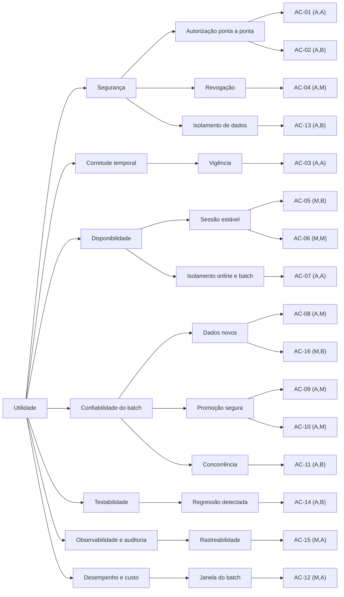

# Foot Fanatics — Avaliação arquitetural ATAM, ciclo 01

> **Método:** ATAM (Bass, Clements e Kazman), fase 1 (passos 1 a 6), conduzida por um avaliador sobre artefatos. A fase 2 (brainstorm e votação com stakeholders, passos 7 e 8) **não foi feita**. Por isso toda prioridade aqui é **proposta do avaliador, com validação pendente**.
> **Data:** 2026-11-13. **Base avaliada:** commit `0347ff9` da `main`.
> **Diferença em relação à Parte C de `docs/arquitetura.md`:** aquela avaliação foi feita sobre o **desenho**. Este ciclo confronta o desenho com o **código e os runs de CI** e cita arquivo e linha como evidência.
> **Regras seguidas:** nenhum código alterado; nenhum requisito novo; o que é hipótese está marcado como tal.
>
> **Revisão 1 (2026-11-14, Aula 07):** a mesma avaliação, agora com **medidas** como evidência: a cobertura do JaCoCo e a análise estática do SonarCloud, sobre o commit `7962730` da `main`. As seções revisadas trazem a marca **[Aula 07]**. O texto original fica como registro do ciclo; o que mudou aparece ao lado, sem apagar o que foi dito antes.

**Prefixos deste documento:**

| Prefixo | Significado |
|---------|-------------|
| DN | Direcionador de negócio |
| AC | Cenário de atributo de qualidade |
| SE | Ponto de sensibilidade |
| TO | Ponto de trade-off |
| RC | Risco |
| NR | Não risco |
| TR | Tema de risco |
| DG | Divergência entre documento e código |
| AP | Ação priorizada |

Os IDs da arquitetura (RAS, RS, DA, ADR, CEN, Q) foram preservados. Caminhos de código são relativos a `src/main/java/br/senac/footfanatics/`.

---

## 0. Fontes consultadas

| Fonte | O que foi lido |
|-------|----------------|
| `docs/prd.md` | Personas P1–P3 (`:6-26`, **geradas por IA, validação pendente**, `:8`); escopos E1–E4 (`:27-31`); fora de escopo (`:32-33`) |
| `README.md` | Descrição (`:3`), escopos detalhados, seção de integração contínua |
| `docs/arquitetura.md` | Parte A (drivers), Parte B (C4, §4, §6–§11), Parte C (ATAM sobre o desenho), Parte D (ADR-001 a ADR-016, matriz D5) |
| `docs/testes/plano-tdd.md` | §7: resultado da fase green e decisões provisórias (§7.4) |
| Código de produção | Os 63 arquivos `.java` de `src/main` e o `application.properties` |
| Testes | 12 classes em `src/test`, mais os dublês de `apoio/` |
| GitHub Actions | Runs `43513343656` (push na `main`, ✅), `43512113294` (✅), `43511699150` (❌ quebra proposital), `43511428888` (✅) e `43506395202` (❌, `master` na fase red, anterior ao CI atual) |
| **[Aula 07]** JaCoCo 0.8.15 | Relatório por classe (`target/site/jacoco/jacoco.csv` e `.xml`) do `./mvnw -B clean verify` sobre `7962730`: 231 testes, 0 falhas, 36 desabilitados. No CI, artifact `cobertura-jacoco-43543654598` (run da `main`) e `cobertura-jacoco-43543267658` (PR #4). Gate: 80% de linhas e 70% de branches. |
| **[Aula 07]** SonarCloud | Projeto `GuilhermeAFSantos_foot-fanatics`, análise da `main` em 2026-11-14T01:59 (commit `7962730`), quality profile **Sonar way core** (313 regras Java), Quality Gate **Sonar way**. Análise do PR #4 (gate do código novo). Lido pela API pública (`api/measures`, `api/issues`, `api/hotspots`, `api/qualitygates`). |
| **[Aula 07]** Plano de TDD | `docs/testes/plano-tdd.md` §8: classificação das lacunas de cobertura e defeitos D-01 e D-02 |

**Fatos estruturais verificados no código**, por busca no repositório:

| Fato | Resultado da busca |
|------|--------------------|
| Anotações Spring (`@RestController`, `@Configuration`, `@Bean`, `@Component`, `@ControllerAdvice`, `@Scheduled`) em `src/main` | **0** |
| Uso de JPA (`jakarta.persistence`, `JpaRepository`) | **0**. O starter está no `pom.xml`, mas não é usado. |
| Implementações de produção de `Repositorio*` (usuários, sessões, assinaturas, conteúdo, eventos) | **0**. Só existem dublês em memória nos testes. |
| `main()` além de `FootFanaticsApplication` (ponto de entrada do Job) | **0** |
| Chamadas de produção a `OrquestradorDoJob`, `RegistradorDeEventos`, `LeitorDoModeloAtivo` e `TratadorDeErros` | **0** fora das próprias classes |
| Arquivos com logger | **0** |
| `application.properties` | Só `spring.application.name` (`:1`) |

Em resumo: o repositório tem o **núcleo de domínio e de aplicação** testado (199 testes no CI, run `43513343656`), mas **não monta um sistema executável** de ponta a ponta. Essa é a constatação central deste ciclo (TR-01).

---

## 1. Direcionadores de negócio

Visão, problema e métricas de sucesso continuam em `TODO` (`docs/prd.md:2-5,34-35`; lacuna L-01). Por isso **nenhum direcionador tem meta de negócio**. Os direcionadores abaixo vêm dos artefatos e não foram criados aqui.

| ID | Direcionador | Origem | Atributos que puxa |
|----|--------------|--------|--------------------|
| DN-01 | A assinatura é o diferencial do produto: conteúdo exclusivo para premium | `README.md:3`; E3/E4 (`README.md:11-12`) | Segurança (autorização), corretude temporal |
| DN-02 | Falha de autorização é vazamento, não desconforto | `docs/prd.md:8,25` (P3) | Segurança, privacidade |
| DN-03 | O assinante usa vários dispositivos e não quer ser deslogado nem perder acesso durante a vigência | `docs/prd.md:17-19` (P2, validação pendente) | Disponibilidade, consistência de sessão |
| DN-04 | É o projeto de uma disciplina de qualidade: a arquitetura precisa ser verificável | `README.md:3` | Testabilidade, observabilidade |
| DN-05 | Restrição do professor: job diário que treina só com dados novos, sem derrubar o online | R-03, INV-1 a INV-3 (`docs/arquitetura.md` §A5, §11) | Confiabilidade do batch, isolamento, custo |
| DN-06 | Restrições de stack e de escopo | R-01, R-02 | Delimitam as soluções |

---

## 2. Cenários de atributo de qualidade (seis partes)

Onde o cenário já existia na Parte C, o ID original aparece entre parênteses. Toda faixa numérica é **hipótese, com validação pendente**. Só os zeros de segurança e integridade são metas naturais do próprio requisito.

| ID | Fonte | Estímulo | Artefato | Ambiente | Resposta | Medida de resposta |
|----|-------|----------|----------|----------|----------|--------------------|
| **AC-01** (novo) | Aplicação Cliente de P1 | `GET` de matéria pública **por HTTP**, sem token | Sistema em execução (API Foot Fanatics) | Operação normal | 200 com a matéria, como na matriz §4.1 | 100% das células da matriz §4.1 respondidas corretamente **via HTTP** |
| **AC-02** (CEN-01) | Usuário free | Pede matéria exclusiva | PoliticaDeAcesso, ServicoDeConteudo | Operação normal | Negação `plano_insuficiente` sem nenhum campo do conteúdo | 0 respostas com conteúdo exclusivo para free ou anônimo |
| **AC-03** (CEN-02) | Assinante premium (P2) | Cancela e pede conteúdo exclusivo depois do instante de corte | ServicoDeAssinatura, PoliticaDeAcesso | Sessão ativa | Acesso negado a partir do instante de corte | Primeira requisição após o corte já negada. **O instante de corte é a pergunta Q-03.** |
| **AC-04** (CEN-05) | P2, ou quem tenha copiado o token | Usa o token de acesso logo depois do logout | ServicoDeSessao | Sessão dentro do TTL | `token_invalido` | Atraso entre logout e recusa = 0 s (ADR-004) |
| **AC-05** (CEN-04) | Duas abas de P2 | Renovam o mesmo refresh ao mesmo tempo | ServicoDeSessao, RepositorioDeSessoes | Operação normal | As duas recebem o mesmo par; P2 continua logada | 0 sessões inconsistentes; 0 logouts involuntários na corrida |
| **AC-06** (novo) | Operação | Reinício ou novo deploy da API | ServicoDeSessao | Sessões ativas | As sessões continuam válidas | Sessões invalidadas por reinício = 0. Hipótese: o requisito existe, mas não está escrito. |
| **AC-07** (CEN-20) | Job de Treino Diário | Lê uma janela grande durante o atendimento online | Banco Operacional, API | "Final do dia", tráfego desconhecido (Q-14) | A API mantém a latência | p95 com batch ≤ p95 sem batch × 1,15–1,25. **Hipótese** (Q-08). |
| **AC-08** (CEN-10) | Transação lenta da API | Faz commit depois do corte com `registrado_em` anterior a ele | ExtratorIncremental, CHECKPOINT | Execução em andamento | O evento entra numa janela; nunca é pulado | Eventos perdidos = 0 |
| **AC-09** (CEN-14) | Treinador | Produz um candidato pior que o ativo | GateDePromocao, OrquestradorDoJob | Execução normal | REPROVADO; ponteiro e checkpoint mantidos | Promoções abaixo de ativo − tolerância = 0 |
| **AC-10** (CEN-15) | Infraestrutura | Queda no meio da promoção | RegistryDeModelosJdbc, OrquestradorDoJob | Gate aprovou | Tudo ou nada: ponteiro, checkpoint, execução **e status das versões** | Estados divergentes = 0 em injeção de falha |
| **AC-11** (CEN-09) | Agendador ou operador | Dois disparos simultâneos | GerenciadorDeLockPostgres | Execução em andamento | Só um prossegue | Execuções simultâneas ≤ 1 |
| **AC-12** (CEN-19) | Crescimento do uso | Volume de eventos cresce várias vezes | ExtratorIncremental, RegistradorDeEventos | Execução diária | Conclui dentro da janela | Tempo proporcional à janela, não ao histórico. Janela: Q-10. |
| **AC-13** (CEN-18) | Credencial vazada do `batch_leitor` | Tenta ler `app.usuario` | Papéis do banco | Operação normal | Permissão negada | 100% negadas (SQLSTATE 42501) |
| **AC-14** (novo) | Desenvolvedor | Introduz uma regressão numa regra de negócio | Suíte + CI | Pull request | O check falha e bloqueia o merge na `main` | Regressão detectada antes do merge em 100% dos casos cobertos por teste |
| **AC-15** (novo) | Operação ou auditoria | Pede quem promoveu ou fez rollback de uma versão, e quem fez login | Auditoria (§7) | Após o fato | Registro com ator, instante e correlação | 100% das ações sensíveis rastreáveis |
| **AC-16** (CEN-12) | Deploy da API | Eventos chegam com `versao_esquema` nova | ValidadorDeDados | Execução diária | Esquema desconhecido vai para a quarentena; nunca é treinado | Treinos com esquema desconhecido = 0 |

### 2.1 [Aula 07] Medidas como evidência nos cenários

**Panorama do projeto** (SonarCloud, `main` em `7962730`):
- 1.592 linhas de código;
- cobertura de 95,3% (97,4% das linhas e 89,7% dos branches);
- **0 bugs, 0 vulnerabilidades, 0 code smells e 0 hotspots** de segurança;
- 0% de duplicação, dívida técnica de 0 min e notas A em confiabilidade, segurança e manutenibilidade;
- Quality Gate **Passed**.

A única issue que o projeto teve, `java:S2077` (SQL montado dinamicamente em `infra/ProvisionadorDeBanco.java`), era um defeito real e está como **FIXED**: CT-S15.04 a reproduz e a correção a fecha.

**Como ler as medidas:**
- **Cobertura** mostra que o código da regra *foi executado* por algum teste. Não prova que a resposta do cenário acontece; isso cabe à asserção do teste citado.
- **SonarCloud** só enxerga o código que existe. Um cenário cujo código não existe (AC-01, AC-07, AC-15) aparece "limpo" justamente por falta do que analisar.

| Cenário | Classes que respondem | JaCoCo (linhas / branches) | SonarCloud | O que a medida acrescenta |
|---------|----------------------|----------------------------|------------|---------------------------|
| AC-01 | PoliticaDeAcesso, ServicoDeConteudo, TratadorDeErros | 100% / 100%; 100% / sem branches; 100% / 100% | 0 issues | O núcleo da matriz está todo exercitado. **A borda HTTP não existe, então não há o que medir**: 97% de cobertura não move o veredito "Não atende". |
| AC-02 | PoliticaDeAcesso, ServicoDeConteudo | 100% / 100% | 0 issues | Reforça NR-01. A listagem com item **liberado** só passou a ser executada com CT-19.05; antes só havia o caso "nega tudo". |
| AC-03 | ServicoDeAssinatura | 95,7% / 80,8% | 0 issues | As linhas e branches restantes (`cancelar` sem premium vigente, `upgrade`) dependem de Q-03, QT-10 e Q-02. **Cobertura alta com a regra provisória** não reduz RC-02. |
| AC-04 | ServicoDeSessao | 100% / 91,3% | 0 issues; maior complexidade cognitiva do projeto (34) | Token ausente ou ilegível (CT-06.09) e logout em corrida (CT-09.06/07) passaram a ser verificados. Os 4 branches restantes são defensivos (plano §8.3). |
| AC-05 | ServicoDeSessao | 100% / 91,3% | 0 issues | Refresh forjado não derruba a sessão legítima (CT-07.09). |
| AC-06 | ServicoDeSessao | — | 0 issues | Medida irrelevante: a chave por instância (SE-04) é decisão de configuração, não caminho de código. |
| AC-07 | — (não há Job executável) | — | — | Sem código, sem medida. RC-03 continua confirmado. |
| AC-08 | ExtratorIncremental, OrquestradorDoJob | 100% / 100%; 99,0% / 90,9% | 0 issues | Janela coberta nas bordas ±1 ms. Δ e o timeout continuam sem valor (RC-08). |
| AC-09 | GateDePromocao, OrquestradorDoJob, TransicoesDeVersao | 100% / 100%; 99,0% / 90,9%; 100% / 66,7% | 0 issues | Descarte (ADR-011) passou a ser verificado em todos os ramos de recusa (CT-S09.04c, 06, 07). Os branches de `TransicoesDeVersao` não cobertos são nulos defensivos. |
| AC-10 | RegistryDeModelosJdbc, OrquestradorDoJob, PromotorDeModelo | 97,9% / 80,0%; 99,0% / 90,9%; 100% / 100% | 0 issues | O caminho de **sucesso** de `finalizar` só passou a rodar no PostgreSQL com CT-S10.04, que revelou o defeito **D-01**. As linhas 133-135 do orquestrador estão **cobertas**, mas nenhum teste injeta falha entre elas: **linha coberta ≠ atomicidade verificada** (RC-04 se mantém). |
| AC-11 | GerenciadorDeLockPostgres | 88,9% / 80,0% | 0 issues | `liberar()` nunca era executado; agora é (CT-S05.04). O que falta é `SQLException` de infraestrutura. |
| AC-12 | ExtratorIncremental, RegistradorDeEventos | 100% / 100% | 0 issues | Cobertura total do adaptador em memória. **A medida não vê custo**, e RC-06 é de desempenho. |
| AC-13 | ProvisionadorDeBanco | 93,3% / 100% | S2077 **FIXED** | A análise estática achou injeção de SQL no provisionamento dos papéis (senha com `$$`). Corrigida e coberta por CT-S15.04. |
| AC-14 | Suíte + CI | 80/70 exigidos; 97,4% / 90,2% medidos | Quality Gate no PR #4: **Passed** (cobertura do código novo 100%, duplicação 0%) | O check `verify (Java 21)` agora também falha quando a cobertura cai abaixo do gate (demonstrado em `plano-tdd.md` §8.6) ou quando o Quality Gate reprova (`qualitygate.wait`). |
| AC-15 | — | — | — | Sem código de auditoria ou log, sem medida. |
| AC-16 | ValidadorDeDados, OrquestradorDoJob | 100% / 91,7% | 0 issues | Quarentena acima do limite **no Job** só passou a ser verificada com CT-S07.06 (trinca −1/0/+1). O branch restante é a janela vazia, bloqueada (volume mínimo). |

---

## 3. Utility tree

Escala: **A** (alta), **M** (média), **B** (baixa), no formato **(importância, dificuldade)**. A dificuldade considera o **estado atual do código**, não só o desenho.

| Cenário | (I,D) | Por que esta importância | Por que esta dificuldade (no código atual) |
|---------|-------|--------------------------|--------------------------------------------|
| AC-01 | **(A,A)** | Sem isso, nenhuma regra de DN-01 ou DN-02 alcança um usuário real | Não existe camada HTTP nem persistência (DG-01, DG-02); é construir o sistema em execução |
| AC-03 | **(A,A)** | DN-01, DN-02: acesso após cancelar ou perda antes do fim | A regra não está definida (Q-03), e o código hoje **não corta** (DG-07) |
| AC-07 | **(A,A)** | INV-1 é obrigatória (DN-05) | Não há processo separado nem limites de recurso (DG-03, DG-05) |
| AC-04 | (A,M) | DN-02 | Implementado no serviço; falta o sistema em execução e a chave persistente |
| AC-08 | (A,M) | DN-05 | Mecanismo implementado; Δ e o timeout de transação da API não existem |
| AC-09 | (A,M) | DN-05 | Gate implementado; a métrica real depende de Q-09 |
| AC-10 | (A,M) | DN-05, INV-2/3 | Transação parcial (DG-06) |
| AC-02 | (A,B) | DN-01, DN-02 | Implementado e coberto pela matriz completa |
| AC-11 | (A,B) | DN-05 | Implementado e testado no PostgreSQL real |
| AC-13 | (A,B) | DN-02 | Papéis implementados e testados |
| AC-14 | (A,B) | DN-04 | CI e proteção da `main` funcionando (run vermelho comprovado). **[Aula 07]** agora com gate de cobertura (80/70) e Quality Gate do SonarCloud no mesmo check. |
| AC-12 | (M,A) | DN-05; sem volume (L-08) | Leitura do histórico inteiro na memória (DG-09) |
| AC-15 | (M,A) | DN-04; DIV-03 | Nada implementado (DG-08) |
| AC-06 | (M,M) | DN-03 | Chave HMAC gerada por instância (SE-04) |
| AC-05 | (M,B) | DN-03 | Implementado e testado com threads |
| AC-16 | (M,B) | DN-05 | Implementado, mas a quarentena não é persistida (DG-10) |

---

## 4. Análise dos cenários de maior prioridade: abordagens, táticas e evidências

**Ordem:** primeiro os três (A,A), depois os quatro (A,M). As táticas seguem o catálogo de Bass, Clements e Kazman, *Software Architecture in Practice*, 4ª ed.

**Veredito:**
- **Atende:** a medida está garantida pelo código e por um teste.
- **Parcial:** o mecanismo existe, mas falta um elo.
- **Não atende:** o código não produz a resposta.

### 4.1 AC-01: autorização ponta a ponta via HTTP (A,A) → **Não atende**

| Abordagem prometida | Tática | Evidência no código |
|---------------------|--------|---------------------|
| FiltroDeAutenticacao valida o token e entrega o principal ao ServicoDeConteudo (`docs/arquitetura.md:275`, §4.3) | Autenticar atores | **Ausente:** nenhum filtro nem configuração de segurança em `src/main` (0 anotações Spring) |
| PoliticaDeAcesso central, nega por padrão (ADR-002) | Autorizar atores; Limitar exposição | `acesso/PoliticaDeAcesso.java:21-33` (regra da matriz), `:24-25` (nega o que não for PUBLICA ou EXCLUSIVA), `:41-42` (dados de outro usuário) |
| Todo caminho de conteúdo passa pela política | Limitar exposição | `conteudo/ServicoDeConteudo.java:24` (busca) e `:34,40` (listagem filtrada) |
| TratadorDeErros converte falhas em Problem Details (ADR-014) | Aderir a padrões | `erro/TratadorDeErros.java:16-25`, **sem ligação com HTTP**: nenhum `@ControllerAdvice` |

- **Testes que comprovam o núcleo:** `AcessoAoConteudoTest#rn19_ct19_03_matrizCompleta` (8 células), `#rn19_ct19_02_todoCaminhoPassaPelaPolitica`, `DadosDeUsuarioTest`, `ContratoDeErroTest`. Todos verdes no run `43513343656`.
- **Lacuna:** nenhum teste exercita HTTP, e nem poderia, porque não há rota.
- **Observação do setup, não reverificada neste ciclo:** a aplicação sobe com a configuração padrão do Spring Security e responde **401 a tudo**.
- **[Aula 07] Medidas:** PoliticaDeAcesso 100% / 100%, ServicoDeConteudo 100% e TratadorDeErros 100% / 100% (JaCoCo); 0 issues (SonarCloud). Os casos novos CT-17.04 (principal nulo), CT-19.04 (dado sem dono) e CT-19.05 (listagem com item liberado) fecharam os ramos da política que nenhum teste executava. **O veredito continua "Não atende"**: a medida é do núcleo, e o que falta (rotas, filtro, persistência) não tem linha para cobrir.

### 4.2 AC-03: cancelamento corta o acesso (A,A) → **Não atende** (regra indefinida)

| Abordagem prometida | Tática | Evidência no código |
|---------------------|--------|---------------------|
| Plano consultado a cada decisão, fora do token (ADR-003) | Autorizar atores (decisão no instante) | `acesso/PoliticaDeAcesso.java:30` → `assinatura/ServicoDeAssinatura.java:25` (`relogio.agora()`) ✅ |
| Fonte única de tempo (ADR-005) | Interfaces especializadas; Limitar não determinismo | `tempo/Relogio.java`; uso em `ServicoDeAssinatura.java:25,44` ✅ |
| Cancelamento corta a partir de `t_corte` (`docs/arquitetura.md:622`) | Revogar acesso | `ServicoDeAssinatura.java:44-48` **só grava** `canceladaEm`. `vigenteEm` (`:57-58`) **ignora** `canceladaEm`, então o acesso continua até `fimVigencia` (DG-07). |

- **Testes:** `AssinaturaTest#rn14_ct14_01` (o token não carrega privilégio) ✅. O caso central CT-13.01/02 está **desabilitado** por causa de Q-03.
- **[Aula 07] Medidas:** ServicoDeAssinatura 95,7% / 80,8%. As lacunas que restam (`cancelar` de free, cancelar duas vezes, premium vencido; `upgrade`) foram classificadas como **bloqueadas** e deliberadamente não testadas (`plano-tdd.md` §8.3), porque o teste fixaria a regra provisória. Esse é o caso em que um percentual mais alto **pioraria** o risco: congelaria TR-04.

### 4.3 AC-07: o batch não degrada o online (A,A) → **Não atende** (no código atual)

| Abordagem prometida | Tática | Evidência no código |
|---------------------|--------|---------------------|
| Job em processo separado (DA-06, `docs/arquitetura.md:871`; ADR-006 `:1619`) | Separar entidades; Agendar recursos | **Ausente:** não há ponto de entrada do Job nem agendador (0 `main()` além da app). Hoje o orquestrador só roda dentro dos testes. |
| `batch_leitor` com limite de conexões e `statement_timeout` (DA-13, `:878`) | Limitar tamanho de filas; Limitar tempo de execução | **Parcial:** `infra/ProvisionadorDeBanco.java:83-92` cria os papéis e privilégios, mas **sem** `CONNECTION LIMIT` e **sem** `statement_timeout` (DG-05) |
| Batch lê só a janela de `eventos` (DA-07) | Gerenciar requisições de trabalho | `treino/ExtratorIncremental.java:20-22` filtra **em memória** depois de `lerTodos()`, ou seja, depende do histórico inteiro (DG-09) |
| API isolada do resultado do batch (DA-16) | Degradação graciosa | `treino/LeitorDoModeloAtivo.java:26-41` mantém a versão atual ou faz fallback ✅, mas **nenhum código** chama `recarregar()` periodicamente (DG-04) |

- **Testes:** `LeitorDoModeloAtivoTest` ✅ (isolamento do modelo). Nenhum teste de carga: o EXP-01 da arquitetura nunca foi executado.
- **[Aula 07] Medidas:** não se aplicam. Cobertura e análise estática não medem latência nem isolamento de processo, e o ponto de entrada do Job não existe. O SonarCloud ainda viu `ProvisionadorDeBanco` (S2077 corrigida), mas os limites de conexão e o `statement_timeout` (DG-05) são ausência de configuração, que nenhuma regra estática acusa.

### 4.4 AC-04: logout revoga na hora (A,M) → **Atende no serviço; Parcial no sistema**

| Abordagem | Tática | Evidência |
|-----------|--------|-----------|
| Token opaco validado contra a SESSAO a cada requisição (ADR-004) | Revogar acesso | `sessao/ServicoDeSessao.java:125` (sessão revogada ou hash divergente → inválido), `:110` (logout revoga) |
| Revogação com controle otimista, sem se perder numa corrida | Transações | `ServicoDeSessao.java:148-149` (incrementa a versão + `substituirSeVersao`) |
| Assinatura HMAC dos tokens | Verificar integridade da mensagem | `ServicoDeSessao.java:160`; chave em `:30`, **gerada por instância** (SE-04, RC-05) |

- **Testes:** `SessaoTest#rn09_ct09_01`, `#rn06_ct06_07`, `#rn09_ct09_05` ✅.
- **Lacuna:** não há adaptador de sessão persistente (DG-02), então em produção as sessões não sobrevivem a nada.
- **[Aula 07] Medidas:** ServicoDeSessao 100% das linhas e 91,3% dos branches; é o arquivo de maior complexidade cognitiva do projeto (34 no SonarCloud), com 0 issues. Três caminhos de revogação que nenhum teste executava agora têm asserção:
  - token ausente, vazio ou com partes ilegíveis → `token_invalido` (CT-06.09);
  - refresh forjado não revoga a sessão legítima (CT-07.09);
  - logout concorrente com renovação ou com outra revogação nunca perde a revogação (CT-09.06, CT-09.07, com corrida determinística e `Clock.fixed`).

  O veredito no serviço fica mais bem sustentado; o "Parcial no sistema" não muda.

### 4.5 AC-08: evento com commit depois do corte (A,M) → **Parcial**

| Abordagem | Tática | Evidência |
|-----------|--------|-----------|
| Janela (watermark, corte] por tempo de ingestão (ADR-008) | Carimbo de tempo | `treino/ExtratorIncremental.java:21` |
| corte = início − Δ | Limitar tempo de execução | `treino/OrquestradorDoJob.java:99` |
| Δ maior que o timeout máximo de transação da API | — | **Ausente:** não há transação de API, nem timeout configurado, nem valor de Δ (Q-15). A garantia depende de um parâmetro que não existe. |

- **Testes:** `JanelaIncrementalTest` (bordas ±1 ms) e `OrquestradorDoJobTest#rs01_cts01_08` ✅. Nenhum teste reproduz o commit tardio real: o EXP-02 nunca foi executado.
- **[Aula 07] Medidas:** ExtratorIncremental 100% / 100%; OrquestradorDoJob 99,0% / 90,9%. A janela está toda exercitada. A dúvida de RC-08 é sobre **parâmetros que não existem** (Δ, timeout), e a cobertura não a resolve.

### 4.6 AC-09: candidato pior que o ativo (A,M) → **Atende** (com métrica abstrata)

| Abordagem | Tática | Evidência |
|-----------|--------|-----------|
| Gate: dados + sanidade + métrica ≥ ativo − tolerância (§6.3 item 12) | Checagem de sanidade | `treino/GateDePromocao.java:16-22` |
| Reprovado → REPROVADA, sem avanço do checkpoint, com limite K (ADR-011) | Monitoramento de condição | `treino/OrquestradorDoJob.java:124-125` (finaliza sem watermark; alerta em K), `:93` (para depois de K) |
| Transições de versão restritas (§6.4) | Prevenção de exceções | `treino/TransicoesDeVersao.java:10-22` |

- **Testes:** `GateDePromocaoTest` e `OrquestradorDoJobTest#rs09_*` ✅.
- **Ressalva:** o `AvaliadorDeCandidato` real não existe (Q-09). O gate compara uma pontuação abstrata.
- **[Aula 07] Medidas:** GateDePromocao 100% / 100%. O descarte humano (ADR-011) tinha ramos de recusa sem teste: responsável nulo ou vazio, data inexistente, execução CONCLUIDA, REPROVADA que não é a mais recente. Agora estão cobertos (CT-S09.04c, CT-S09.06, CT-S09.07). Continua sem teste o contador que zera numa aprovação: está bloqueado (QT-14).

### 4.7 AC-10: queda durante a promoção (A,M) → **Parcial**

| Abordagem | Tática | Evidência |
|-----------|--------|-----------|
| Transação final única: execução + checkpoint + ponteiro (ADR-010) | Transações | `treino/jdbc/RegistryDeModelosJdbc.java:112-141` (`setAutoCommit(false)` … `commit`/`rollback`) ✅ |
| Status das versões fora dessa transação | — | `treino/OrquestradorDoJob.java:133-134` mudam ATIVO e APROVADO_INATIVO **antes** do `finalizar` (`:135`), em chamadas separadas (DG-06) |
| Rollback manual | Reversão | `treino/PromotorDeModelo.java:31-41`: três escritas separadas, também fora de transação |

- **Testes:** `PersistenciaDoTreinoIntegracaoTest#rs10_cts10_02` ✅ prova o "tudo ou nada" do `finalizar`. **Nenhum teste injeta falha entre as linhas 133 e 135.**
- **[Aula 07] Medidas e correções:**
  - **A evidência do ciclo era mais fraca do que parecia.** A limpeza entre testes de integração apagava a linha do checkpoint, e a asserção de checkpoint do CT-S10.02 comparava `null` com `null` (defeito **D-02**, `plano-tdd.md` §8.4). Corrigida, a asserção passou a verificar o checkpoint e continua verde.
  - **Até a Aula 07, o caminho de sucesso de `finalizar` nunca tinha rodado contra o PostgreSQL.** O JaCoCo mostrava `commit()` sem execução. O novo CT-S10.04 cobre esse caminho e revelou o defeito **D-01**: `versaoAnterior()` lançava `NullPointerException` logo depois da primeira promoção, o que quebraria o rollback. Corrigido.
  - Hoje RegistryDeModelosJdbc está em 97,9% / 80,0%. As linhas 133-135 do orquestrador estão cobertas, mas **sem falha injetada**, então o veredito "Parcial" se mantém.

---

## 5. Descobertas

### 5.1 Pontos de sensibilidade

| ID | Parâmetro ou decisão | Afeta | Evidência | [Aula 07] Revisão à luz das medidas |
|----|----------------------|-------|-----------|-------------------------------------|
| SE-01 | Ordem "status das versões → `finalizar`" | Integridade do registry (AC-10) | `OrquestradorDoJob.java:133-135` | **Mantido.** As linhas estão 100% cobertas e mesmo assim a sensibilidade não está verificada: falta injetar falha entre elas. É o exemplo de que cobertura é condição necessária, não prova. |
| SE-02 | Margem Δ × timeout de transação da API | Perda de eventos (AC-08) | `OrquestradorDoJob.java:99`; o timeout não existe | **Mantido.** Nenhuma medida alcança um parâmetro sem valor. |
| SE-03 | Leitura `lerTodos()` antes de filtrar | Tempo do batch e da escrita de eventos (AC-07, AC-12) | `ExtratorIncremental.java:20`; `RegistradorDeEventos.java:13` | **Mantido.** 100% de cobertura e 0 issues: o problema é de custo, que nem o JaCoCo nem o SonarCloud medem. |
| SE-04 | Chave HMAC gerada por instância | Sobrevivência das sessões a reinício e escala horizontal (AC-06) | `ServicoDeSessao.java:30` | **Mantido.** O SonarCloud não acusou nada (a chave é gerada com `SecureRandom`, o que está correto). O problema é de ciclo de vida, não de código. |
| SE-05 | Fronteira da vigência (início inclusivo, fim exclusivo) | Corretude temporal (AC-03) | `ServicoDeAssinatura.java:57-58`; AM-01 em aberto | **Ampliado.** O material da Aula 07 define, para o token, "expiração ≤ agora → negar", o contrário do código atual na borda (`ServicoDeSessao.java:57`, `isAfter`). A mesma decisão de fronteira (AM-01) agora tem uma fonte que a responde para o token (`plano-tdd.md` §8.5). **Atualização (2026-11-14):** a regra foi alinhada à aula. O token de acesso expira no instante exato (`ServicoDeSessao.validar`, `!agora.isBefore`), com os códigos `token_ausente` e `token_revogado` (`plano-tdd.md` §9; CT-06.03, CT-06.08, CT-06.10, CT-06.11). AM-01 continua aberta para a vigência, o refresh, o código de recuperação e `t_corte`. |
| SE-06 | Tolerância de reuso do refresh | Segurança × usabilidade (AC-04, AC-05) | `ServicoDeSessao.java:135` | **Mais bem delimitado.** A tolerância nunca beneficia um refresh forjado (CT-07.09), então a janela de risco do TO-02 se limita a um refresh autêntico roubado. |
| **SE-07** (novo) | Gate de cobertura medido no **bundle inteiro** (80/70) | Detecção de regressão nas classes críticas (AC-14) | `pom.xml` (regra `BUNDLE`); medido hoje: 97,4% / 90,2% | Com 613 linhas a cobrir, a folga até 80% é de cerca de 100 linhas. Uma classe crítica, como ServicoDeSessao ou PoliticaDeAcesso, poderia perder todos os testes sem o gate perceber. O próprio material da aula admite "critério mais alto e específico" para classes críticas. |
| **SE-08** (novo) | Quality Gate aplicado **só ao código novo** + análise **pulada em PR de fork** | O que o check exigido realmente garante (AC-14) | `ci.yml` (step "Análise SonarCloud e Quality Gate", condição `if`); Quality Gate "Sonar way" | Em PR do próprio repositório, o gate reprovado derruba `verify (Java 21)`. Em PR de fork, o step não roda (sem secret), e o check exigido fica verde **sem** Quality Gate. Ver RC-11. |

### 5.2 Pontos de trade-off

| ID | Trade-off | Ganha | Perde | Evidência |
|----|-----------|-------|-------|-----------|
| TO-01 | Token opaco validado na SESSAO a cada requisição | Revogação imediata (AC-04) | Uma consulta ao banco por requisição autenticada (desempenho) | `ServicoDeSessao.java:125` |
| TO-02 | Tolerância de reuso do refresh | Usabilidade de P2 (AC-05) | Uma janela curta para um refresh roubado (segurança) | `ServicoDeSessao.java:92-96,135` |
| TO-03 | Plano consultado a cada decisão | Corretude temporal (AC-03) | Uma consulta por pedido exclusivo (desempenho) | `PoliticaDeAcesso.java:30` |
| TO-04 | Não avançar o checkpoint quando o gate reprova | Nenhum dado perdido | Janelas acumuladas e mais custo (AC-12) | `OrquestradorDoJob.java:124` |
| TO-05 | Chave HMAC por instância | Nada a configurar; nenhum segredo no repositório | Sessões perdidas a cada reinício (AC-06) | `ServicoDeSessao.java:30` |
| **TO-06** [Aula 07] | Esperar o Quality Gate dentro do check exigido (`sonar.qualitygate.wait=true`) | Nenhum merge com gate reprovado (AC-14) | O merge passa a depender da disponibilidade do SonarCloud e de um secret; o CI fica cerca de 30 s mais lento (1m06s no PR #3, 1m36s no PR #4) | `ci.yml`; runs `43541348766` e `43543267658` |

### 5.3 Riscos

**Confirmado** = a evidência no código mostra que a resposta do cenário não é produzida hoje. **Dúvida** = depende de medição ou de pergunta em aberto.

| ID | Risco | Tipo | Cenário | Direcionador | Evidência | [Aula 07] Revisão |
|----|-------|------|---------|--------------|-----------|-------------------|
| RC-01 | Nenhuma regra de acesso alcança um usuário real: não há HTTP nem persistência | **Confirmado** | AC-01 | DN-01, DN-02 | 0 controladores, filtros ou repositórios de produção | **Mantido.** Os 0 issues e os 97% de cobertura medem só o núcleo. Ver TR-05. |
| RC-02 | O cancelamento não corta o acesso antes do fim da vigência | **Confirmado** (enquanto Q-03 não for respondida) | AC-03 | DN-01, DN-02 | `ServicoDeAssinatura.java:44-48,57-58` | **Mantido.** As lacunas de cobertura aqui foram deixadas sem teste de propósito (bloqueadas). |
| RC-03 | O batch não tem isolamento de processo nem de recurso | **Confirmado** | AC-07 | DN-05 | Sem ponto de entrada do Job; `ProvisionadorDeBanco.java:83-92` sem limites (em `7962730`: `:85-98`) | **Mantido.** Ausência de configuração não aparece em medida estática. |
| RC-04 | Uma queda entre a troca de status e o `finalizar` deixa o status de uma versão divergente do ponteiro | **Confirmado** (por inspeção; sem teste) | AC-10 | DN-05 | `OrquestradorDoJob.java:133-135`; `PromotorDeModelo.java:36-41` | **Mantido**, apesar de as linhas estarem cobertas (SE-01). O caminho de sucesso do registry no PostgreSQL agora é testado (CT-S10.04, CT-S11.08); o de falha entre as escritas, não. |
| RC-05 | Todas as sessões caem a cada reinício ou deploy | **Confirmado** | AC-06 | DN-03 | `ServicoDeSessao.java:30` | **Mantido.** |
| RC-06 | O custo do batch e da escrita de eventos cresce com o histórico, não com a janela | **Confirmado** no adaptador em memória; o adaptador real não existe | AC-12 | DN-05 | `ExtratorIncremental.java:20`; `RegistradorDeEventos.java:13` | **Mantido.** 100% de cobertura e 0 issues: desempenho não é medido. |
| RC-07 | Nenhuma ação sensível é auditada, e não há log nem métrica | **Confirmado** | AC-15 | DN-04, DN-02 | 0 loggers; nenhum componente de auditoria | **Mantido.** |
| RC-08 | A garantia contra eventos tardios depende de Δ e de um timeout que não existem | Dúvida | AC-08 | DN-05 | `OrquestradorDoJob.java:99` | **Mantido.** |
| RC-09 | A imagem `postgres:latest` sem versão fixa torna o CI não reprodutível | **Confirmado** (RK-10 continua aberto) | AC-14 | DN-04 | `TestcontainersConfiguration.java:15`; `PersistenciaDoTreinoIntegracaoTest.java:42` | **Mantido e ampliado.** O scanner do Sonar foi fixado (5.8.0.7211, `pom.xml`), mas a imagem do PostgreSQL não. O run da `main` também avisou que `actions/upload-artifact@v5` usa o Node 20, que está obsoleto. |
| RC-10 | A quarentena não é persistida: a linhagem dos rejeitados se perde | **Confirmado** | AC-16 | DN-05 | `ValidadorDeDados.java:21-29` devolve a lista, mas nenhum código grava em `ml.quarentena` | **Mantido.** O limite de quarentena no Job agora é verificado (CT-S07.06); a persistência não. |
| **RC-11** (novo) | PR vindo de fork passa no check exigido sem Quality Gate do SonarCloud | **Confirmado** (por configuração) | AC-14 | DN-04 | `ci.yml`: o step do Sonar só roda com secret disponível. A proteção da `main` exige só `verify (Java 21)`; o check `SonarCloud Code Analysis` existe (commit `7962730`), mas não é exigido. | Hoje o repositório não recebe PRs de fork, por isso o impacto é baixo. Resolver: exigir também `SonarCloud Code Analysis` (AP-11). |
| **RC-12** (novo, já tratado) | Injeção de SQL no provisionamento dos papéis por uma senha com `$$` | **Confirmado e corrigido** | AC-13 | DN-02 | SonarCloud `java:S2077` em `ProvisionadorDeBanco.java:102` (versão anterior); reproduzido por CT-S15.04 (vermelho no código antigo) | Passou a NR-08. A senha vem da configuração do operador, então a exploração exigiria acesso à configuração; mesmo assim, um provisionamento que quebra ou executa SQL com uma senha válida era defeito. |
| **RC-13** (novo, já tratado) | `versaoAnterior()` quebrava (NPE) logo depois da primeira promoção, impedindo o rollback de responder de forma controlada | **Confirmado e corrigido** | AC-10 | DN-05 | Defeito D-01, revelado pela lacuna do JaCoCo em `RegistryDeModelosJdbc` (`commit()` nunca executado); CT-S10.04 | Encontrado **porque** a cobertura apontou um caminho nunca exercitado no banco real. |

### 5.4 Não riscos

| ID | Não risco | Cenário | Evidência | [Aula 07] Revisão |
|----|-----------|---------|-----------|-------------------|
| NR-01 | A matriz de acesso é decidida num único ponto, que nega por padrão | AC-02 | `PoliticaDeAcesso.java:21-42`; `AcessoAoConteudoTest#rn19_ct19_03` | **Reforçado:** 100% de linhas e branches. Principal nulo e dado sem dono agora negados com teste (CT-17.04, CT-19.04). |
| NR-02 | Execuções sobrepostas do Job | AC-11 | `GerenciadorDeLockPostgres.java:33-38`; `PersistenciaDoTreinoIntegracaoTest#rs05_*` contra PostgreSQL real | **Reforçado:** `liberar()`, que nunca era executado, agora é testado (CT-S05.04). O próximo disparo consegue o lock. |
| NR-03 | Papéis do banco isolam o batch de `app` | AC-13 | `ProvisionadorDeBanco.java:83-92` (em `7962730`: `:85-98`); `#rs15_cts15_01` (SQLSTATE 42501) | **Mantido.** O provisionamento em si tinha uma injeção (RC-12), já corrigida; os privilégios não mudaram. |
| NR-04 | Ponteiro, checkpoint e execução mudam juntos | AC-10 (parte) | `RegistryDeModelosJdbc.java:112-141`; `#rs10_cts10_02` | **Corrigido na evidência.** No ciclo 01, a parte "checkpoint" deste NR se apoiava numa asserção que comparava `null` com `null` (D-02). Hoje se apoia em CT-S10.02 (falha → nada muda) e CT-S10.04 (sucesso → tudo muda, inclusive a versão anterior). |
| NR-05 | Uma regressão numa regra coberta bloqueia o merge | AC-14 | Run `43511699150` ❌ (`expected: <402> but was: <403>`), depois `43512113294` ✅; proteção da `main` exige `verify (Java 21)` | **Ampliado:** o mesmo check falha também quando a cobertura cai abaixo de 80/70 (`plano-tdd.md` §8.6, "lines covered ratio is 0.03") e quando o Quality Gate reprova. Ressalvas: SE-07 e RC-11. |
| NR-06 | Corrida de renovação na mesma sessão | AC-05 | `ServicoDeSessao.java:85-96`; `SessaoTest#rn08_*` com threads | **Reforçado:** a revogação em corrida também é verificada (CT-09.06, CT-09.07), de forma determinística. |
| NR-07 | Versão do modelo imutável no banco | AC-10 | `ProvisionadorDeBanco.java:55-62` (trigger; em `7962730`: `:57-64`); `#rs12_cts12_01` | **Mantido.** |
| **NR-08** (novo) | O provisionamento dos papéis não injeta SQL, qualquer que seja a senha | AC-13 | `ProvisionadorDeBanco.java:108-128` (`format('… %I … %L')` no servidor); `#rs15_cts15_04`; SonarCloud S2077 **FIXED** | Era RC-12. |
| **NR-09** (novo) | Manutenibilidade e duplicação do código existente | Transversal (DN-04) | SonarCloud, `main` `7962730`: 0 code smells, 0% de duplicação, dívida técnica de 0 min, nota A; maior complexidade cognitiva por arquivo: 34 (`ServicoDeSessao`) | Vale para o código que existe. A dívida está no código que **falta** (TR-01, TR-05). |
| **NR-10** (novo) | Vazamento do token do SonarCloud pelo CI | AC-14 | O token só existe no secret `SONAR_TOKEN`. Nos logs dos runs `43543267658` e `43543654598` aparece apenas como `SONAR_TOKEN: ***`, e não está em nenhum arquivo nem commit. `permissions: contents: read`; sem `pull_request_target`. | — |

### 5.5 Temas de risco

| ID | Tema | Riscos | Direcionador ameaçado |
|----|------|--------|-----------------------|
| **TR-01** | **Núcleo sem sistema:** as regras existem e estão testadas, mas não há borda HTTP, persistência da API, ponto de entrada do Job nem configuração. A arquitetura documentada é a do sistema; o código é a do domínio. | RC-01, RC-03, RC-05, RC-06 | DN-01, DN-02, DN-05 |
| **TR-02** | **Atomicidade incompleta no registry:** a transação cobre ponteiro e checkpoint, mas não o estado das versões | RC-04 | DN-05 |
| **TR-03** | **Operação às cegas:** sem log, métrica nem auditoria, nenhum cenário de produção é verificável | RC-07, RC-08, RC-10 | DN-04 |
| **TR-04** | **Regras de negócio provisórias tratadas como comportamento:** o código já escolheu respostas para perguntas em aberto (cancelamento, bordas) | RC-02 | DN-01 |
| **TR-05** [Aula 07] | **Medidas verdes sobre um núcleo sem sistema.** 97,4% de cobertura, 0 issues e Quality Gate aprovado descrevem bem o código que existe, mas nada dizem sobre os cenários cujo código não existe (AC-01, AC-07, AC-15) nem sobre custo e atomicidade sob falha. O risco é ler os números como prontidão. | RC-01, RC-03, RC-04, RC-06, RC-07 | DN-01, DN-04, DN-05 |

---

## 6. Divergências: o que `docs/arquitetura.md` promete × o que o código faz

| ID | Promessa (documento) | Realidade (código) | Severidade |
|----|----------------------|--------------------|------------|
| **DG-01** | FiltroDeAutenticacao e camada HTTP (catálogo `:275`, componentes §2.4, sequência §4.3 a partir de `:625`) | Não existem. 0 controladores, filtros ou `@Configuration`. TratadorDeErros (`erro/TratadorDeErros.java:16-25`) não está ligado ao HTTP. | **Alta** |
| **DG-02** | Banco Operacional com app, sessão, assinatura e conteúdo; Spring Data JPA (§1.1, §3) | 0 adaptadores de produção para `Repositorio*`. JPA declarado no `pom.xml` e nunca usado. As tabelas de `app` são criadas pelo ProvisionadorDeBanco, mas ninguém as lê ou escreve. | **Alta** |
| **DG-03** | Job de Treino Diário em processo separado, disparado pelo Agendador Diário (DA-06 `:871`; ADR-006 `:1619`) | Nenhum ponto de entrada nem agendador. O orquestrador só é instanciado pelos testes. | **Alta** |
| **DG-04** | O ServicoDeConteudo registra eventos e aplica o Modelo M (§4.3 `:669-670`); o LeitorDoModeloAtivo recarrega periodicamente (DA-16 `:881`) | `RegistradorDeEventos` e `LeitorDoModeloAtivo` não são chamados por nenhum código de produção. `ServicoDeConteudo.java` não registra eventos. | Média |
| **DG-05** | `batch_leitor` com limite de conexões e `statement_timeout` (DA-13 `:878`) | `ProvisionadorDeBanco.java:83-92` concede privilégios, mas não define `CONNECTION LIMIT` nem `statement_timeout` | Média |
| **DG-06** | "Tudo ou nada" na promoção (ADR-010 `:1671`; DA-11 `:876`) | Status das versões fora da transação: `OrquestradorDoJob.java:133-135`; `PromotorDeModelo.java:36-41` | Média |
| **DG-07** | Cancelamento corta o acesso a partir do instante de corte (`:622`; ADR-003) | Só grava `canceladaEm` (`ServicoDeAssinatura.java:44-48`); `vigenteEm` ignora o campo (`:57-58`). Registrado como provisório em `plano-tdd.md` §7.4. | Média (depende de Q-03) |
| **DG-08** | Logs correlacionados, métricas, alertas e auditoria (§7 `:823-832`; ADR-016 `:1749`) | 0 loggers, 0 métricas, nenhum componente de auditoria | Média |
| **DG-09** | O batch lê só a janela (DA-07; §6.3 item 1) | `ExtratorIncremental.java:20` lê tudo e filtra em memória. `RegistradorDeEventos.java:13` faz o mesmo para deduplicar. | Média |
| **DG-10** | Registros inválidos vão para a QUARENTENA com o motivo (§6.3 item 8, `:799`) | `ValidadorDeDados.java:21-29` só separa a lista; nada grava em `ml.quarentena` (a tabela existe: `ProvisionadorDeBanco.java`) | Baixa |
| **DG-11** | Novas tentativas com **espera crescente** e timeout global da execução (§6.3 item 6, `:797`) | `OrquestradorDoJob.java:140-143` repete sem espera, e não há timeout global | Baixa |
| **DG-12** | Minimização: `sujeito_pseudonimo` nos eventos (§8 `:840`) | Nenhum código pseudonimiza: o campo vem pronto de quem chama o `RegistradorDeEventos` | Baixa (o registrador nem é usado, DG-04) |
| **DG-13** | TLS entre a Aplicação Cliente e a API (§8 `:843`) | Sem configuração de servidor nem de TLS (`application.properties:1`) | Baixa (sem HTTP, DG-01) |

**Convergências relevantes**, para não registrar só o que falta:
- ADR-002, ADR-003 (consulta ao plano), ADR-004, ADR-005, ADR-009 e ADR-012: implementados como descritos, com testes verdes no CI.
- Papéis do banco (§3) e imutabilidade de versão: implementados e testados contra PostgreSQL real.

---

## 7. Ações priorizadas para o próximo ciclo

Critério: primeiro o que destrava cenários (A,A); depois o que transforma "Parcial" em "Atende"; por fim o que dá evidência ao ciclo 02.

| Prioridade | Ação | Resolve | Cenários | Quem decide ou executa | [Aula 07] Situação |
|------------|------|---------|----------|------------------------|--------------------|
| **AP-01** | **Responder Q-03** (cancelamento: corte imediato ou no fim da vigência) e ajustar `ServicoDeAssinatura` e os casos CT-13.01/02 | RC-02, DG-07, TR-04 | AC-03 | Professor/PO → dev | ⬜ **Não atendida.** Q-03 continua sem resposta. |
| **AP-02** | **Construir a borda HTTP mínima** (FiltroDeAutenticacao + rotas de conteúdo + TratadorDeErros ligado ao HTTP) e o **adaptador persistente** de sessão e assinatura; repetir a matriz §4.1 via HTTP | RC-01, DG-01, DG-02, TR-01 | AC-01, AC-04 | dev, com ADR-001/002/004 | ⬜ **Não atendida.** |
| **AP-03** | **Incluir a troca de status das versões na transação de `finalizar`** (e no rollback) e escrever o teste de injeção de falha entre as linhas 133 e 135 | RC-04, DG-06, TR-02 | AC-10 | dev | ⬜ **Não atendida.** Avanço lateral: o caminho de sucesso do registry no PostgreSQL agora é testado (CT-S10.04, CT-S11.08) e o defeito D-01 foi corrigido. A transação e a injeção de falha continuam pendentes. |
| **AP-04** | **Ponto de entrada do Job** em processo separado + `CONNECTION LIMIT` e `statement_timeout` para o `batch_leitor`; depois executar o EXP-01 (carga com e sem batch) | RC-03, DG-03, DG-05 | AC-07 | dev + DevOps | ⬜ **Não atendida.** |
| **AP-05** | **Chave HMAC vinda de configuração secreta**, injetada no `ServicoDeSessao`, mantendo o CI sem segredos (o teste continua gerando a sua) | RC-05, SE-04 | AC-06 | dev + DevOps | ⬜ **Não atendida.** O CI agora tem um secret (`SONAR_TOKEN`), restrito ao step do Sonar; a chave HMAC continua gerada por instância. |
| **AP-06** | **Leitura da janela no banco** (`WHERE registrado_em > ? AND registrado_em <= ?`) num adaptador JDBC de eventos; a deduplicação passa a ser a restrição `UNIQUE` | RC-06, DG-09 | AC-12 | dev | ⬜ **Não atendida.** |
| **AP-07** | **Observabilidade mínima:** logs com `id_execucao` e `id_correlacao`, a métrica de eventos perdidos e o registro de promoção e rollback; responder Q-06 (auditoria) | RC-07, DG-08, TR-03 | AC-15 | Professor (Q-06) → dev | ⬜ **Não atendida.** |
| **AP-08** | **Fixar a versão da imagem do PostgreSQL** nos testes (`TestcontainersConfiguration.java:15`, `PersistenciaDoTreinoIntegracaoTest.java:42`) | RC-09 | AC-14 | dev | ⬜ **Não atendida.** Só o scanner do Sonar foi fixado. |
| **AP-09** | **Persistir a quarentena** e implementar o backoff e o timeout global do Job | RC-10, DG-10, DG-11 | AC-16 | dev | ⬜ **Não atendida.** |
| **AP-10** | **Fazer a fase 2 do ATAM com stakeholders:** validar as personas (C-03), votar importância e dificuldade, responder Q-08, Q-09, Q-10 e Q-14 | Limitações deste ciclo | Todos | Professor, turma | ⬜ **Não atendida.** |

**[Aula 07] Balanço:** **nenhuma das dez ações foi atendida.** A Aula 07 tratou da medição (cobertura e análise estática), que não estava na lista. O que foi feito fortalece AC-14 e a evidência de AC-02, AC-04, AC-05, AC-09, AC-10, AC-11, AC-13 e AC-16, mas não muda nenhum veredito "Não atende" ou "Parcial" da §4.

Concluído na Aula 07, fora da lista original:

| Item | Efeito | Evidência |
|------|--------|-----------|
| JaCoCo com gate 80/70 no `verify`, relatório como artifact | AC-14 mede cobertura; queda abaixo da meta derruba o build | `pom.xml`; `plano-tdd.md` §8.6; artifact `cobertura-jacoco-43543654598` |
| SonarCloud com Quality Gate no check exigido | AC-14 cobre bugs, vulnerabilidades, manutenibilidade e duplicação do código novo | `ci.yml`; PR #4 (gate **Passed**); análise da `main` em `7962730` |
| 21 testes das lacunas de risco + CT-S15.04 | Reforçam NR-01, NR-02, NR-04, NR-05 e NR-06 | `plano-tdd.md` §8.3 e matriz §7.5 |
| Correção de S2077 (RC-12) e D-01 (RC-13); correção da evidência D-02 | Dois defeitos reais e uma evidência vazia eliminados | `plano-tdd.md` §8.4; SonarCloud S2077 FIXED |

Ações novas que surgiram da revisão:

| Prioridade | Ação | Resolve | Cenários | Quem executa |
|------------|------|---------|----------|--------------|
| **AP-11** | Exigir também o check `SonarCloud Code Analysis` na proteção da `main` | RC-11, SE-08 | AC-14 | DevOps |
| **AP-12** | Meta de cobertura **por classe** para as classes críticas (sessão, política, registry), além da meta global | SE-07 | AC-04, AC-10, AC-14 | dev (critério a combinar com o professor) |
| **AP-13** | Atualizar `actions/upload-artifact` para uma versão que rode no Node 24 (o run `43543654598` avisou do Node 20 obsoleto) | RC-09 (reprodutibilidade do CI) | AC-14 | DevOps |

---

## 8. Limitações deste ciclo

1. **Sem stakeholders:** importância e dificuldade são propostas do avaliador (passos 7–8 do ATAM não realizados).
2. **Personas geradas por IA** (`docs/prd.md:8`). DN-03 depende delas.
3. **Nenhum requisito numérico existe.** As medidas com faixa (AC-07) são hipóteses.
4. **Nenhuma medição de desempenho foi feita.** Os experimentos EXP-01 e EXP-02 continuam pendentes.
5. **O comportamento "401 para tudo"** do sistema em execução foi observado no setup e **não foi reverificado** neste ciclo.
6. **As evidências de execução são os runs de CI citados.** A análise de código é estática (leitura e busca), e nenhuma regra foi testada além da suíte existente.
7. **[Aula 07] As medidas valem para o código que existe.** O SonarCloud usou o perfil padrão (Sonar way core, 313 regras Java), sem regras de arquitetura ou de camadas. A cobertura mede execução, não a qualidade das asserções. Nenhuma das duas mede desempenho, disponibilidade ou atomicidade sob falha (TR-05).
8. **[Aula 07] Os números de cobertura por classe vêm da execução local** de `./mvnw -B clean verify` sobre `7962730`, idêntica em resultado à do CI (o SonarCloud reporta os mesmos 97,4% de linhas a partir do XML gerado no run `43543654598`). Nos branches, o SonarCloud conta 224 condições (89,7%) e o JaCoCo 222 (90,2%), porque os dois contam condições de forma um pouco diferente. A cobertura total do SonarCloud (95,3%) combina linhas e branches.
